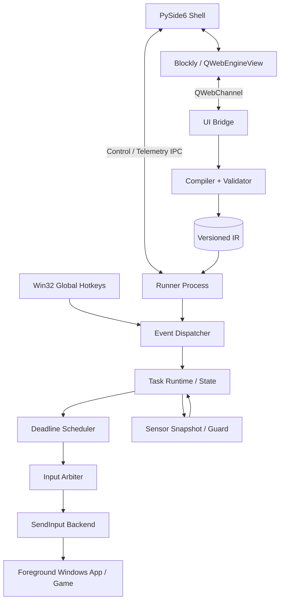

# Macro Studio — Codex용 제품·기술 기획서

> 문서 버전: **1.0**  
> 작성일: **2026-11-14**  
> 플랫폼: **Windows 11 x64 우선**  
> 상태: **개발 착수용 명세 (일부 수치는 검증 목표)**

---

## 0. Codex에 대한 최상위 작업 지시

당신은 Windows 데스크톱 자동화 도구 **Macro Studio**의 구현 담당 개발자다. 이 문서를 제품 요구사항, 아키텍처, 동작 의미론, 테스트 기준의 **단일 기준(Single Source of Truth)** 으로 사용한다.

**목표:** Scratch/Entry처럼 블록을 조합해서 매크로를 작성하고, 작성한 프로그램을 별도 프로세스의 고성능 런타임이 실행하는 Windows 앱을 구현한다. 다음 두 모델을 **동일한 워크플로/런타임으로** 지원해야 한다.

1. **자율형(절차적 반복형):** 프로그램이 스스로 조건을 평가하고 동작을 반복 수행한다.
2. **반응형(핫키형):** 사용자가 단축키로 실행 시점을 결정하고 프로그램이 동작 시퀀스를 수행한다.
3. **혼합형:** 자율형과 반응형을 한 프로젝트에서 병행하며 상태와 워크플로를 공유한다.

**구현 원칙:**
- 문서에 명시된 **MVP를 우선 구현**한다. 후속 기능을 미리 과도하게 구축하지 않는다.
- 사용자 입력을 직접 실행할 수 있는 코드 문자열로 생성하거나 `exec`/`eval`하지 않는다. 검증 가능한 **버전 관리형 IR**을 해석한다.
- GUI 및 Blockly 렌더링은 **입력 타이밍의 실시간 경로에 개입하지 않는다**.
- 기본은 **시뮬레이션(드라이런) 모드**이며, 실제 입력은 사용자가 명시적으로 ARM/실행해야만 발생한다.
- 외부 사이트/CDN 없이 로컬 리소스로 실행 가능하게 만든다.
- Windows 전용 기능은 추상화하며 다른 OS에서는 **FakeInputBackend**로 테스트할 수 있게 한다.
- 단계마다 동작하는 결과물, 실행 방법, 테스트, 남은 제한사항을 보고한다.
- 구현 중 애매한 부분은 **안전하고 단순한 기본 동작**을 선택하고 결정 사항을 `docs/DECISIONS.md`에 남긴다.
- 마지막에 제시된 **Codex 구현 순서**를 따른다. 한번에 전 기능을 구현하려 하지 않는다.

---

## 1. 제품 정의

### 1.1 한 문장 정의

> 사용자가 블록 기반으로 이벤트·조건·반복·입력 시퀀스를 설계하고, Windows 고성능 입력 엔진으로 실행하는 **이벤트 기반 비주얼 프로그래밍 환경**.

### 1.2 설계 철학

- **Trigger → Guard → Workflow → Task → Output** 를 통일된 실행 모델로 삼는다.
- 자율형과 반응형의 차이는 *무엇이 워크플로를 시작시키는지*에 있으며 워크플로 정의 자체는 동일하다.
- 자율형 = `프로젝트 시작` 등으로 생성된 장수명 작업 + 조건/반복 블록.
- 반응형 = `핫키 발생` 등으로 생성된 단수명 작업.
- 혼합형 = 여러 핸들러의 Task가 공통 상태·워크플로·입력 스케줄러를 공유.
- 프로그램/프로젝트는 편집 시점의 **Blockly Workspace**와 실행 시점의 **검증된 IR**로 분리한다.
- **빠른 입력 생성**과 **앱이 입력을 인식하는 빈도**는 다른 지표다. 200Hz 합성 입력이 게임에서 200회 행동으로 인식된다는 보장은 없다.

### 1.3 주요 사용 시나리오

**UC-A. 자율형**

```text
[프로젝트 시작 시]
  [계속 반복]
    [만약 활성 창이 대상 프로그램이고 변수가 auto_enabled 이면]
      [A 키를 200Hz, 2ms 유지로 30회 연타]
    [10ms 대기]
```

**UC-B. 반응형**

```text
[F7 눌렀을 때]
  [B 키 50ms 누르기]
  [100ms 대기]
  [C 키 50ms 누르기]
```

**UC-C. 혼합형**

```text
[프로젝트 시작 시] -> 자동화 루프 실행
[F6 눌렀을 때] -> auto_enabled 토글
[F7 눌렀을 때] -> 자동 작업과 함께 별도 동작 실행
[긴급정지 핫키] -> 모두 중단 및 합성 입력 해제
```

추후에는 화면 픽셀, 이미지 탐지, 창 상태, 사용자 정의 이벤트를 자율형 Guard의 입력으로 확장한다.

### 1.4 제품 비목표(Non-goals)

- 게임 보안/안티치트 우회, 보호된 프로세스에 대한 강제 입력, 관리자 권한 우회.
- 하드 리얼타임 또는 모든 게임의 입력 인식 보장.
- 게임 프로세스 메모리 읽기/쓰기, 드라이버/커널 입력 주입, HID 장치 에뮬레이션.
- 최초 버전의 OCR/컴퓨터 비전/복잡한 조건 센서.
- 최초 버전의 매크로 마켓플레이스, 클라우드 동기화, 서드파티 스크립트 플러그인.

---

## 2. 권장 기술 스택

| 계층 | 권장 기술 | 비고 |
|---|---|---|
| 데스크톱 UI | Python 3.12+ / PySide6 | Qt 위젯, 메뉴, 프로젝트 관리 |
| 블록 편집기 | Google Blockly (JavaScript) | 로컬 번들, JSON workspace serialization |
| 웹뷰 | `PySide6.QtWebEngineWidgets.QWebEngineView` | 앱 내 블록 편집기 |
| JS↔Python | `PySide6.QtWebChannel.QWebChannel` | **제어/편집만**, 실시간 입력 경로 제외 |
| 앱↔런타임 | `multiprocessing` (Windows `spawn`) 또는 명시적 IPC | 독립 프로세스; 명령/상태 메시지 |
| 컴파일러 | Python | Blockly 상태 → 프로젝트 AST → IR + 검증 |
| 실행기 | Python | 이벤트 디스패처, Task, 상태, 제어 흐름 |
| 스케줄러 | Python + `time.perf_counter_ns()` | 절대 데드라인 기반; 추후 C++ 교체 가능 |
| 입력 | `ctypes` + `user32.SendInput()` | Windows 네이티브 합성 입력 |
| 전역 핫키 | Win32 `RegisterHotKey` / 메시지 루프 | 초기 버전은 조합형 단축키에 집중 |
| 테스트 | `pytest`, FakeBackend, 선택적 JS 테스트 | 실제 입력 없이 로직 검증 |
| 패키징 | 추후 PyInstaller 검토 | MVP에선 개발 환경 실행 우선 |

**주의:** 라이브러리 최신 버전/호환성을 설치 시 확인하고 의존성 버전을 고정한다. Blockly는 가능하면 공식 JSON 직렬화 API를 사용한다. Qt WebEngine의 보안/리소스 배포 제약을 지킨다.

---

## 3. 상위 아키텍처



### 3.1 프로세스 및 스레드

**UI 프로세스**
- Qt 메인 스레드: Blockly 호스트, 메뉴, 속성, 시작/정지, 저장, 로그 표시.
- `START`를 요청할 때 최신 블록을 검증하고 컴파일한 뒤 Runner에 `LOAD_PROGRAM`을 전송한다. 세션은 시작할 때 받은 IR을 사용한다. 실행 중 편집과 저장은 가능하며, 변경 내용은 다음 `START`에 반영된다.
- UI가 멈춰도 Worker가 무기한 입력을 내보내지 않도록 별도 watchdog/안전 중단 경로 필요.

**Runner 프로세스**
- 제어 메시지 수신기: `ARM`, `START`, `PAUSE`, `RESUME`, `STOP`, `SHUTDOWN`.
- Win32 메시지 루프가 필요한 핫키 수신기(전용 스레드 가능).
- 논리적 Task/워크플로를 구동하는 런타임.
- 스케줄링 및 중앙 Input Dispatcher. 고속 입력의 hot path에서 UI 호출·디스크 쓰기·JSON 파싱 금지.
- 텔레메트리 집계 및 저주파(예: 2~10Hz) 전송.

**중요:** 다중 OS 스레드가 각자 `SendInput()`을 호출하지 않도록 **중앙 Input Dispatcher**를 단일 권한 지점으로 둔다. 동시 Task는 우선 논리적 코루틴/스케줄된 실행 흐름으로 다룬다.

### 3.2 제어 경로 vs 고속 입력 경로

```text
제어 경로: Blockly → compile → IR → IPC → Task Runtime
고속 경로: 예약된 타임스탬프 → Scheduler → Input Arbiter → SendInput
센서 경로: 창/키 상태(필요시 화면) 샘플링 → 공유 상태 Snapshot → Guard
```

픽셀 검사, 이미지 처리 같은 상대적으로 느린 판단을 고속 키 이벤트 처리 루프 안에 넣지 않는다.

---

## 4. 통일된 프로그래밍 모델

### 4.1 핵심 개념

| 용어 | 의미 |
|---|---|
| Project | 블록 Workspace, 핸들러, 사용자 워크플로, 전역 변수, 설정 |
| Event Source | 프로그램 시작, 핫키, 주기 타이머, 상태 변화 등 |
| Event | 발생 시각/유형/페이로드를 가진 사실 |
| Handler | 특정 이벤트에 반응하는 엔트리포인트 + 선택적 Guard |
| Guard | 실행 조건. 참일 때만 Task 생성 |
| Workflow | 재사용 가능한 절차적 명령·조건·반복 시퀀스 |
| Task | Workflow의 **실행 인스턴스** (코루틴/PC/지역 상태 포함) |
| Scheduler | Task 재개 및 입력 이벤트의 타이밍 관리 |
| Input Arbiter | 공유 키/마우스 상태와 Task 간 충돌 해결 |
| State | 프로젝트 전역 변수, 태스크 로컬 변수, 활성 모드 |

### 4.2 핸들러 정의

모든 핸들러는 다음 모델로 통일한다.

```text
Handler {
  id,
  event_source,
  optional_guard,
  workflow_id,
  reentrancy_policy,
  priority,
  enabled
}
```

**MVP 이벤트:**
- `on_project_start`
- `on_hotkey_pressed` (예: Ctrl+Alt+F7)
- `on_interval` (시간 간격)

**후속 이벤트:** `on_hotkey_released`, `while_key_held`, `on_variable_changed`, `on_pixel_changed`, `on_window_focus_changed`, 사용자 정의 이벤트.

- 주기 핸들러의 첫 이벤트는 세션 시작 후 지정 간격이 지난 시점에 발생한다. 이후 시각도 같은 시작 시각을 기준으로 계산한다. 밀린 이벤트와 일시정지 중 지나간 이벤트는 버린다. 다음 예정 이벤트에는 핸들러의 재진입 정책을 적용한다.

### 4.3 Task 수명주기

```text
CREATED → READY → RUNNING → WAITING → READY → ... → COMPLETED
                     ↘ CANCEL_REQUESTED → CLEANUP → CANCELLED
                     ↘ FAILED → CLEANUP
```

- `wait(ms)`는 스레드를 점유하는 무한 sleep이 아니라, 현재 Task의 다음 재개 시각을 예약하고 제어권 반환.
- `repeat`는 Task의 제어 흐름이다. 반복 횟수/조건을 안전하게 검증한다.
- **무한 루프에 대기가 전혀 없는 경우** 정지 명령/기타 Task가 굶주리지 않도록 명령 예산 또는 강제 양보(yield) 규칙을 둔다.
- Task는 취소 요청을 인지해야 하며, 시간 기반 블록은 취소 가능해야 한다.
- 워크플로 호출 시 스택 깊이/재귀 제한을 둔다.
- 호출된 워크플로의 마지막 명령이 끝나면 호출 지점으로 돌아간다. `종료` 블록을 실행하면 호출 깊이와 관계없이 Task 전체를 끝내고 그 Task가 소유한 입력을 해제한다.

### 4.4 핸들러 재진입 정책

| 정책 | 의미 | MVP |
|---|---|---|
| `ignore_if_running` | 동일 핸들러 Task가 진행 중이면 새로운 이벤트 무시 | 필수/기본 |
| `restart` | 기존 Task 취소·정리 후 새 Task 실행 | 필수 |
| `queue` | 요청을 유한 대기열에 넣고 순차 실행 | 후속 |
| `parallel` | 복수 Task 동시 실행 | 후속 |
| `override` | 대상 Task를 중단/일시정지하고 우선 실행 | 후속 |

MVP에서 같은 핸들러의 Task는 한 번에 하나만 실행한다. `restart`는 기존 Task의 취소와 입력 정리를 마친 뒤 새 Task를 시작한다. 서로 다른 핸들러의 Task는 함께 실행할 수 있으며, 입력 충돌은 §7.3에 따라 처리한다. 이벤트 큐 길이와 동시 Task 수에 상한을 둔다.

### 4.5 공유 상태와 원자성

- `Global Variables`: 프로젝트 단위 상태.
- `Task Locals`: 실행 인스턴스마다 별도 상태.
- 새 세션은 프로젝트에 저장된 전역 변수 초기값을 사용한다. 같은 세션에서 일시정지하고 재개하면 현재 값을 유지한다.
- MVP는 숫자, 불리언, 문자열을 지원한다. 초기값이 전역 변수의 타입을 결정하며, 서로 다른 타입 간 암시적 변환은 허용하지 않는다.
- 런타임은 상태 변경을 순차 반영한다. 대입 블록 하나는 식 평가부터 쓰기까지 한 번에 처리한다. 여러 블록에 걸친 읽기와 쓰기 사이에는 다른 Task가 실행될 수 있다.
- 같은 시각의 정지 및 정리 요청을 일반 이벤트보다 먼저 처리한다. 일반 이벤트는 도착 순서대로 처리한다. 같은 이벤트에 매칭된 핸들러는 우선순위가 높은 것부터 평가하고, 우선순위가 같으면 프로젝트 정의 순서를 따른다. Guard는 평가 시점까지 반영된 값을 읽는다.

### 4.6 선택적 상태 머신

`Idle`, `Auto`, `Override` 같은 모드는 **일반 전역 상태**로 표현 가능하다. 별도 시각적 State Machine 편집기는 후속 기능으로 미룬다. 단순 매크로를 작성하는 데 상태 머신을 강제하지 않는다.

---

## 5. 블록 언어 설계

### 5.1 카테고리

| 분류 | MVP 블록 | 이후 확장 |
|---|---|---|
| 이벤트 | 프로젝트 시작, 단축키 누름, 주기마다 | 키 해제, 상태 변화, 픽셀 변화 |
| 입력 | KeyDown, KeyUp, Tap(누름 길이), 연타(Hz/길이/횟수), 마우스 클릭 | 드래그, 휠, 복합 키 시퀀스 |
| 시간 | 기다리기(ms), 주기 반복 | 시간 제한, 데드라인 |
| 제어 | if/else, N회 반복, 계속 반복, 종료 | break/continue, 예외 핸들링 |
| 데이터 | 변수 읽기/쓰기, 숫자·비교·논리 연산 | 배열, 딕셔너리 |
| 상태 조회 | 활성 대상 창 여부, 입력 상태, 현재 시간 | 픽셀·이미지·OCR |
| 워크플로 | 정의, 호출 | 인자·반환값, 라이브러리 |

MVP는 **워크플로 정의/호출**을 반드시 포함해 동일한 액션을 자율/반응형 양쪽에서 재사용할 수 있게 한다.

### 5.2 구조적 규칙

- 이벤트 블록은 최상위(Hat Block)에서만 사용한다.
- 실행 블록은 명령 연결(Statement Connection), 참조 값 블록은 타입 있는 Expression Connection 사용.
- 잘못 연결된 블록은 실행 전 컴파일 오류로 보고한다.
- 연결되지 않은 일반 블록은 무시하되 경고(또는 오류) 정책을 명시한다.
- 모든 블록에 안정적인 ID를 부여하고, 컴파일 오류 및 실행 로그가 원본 블록 ID를 참조할 수 있어야 한다.
- 한글 사용자 인터페이스를 기본으로 하고 내부 opcode/ID는 영문으로 통일.

### 5.3 고주파 입력 전용 블록

```text
[키 연타하기: 키=A, 주파수=200 Hz, 누름시간=2 ms, 횟수=100]
```

**정확한 의미:**
- `period_ns = 1_000_000_000 / hz` (가능하면 정수/유리수 누적 오차 보정).
- 매 주기 `KeyDown` → `hold_ns` 후 `KeyUp` 예약.
- `hold_ns > 0`, `hold_ns < period_ns`.
- `N회`는 예정된 누름·해제 주기 수다. `skip_missed`로 건너뛴 주기만큼 실제 발행 쌍이 줄어든다. 원래 종료 시각은 유지한다.
- Task 취소/중단/포커스 상실 시 합성 KeyDown을 해제한다.
- 최초 구현은 `1~200Hz`를 기본 제공하고, 더 높은 Hz는 설정으로 **실험적** 활성화할 수 있다. 보장 수치가 아닌 벤치마크 대상이다.
- 매 프레임 Blockly나 Python 인터프리터의 범용 명령 N개를 돌리는 대신, `tap_sequence` **단일 IR 연산**으로 컴파일한다.

### 5.4 시간 모델

- 단위: 내부적으로 나노초 정수, UI에서는 ms / Hz를 명확히 표시.
- 반복 스케줄은 `now + sleep`의 반복이 아니라 **최초 기준 시각 + n × period**로 계산.
- 기본 정책은 `skip_missed`다. 예정된 해제 시각 전에 깨어나면 키를 즉시 누르고 원래 시각에 해제한다. 예정된 해제 시각에 도달했거나 지났으면 아직 누르지 않은 주기를 건너뛰고 누락 통계에 기록한다. 이미 누른 키의 해제 시각이 지났으면 즉시 해제한다.
- 예를 들어 200Hz, 누름 시간 2ms인 연타는 예정된 누름 시각보다 1ms 늦었을 때 약 1ms 동안 누른다. 2ms 이상 늦어서 누름 구간이 끝났으면 해당 주기를 건너뛴다.
- 정지 요청, 포커스 이탈 등을 이벤트 간에 확인한다.
- 짧은 시간의 busy wait은 극히 제한적으로 사용하고 CPU 사용률을 측정한다.
- Windows의 일반 사용자 모드에서 1ms 이하 지터와 정확한 시점의 wake-up은 **보장하지 않는다**.

---

## 6. 프로젝트 저장 포맷과 실행 IR

### 6.1 두 형식을 혼동하지 말 것

1. **편집 프로젝트 파일**: Blockly Workspace JSON + 앱 메타데이터, 전역 변수/대상 창/핫키 정책 등. 예: `.macroproj` (JSON).
2. **컴파일된 IR**: 검증된 실행 명령. **Blockly 전용 필드/렌더링 좌표는 포함하지 않음.**

편집 파일을 로드한 뒤 컴파일할 수 있어야 하며, IR 단독 파일을 무조건 편집 가능하게 간주하지 않는다.

### 6.2 편집 프로젝트 예시(개념)

```json
{
  "schema_version": 1,
  "name": "Example project",
  "workspace": {"blocks": {"languageVersion": 0, "blocks": []}},
  "settings": {
    "dry_run_default": true,
    "focus_policy": "pause_on_blur"
  }
}
```

`workspace`는 실제 Blockly serializer가 출력한 객체로 저장한다. 예시 내부의 버전값은 실제 라이브러리에 맞춰 갱신한다.

### 6.3 IR 예시(규범적 방향)

```json
{
  "ir_version": 1,
  "project_id": "example",
  "globals": {"auto_enabled": true},
  "workflows": {
    "tap_a_100_times": {
      "steps": [
        {
          "op": "tap_sequence",
          "block_id": "b-tap-1",
          "key": {"kind": "scan_code", "code": 30, "extended": false},
          "frequency_hz": 200,
          "hold_ns": 2000000,
          "count": 100,
          "missed_tick_policy": "skip_missed"
        }
      ]
    },
    "reactive_action": {
      "steps": [
        {"op": "key_tap", "block_id": "b-tap-b", "key": "B", "hold_ns": 50000000},
        {"op": "wait", "block_id": "b-wait", "duration_ns": 100000000},
        {"op": "key_tap", "block_id": "b-tap-c", "key": "C", "hold_ns": 50000000}
      ]
    }
  },
  "handlers": [
    {
      "id": "h-start",
      "event": {"type": "project_start"},
      "workflow_id": "tap_a_100_times",
      "policy": "ignore_if_running"
    },
    {
      "id": "h-hotkey",
      "event": {"type": "hotkey_pressed", "hotkey": "CTRL+ALT+F7"},
      "workflow_id": "reactive_action",
      "policy": "restart"
    }
  ]
}
```

**구현 시 보완할 것:** 위의 예제에서는 읽기 쉬운 이름/scan code가 혼재한다. 내부 검증 결과는 반드시 **일관된 정규화 KeySpec**으로 변환한다. `source block ID`, 오류 위치 매핑, 핸들러 우선순위, guard 표현식도 스키마에 포함한다.

### 6.4 IR 검증(실행 전 필수)

- 지원하지 않는 `ir_version` 또는 `op` 거부.
- 정의되지 않은 workflow/변수 참조 거부.
- 타입 검사(불리언 조건, 정수 반복 횟수 등).
- 동일한 프로젝트 핫키의 중복 지정과 긴급정지 핫키의 재사용을 거부한다. 정적으로 확인할 수 있는 합성 입력의 핫키 충돌도 거부한다(§8.3).
- 음수 대기, 0Hz, 잘못된 key, `hold >= period` 금지.
- 반복 횟수/Task 수/큐 길이/워크플로 호출 깊이 상한.
- 무한 반복문에는 취소 가능한 대기 또는 작업 예산 적용.
- 프로젝트 로드만으로 자동 시작하거나 실제 입력하지 않음.
- 파일에서 로드한 문자열을 Python 코드로 평가하지 않음.

---

## 7. 고성능 입력 및 스케줄러

### 7.1 InputBackend 인터페이스

```python
class InputBackend(Protocol):
    def send_key_down(self, key: KeySpec) -> None: ...
    def send_key_up(self, key: KeySpec) -> None: ...
    def send_mouse_button(self, button: MouseButton, down: bool) -> None: ...
    def move_mouse(self, x: int, y: int) -> None: ...
    def release_all_owned_inputs(self) -> None: ...
```

구현체:
- `FakeInputBackend`: 이벤트와 타임스탬프 기록, OS 입력을 전혀 생성하지 않음.
- `WindowsSendInputBackend`: `ctypes`로 Win32 구조체와 `SendInput` 연결.

**권장 방식:** 스캔 코드 기반 키 입력은 `KEYEVENTF_SCANCODE` / `KEYEVENTF_KEYUP` 및 extended key 처리를 사용한다. Mouse/Keyboard/Hardware `INPUT` union 레이아웃과 포인터 크기(x64)를 검증한다. `SendInput` 반환값(삽입 이벤트 개수)을 검사하고 오류를 보고한다. 합성 입력은 백그라운드 윈도우 전용 메시지 전송과 다름을 명시한다.

### 7.2 Scheduler 책임

- 단조 고해상도 시계(`perf_counter_ns`) 사용.
- 다음 deadline을 가지는 예약 이벤트에 대해 우선순위 큐/최소 힙 유지.
- 예약된 KeyDown/KeyUp 이벤트 전달, Task 재개, 취소, 포커스 가드.
- 장시간 대기에는 sleep 또는 Windows 고해상도 waitable timer를 검토; deadline 직전의 짧은 구간에서만 선택적 spin.
- 정지 요청이 지연되지 않도록 bounded wait/다른 wake-up 경로 구현.
- 지나간 deadline을 무한히 따라잡지 않고 누락 주기 처리 정책 적용.
- 긴 연타 시퀀스 전 이벤트를 무한히 큐에 쌓지 말고 **bounded rolling horizon** 또는 다음 이벤트만 예약.

### 7.3 Input Arbitration

- 개별 Task별로 자신이 눌러 유지 중인 합성 키를 추적한다.
- 먼저 누른 Task가 해당 키나 마우스 버튼을 독점한다. 다른 Task가 같은 입력을 누르려 하면 해당 블록에 충돌 오류를 표시하고 그 Task를 종료한다. 종료 시 그 Task가 소유한 입력만 해제한다.
- 입력 충돌이나 블록 실행 오류는 해당 Task에서 처리한다. 실제 입력 전송 또는 해제에 실패하면 세션 전체를 중단하고, 남은 입력의 해제를 시도한 뒤 오류를 표시한다.
- Task 종료·강제 중단·포커스 이탈·IPC 연결 끊김·프로세스 종료 전에 가능한 합성 키 해제를 시도한다.
- 사용자가 실제 물리적으로 누르고 있는 키를 임의로 해제하지 않도록 합성 입력 소유 상태와 물리 입력 상태를 구분한다. OS 자체는 키의 소유권을 구분하지 않으므로 이 동작은 **최선의 노력**이다.

### 7.4 Windows 제약

- `SendInput`은 UIPI 무결성 수준 제약을 받는다. 권한 상승/보안 우회를 시도하지 말 것.
- `SendInput` 성공 = 대상 앱의 실제 입력 인식 **아님**.
- DirectInput/Raw Input, 프레임별 키 상태 폴링, 게임별 입력 차이로 인해 일부 이벤트는 누락/무시될 수 있다.
- 실행 중 창 포커스가 변경되면 엉뚱한 앱에 입력할 수 있으므로 포커스 정책이 필요.
- `ctypes`가 빠른 OS API 호출을 제공하더라도 Python 타이밍 지터는 남는다. 더 높은 주파수가 필요할 때 스케줄러/디스패처만 C++ 확장 모듈로 교체할 수 있도록 인터페이스 유지.

---

## 8. 활성 창 정책 및 안전성

### 8.1 명시적 활성화 절차

1. 프로젝트의 기본 모드는 드라이런이다. 실입력을 허용하려면 대상 창 하나를 선택하고 `ARM`을 설정한다. 대상 창이 닫혔다가 다시 열리면 사용자가 다시 선택한다.
2. 드라이런과 실입력 모두 사용자가 `START`를 눌러 세션을 시작한다. 최신 블록의 검증과 컴파일이 성공해야 한다. 실입력은 대상 창 확인이 필요하며, 선택한 창이 포그라운드일 때만 보낸다.
3. 실입력 `START` 시 대상 창이 포그라운드가 아니면 최대 5초간 기다린다. 포커스가 확인되면 세션을 시작한다. 시간이 지나면 ARM 상태로 돌아간다. 대기 중에는 실입력을 보내지 않고 프로젝트 핫키를 버린다.
4. 세션이 시작되면 프로젝트 시작 이벤트를 한 번 발행한다. 프로젝트 핫키는 실행 중인 세션에서만 처리한다. 모든 Task가 끝나고 활성 핫키 또는 주기 핸들러가 없으면 세션을 자동 종료한다.
5. 수동 `PAUSE` 또는 실입력 중 대상 창의 포커스 이탈이 발생하면 모든 Task를 취소하고 예약 입력을 지운 뒤 소유 입력을 해제한다. 일시정지 중 프로젝트 핫키는 버린다. 실입력 `RESUME` 시 대상 창의 포커스를 최대 5초간 기다리며, 시간이 지나면 일시정지를 유지한다. 재개 후에는 새 이벤트부터 처리한다. 시작 워크플로를 다시 실행하려면 새 세션을 시작한다.
6. `STOP` 또는 긴급정지 시 모든 Task를 취소하고 스케줄 큐를 비운 뒤 소유 입력을 해제한다. 세션을 종료하고 사용자에게 상태를 표시한다.

ARM은 실입력을 허용하는 프로젝트 설정이다. 사용자가 명시적으로 설정한 ARM은 정상 종료, `STOP`, 긴급정지, Runner 장애, 앱 재시작 후에도 보존한다. 이 PC의 사용자 설정에 프로젝트 ID와 파일 경로를 함께 저장하고, 둘 다 일치할 때 복원한다. `DISARM`은 저장된 설정도 지운다.

같은 프로젝트의 블록이나 대상 창을 바꿔도 ARM은 유지한다. 새 프로젝트와 다른 이름으로 저장한 사본은 드라이런으로 시작한다. 파일을 다른 경로로 복사하거나 이동한 경우에도 드라이런으로 시작한다. ARM을 복원한 뒤에도 사용자가 대상을 확인하고 `START`를 눌러야 실입력 세션이 열린다.

### 8.2 필수 가드레일

- 전역 긴급정지 핫키의 기본값은 `Ctrl+Alt+Shift+F11`이다. 사용자가 변경할 수 있으며 중복을 검사한다. Windows는 F12를 디버거용으로 예약한다.
- UI 상의 명시적 중단 버튼. 앱 종료 시 Worker 정지 및 키 정리.
- ARM 이전에는 `FakeInputBackend`만 사용.
- 최초 실제 입력 전에 경고/대상 확인 UI.
- 무한 루프 또는 고속 시퀀스에도 STOP 반응성을 유지.
- 기본 주파수 제한(예: 200Hz)과 실험 모드 상한을 구분하고 설정.
- 프로젝트 파일만 여는 것으로 실제 동작 실행 금지.
- 외부 URL, 코드 실행, 서브프로세스 실행, 파일 삭제 등의 블록을 기본 제공하지 않음.
- 계정 정보 수집, 백그라운드 감시, 은닉 실행, 원격 제어 기능은 범위에서 제외.

### 8.3 핫키 처리

- MVP는 `RegisterHotKey` 지원 범위의 조합형 전역 단축키부터 구현.
- 실행기에서 Win32 메시지 루프를 정상적으로 구동하고 종료 시 `UnregisterHotKey`.
- 같은 프로젝트에서 같은 핫키를 여러 핸들러에 지정하거나 긴급정지 핫키를 프로젝트 핸들러에 지정하면 검증 오류를 표시한다. 키를 길게 눌러 생기는 자동 반복은 무시한다. 다시 누르면 핸들러의 재진입 정책을 적용한다.
- 긴급정지 핫키를 등록하지 못하면 실입력 세션 시작을 막는다. 일반 핫키 등록에 실패하면 해당 핸들러를 사용할 수 없다고 GUI에 표시하고 나머지 핸들러는 실행한다.
- 입력 블록이 등록된 프로젝트 핫키 또는 긴급정지 핫키 조합을 만드는 동작을 정적으로 확인할 수 있으면 검증 오류로 처리한다. 실행 중 여러 블록의 입력이 그런 조합을 만들려 하면, 마지막 키를 보내기 전에 해당 Task를 종료하고 그 Task가 소유한 입력을 해제한다.
- UI가 포커스를 점유한 상태에서 만든 편집 단축키와 실행 핫키가 충돌하지 않도록 한다.

---

## 9. UI/UX 사양

### 9.1 레이아웃

```text
┌────────────────────────────────────────────────────────────────────┐
│ Macro Studio · 실행 모드    [ARM] [시작/정지] [일시정지/재개]    [검증] │
├─────────────────┬──────────────────────────────────┬───────────────┤
│ 블록 팔레트     │ Blockly 캔버스                   │ 실행/속성      │
│  이벤트         │                                  │ 대상 창        │
│  키보드         │ [프로젝트 시작하면]              │ 실행 상태      │
│  마우스         │   [계속 반복]                    │ 지터/주파수    │
│  시간           │     [...]                        │ 오류·로그      │
│  제어           │ [F7 누르면]                      │               │
│  변수           │   [...]                          │               │
│  워크플로       │                                  │               │
├─────────────────┴──────────────────────────────────┴───────────────┤
│ 상태: DRY RUN / ARMED / RUNNING / PAUSED / STOPPED                  │
└────────────────────────────────────────────────────────────────────┘
```

### 9.2 최소 UX 요구사항

- 블록 카테고리별 색 구분, 한글 명칭, 블록 툴팁.
- 파일 메뉴와 단축키에서 프로젝트 새로 만들기, 열기, 저장, 다른 이름으로 저장을 제공한다.
- 상단 중앙의 아이콘은 ARM, 시작·정지, 일시정지·재개 순서로 배치한다. 각 아이콘의 툴팁과 접근성 이름은 현재 누르면 실행할 동작을 표시한다.
- 편집 변경 시 미저장 표시.
- 컴파일 오류를 블록 ID/위치에 매핑해 해당 블록을 강조.
- 실행 상태: `DRY_RUN`, `ARMED`, `RUNNING`, `PAUSED`, `STOPPED`, `ERROR`.
- 세션 상태와 ARM 설정을 함께 표시한다. `START` 또는 `RESUME`이 대상 창을 기다리는 동안에는 대기 사유를 표시한다.
- 사용자에게 실제 입력 동작/종료 상태를 명확히 표시.
- 부하가 높은 시퀀스에서도 편집 UI가 독립적으로 반응.
- 로컬 WebEngine 내에서 외부 임의 사이트로 이동하지 않도록 탐색 제한.

---

## 10. IPC 계약(초안)

작업 프로세스 간 제어 메시지는 JSON 호환 객체로 정의하고, 메시지 스키마를 버전 관리한다. MVP에서는 Python 객체를 `multiprocessing.Pipe` 등으로 전달할 수 있지만, 수신 메시지의 타입/크기/상태 전이는 항상 검증한다.

**UI → Runner**

```text
LOAD_PROGRAM(ir)
ARM(target_window, options)
DISARM()
START()
PAUSE()
RESUME()
STOP(reason)
SHUTDOWN()
HEARTBEAT()
```

**Runner → UI**

```text
READY(capabilities)
ACK(request_id)
STATE_CHANGED(state, reason)
COMPILE_OR_RUNTIME_ERROR(block_id, code, message)
TELEMETRY(snapshot)
LOG(level, message)
```

계약 규칙:
- 명령에 `request_id`, `schema_version`을 둔다.
- 잘못된 상태 전이(예: 미검증 IR을 START)는 거부.
- `STOP`은 중복 호출해도 안전해야 하며, 가능한 빠르게 수용.
- 고빈도 이벤트별 IPC 전송은 금지. 텔레메트리는 저주파 집계.
- UI는 응답하는 동안 250ms마다 `HEARTBEAT`를 보낸다. Runner는 1초 동안 신호를 받지 못하거나 UI 연결이 끊기면 세션을 종료하고 소유 입력을 해제한다. UI가 다시 응답하면 중단 사유를 표시한다. Runner 연결이 끊기면 UI에 `ERROR`를 표시한다. ARM 설정은 보존한다.

---

## 11. 성능 목표 및 벤치마크

### 11.1 성능 정의

1. **Command Rate:** Scheduler가 보내려 한 KeyDown/KeyUp 이벤트 수/s.
2. **Injection Rate:** `SendInput` 반환값 기준 OS 스트림에 삽입 성공한 이벤트 수/s.
3. **Observed Rate:** 별도 관측 도구가 수신한 입력 이벤트 수/s.
4. **Recognized Rate:** 실제 대상 프로그램에서 행동으로 처리한 횟수/s (별도 앱별 측정).
5. **Scheduling Jitter:** 실제 이벤트 발생 시각 − 예약 시각(평균/P95/P99/최대).
6. **Stop Latency:** STOP 요청부터 **추가 합성 입력 생성 중단 + 정리 완료**까지 걸린 시간.
7. **CPU Load:** 100/200Hz 실행 중 프로세스별 평균/최대 CPU 점유.

### 11.2 목표(보장 아님)

- **기능 목표:** 테스트 환경에서 100Hz, 200Hz KeyDown/KeyUp 페어를 일정 시간 정상적으로 **발행**.
- **안전 목표:** STOP/포커스 이탈/예외 발생 시 남은 합성 키 상태를 정리.
- **응답 목표:** 대부분의 정상 환경에서 UI 입력 지연 없이 작업 제어. Stop latency 측정하고 회귀 테스트.
- **확장 목표:** 500Hz와 1000Hz는 측정 기반의 후속 실험. 달성/인식 보장을 제품 문구로 사용하지 말 것.
- 숫자형 지터·stop latency 합격 기준은 **하드웨어/OS 측정 후** 고정한다. 무근거하게 `P99 < 1ms`를 보장하지 않는다.

### 11.3 필수 테스트 행렬

| 테스트 | FakeBackend | 실제 Windows | 판정 |
|---|---:|---:|---|
| 블록 JSON 저장/로드 왕복 | ✓ | 선택 | 의미 동일 |
| 자동/핫키 핸들러 컴파일 | ✓ | 선택 | IR 검증 통과 |
| 조건/반복/변수/워크플로 호출 | ✓ | 선택 | 기대된 실행 순서 |
| 100/200Hz 합성 입력 | ✓ | ✓ | 발행 수·시간 오차 보고 |
| 중간 STOP, 포커스 이탈 | ✓ | ✓ | 추가 입력 중단, 키 정리 |
| 일시정지와 재개 | ✓ | ✓ | Task 취소와 입력 해제, 대기 중 이벤트 폐기, 재개 후 새 이벤트 처리 |
| ARM 보존과 대상 창 확인 | ✓ | ✓ | 같은 ID와 경로에서 복원, `START`와 대상 확인 후 실행, 5초 대기 만료 처리 |
| 잘못된 IR/핫키 충돌 | ✓ | ✓ | 안전한 오류 반환 |
| 핫키 등록 실패, 자동 반복, 합성 입력 재발동 | ✓ | ✓ | 등록 실패 유형별 처리, 길게 누르면 한 번 실행, 재발동 방지 |
| UI 1초 이상 정체 또는 Runner 장애 | ✓ | ✓ | 세션 중단, 오류 표시, ARM 설정 보존 |
| 같은 키를 두 Task가 다룸 | ✓ | 선택 | 후발 Task만 종료하고 먼저 누른 Task의 입력은 유지 |
| 실제 입력 전송 또는 해제 실패 | ✓ (실패 모의) | 선택 | 세션 중단, 남은 입력 해제 시도, 오류 표시 |
| 실제 게임에서 입력 인식 | 불가 | 수동·별도 | 입력 특성 기록, 보장하지 않음 |

**측정 결과는 CSV/JSON으로 내보낼 수 있게 구성**(MVP에서는 CLI 벤치마크 출력만으로 시작 가능).

---

## 12. 테스트 가능한 구현 분리

### 12.1 순수 로직 계층

- AST/IR 스키마 및 Validator.
- 이벤트 → 핸들러 매칭.
- Task 상태 전이.
- 제어 흐름 Interpreter.
- Time abstraction (`Clock` 인터페이스).
- Fake Scheduler/Fake Backend.

이 계층은 Windows가 아닌 CI 환경에서도 단위 테스트가 가능해야 한다.

### 12.2 Windows 통합 계층

- `SendInput` 구조체 정의/스캔 코드 매핑.
- 전역 핫키 등록/해제.
- `GetForegroundWindow()` 기반 대상 포커스 확인.
- 실행 프로세스 lifecycle + watchdog.
- 실제 키 이벤트 발행 측정.

**통합 테스트는 명시적 플래그로만 실제 입력을 보낸다.** 자동 `pytest` 기본 실행에서 OS에 실제 키 입력을 주입하지 않는다.

---

## 13. 권장 디렉터리 구조

```text
macro-studio/
├── README.md
├── pyproject.toml
├── .gitignore
├── docs/
│   ├── SPEC.md                   # 이 문서
│   ├── ARCHITECTURE.md
│   ├── DECISIONS.md
│   └── IR_SCHEMA.md
├── src/macro_studio/
│   ├── __main__.py
│   ├── app.py
│   ├── ui/
│   │   ├── main_window.py
│   │   ├── bridge.py
│   │   └── project_controller.py
│   ├── compiler/
│   │   ├── workspace_parser.py
│   │   ├── ast.py
│   │   ├── ir.py
│   │   ├── validator.py
│   │   └── compile.py
│   ├── runtime/
│   │   ├── worker.py
│   │   ├── event_dispatcher.py
│   │   ├── task.py
│   │   ├── interpreter.py
│   │   ├── scheduler.py
│   │   ├── input_arbiter.py
│   │   ├── clock.py
│   │   └── telemetry.py
│   ├── backends/
│   │   ├── base.py
│   │   ├── fake.py
│   │   └── win32_sendinput.py
│   ├── platform_win/
│   │   ├── hotkeys.py
│   │   └── foreground.py
│   ├── ipc/
│   │   ├── messages.py
│   │   └── transport.py
│   └── storage/
│       └── projects.py
├── frontend/
│   ├── package.json
│   ├── src/
│   │   ├── index.html
│   │   ├── main.js
│   │   ├── blocks.js
│   │   ├── toolbox.js
│   │   └── bridge.js
│   └── dist/                      # 빌드된 로컬 에셋
├── tests/
│   ├── test_ir_validation.py
│   ├── test_workflows.py
│   ├── test_events.py
│   ├── test_scheduler_fake.py
│   ├── test_cancellation.py
│   ├── test_input_arbiter.py
│   └── integration_win/
└── tools/
    └── benchmark_input.py
```

구조는 권장안이며 실제 구현에 따라 파일명은 조정 가능하다. **모듈 경계/계약은 유지**한다.

---

## 14. 단계별 구현 계획과 완료 기준

### Phase 0 — 골격/계약/가짜 실행기

**작업**
1. `pyproject.toml`, 패키지 구조, README, 테스트 환경 구축.
2. IR 스키마 v1, Clock/InputBackend 추상화, FakeBackend 구현.
3. 프로젝트 시작/핫키 이벤트, Task 생명주기, `wait`·`repeat`·`if/else`·변수·워크플로 호출·`key_tap`·`tap_sequence` interpreter 구현.
4. CLI에서 JSON IR을 검증하고 가상 시간으로 실행한다. 모의 핫키의 발생 시각과 가상 실행 시간을 지정할 수 있다. 실행 시간이 끝나면 Task를 정리한 뒤 이벤트 로그를 출력한다. 같은 명령은 같은 이벤트 순서와 시각을 재현한다.

**완료 조건**
- 실제 입력 없이 FakeBackend에 기대한 이벤트가 기록된다.
- 자율형과 반응형의 두 워크플로가 **동일한 런타임**에서 처리된다.
- 잘못된 IR은 안전하게 거부된다.
- 단위 테스트 통과.

### Phase 1 — Windows Input Engine / 안전한 실행

**작업**
1. `ctypes` SendInput, KeySpec/키 해제, 오류 처리.
2. 정밀 deadline scheduler 및 cancel 가능한 시퀀스.
3. Win32 글로벌 핫키, 포커스 가드, ARM/STOP.
4. 벤치마크 CLI(100Hz/200Hz, 발행률, 지터, stop latency).

**완료 조건**
- Windows 실입력은 명시적으로 ARM한 경우에만 발생.
- `STOP`과 긴급정지는 세션을 종료한다. 수동 일시정지와 포커스 이탈은 Task를 취소하고 소유 입력을 해제한 뒤 세션을 일시정지한다. 명시적 재개 후 새 이벤트를 처리한다.
- 100/200Hz 입력 발행 측정 리포트 출력(결과값 보장 아님).
- 관리자 권한 없이 동작 가능한 범위 명확히 안내.

### Phase 2 — Blockly/데스크톱 UI 통합

**작업**
1. PySide6 메인 창 + QWebEngineView + 로컬 Blockly 번들.
2. 기본 이벤트/입력/제어/변수/워크플로 블록.
3. Workspace serialization(JSON), 로드/저장.
4. Blockly → IR 컴파일 및 블록 ID별 오류 표시.
5. QWebChannel ↔ Python Bridge, Runner IPC, 실행 상태 표시.

**완료 조건**
- GUI에서 자율형·반응형 워크플로를 배치·저장·실행.
- 프로세스가 분리되어 UI가 실행 타이밍을 제어하지 않음.
- 드라이런과 실입력 모드가 시각적으로 구분됨.

### Phase 3 — 혼합 실행/충돌 처리/사용성 개선

**작업**
1. 하나의 프로젝트에 두 핸들러를 동시에 배치 및 재사용 워크플로 호출.
2. 기본 정책 `ignore_if_running`, `restart`와 명시적 충돌 처리.
3. 전역 변수/조건문의 의미론 고정, 재시작 및 키 정리 테스트.
4. 오류 매핑, 실행 통계 및 로그, 예제 프로젝트 3종.

**완료 조건**
- 자동 반복 중 F7을 누르면 해당 핸들러의 Task가 별도로 실행된다. 두 핸들러는 전역 상태와 재사용 워크플로를 공유한다.
- 입력/상태 충돌의 동작이 문서화되어 재현 가능.
- 재시작/중지/포커스 이탈/Worker 오류의 테스트 통과.

### Phase 4 — 후속 확장(초기 작업 범위 제외)

- `parallel`, `queue`, `override` + 자원별 arbitration 강화.
- 화면 센서(픽셀/영역/이미지/OCR), 별도 낮은 주기 센서 파이프라인.
- 시각적 FSM, 사용자 정의 이벤트, 사용자 정의 워크플로 인자/반환값.
- C++ 스케줄러/디스패처 선택적 교체.
- 실행 디버거(브레이크포인트/단계 실행), 프로젝트 마이그레이션, 패키징.

---

## 15. 주요 아키텍처 결정 기록(ADR 초안)

**ADR-001 — 이벤트 기반 통합:** 자율/반응형을 다른 인터프리터로 구현하지 않는다. 둘 다 Event → Handler → Workflow → Task 경로를 사용한다.

**ADR-002 — Blockly는 편집기:** Blockly가 입력 생성 함수나 고속 루프를 직접 실행하지 않는다. 편집 결과만 컴파일한다.

**ADR-003 — IR은 안정적 계약:** 런타임은 Blockly, Qt와 독립. 추후 C++로 이식할 수 있도록 IR opcode/타이밍 의미가 문서화되어야 한다.

**ADR-004 — 실입력과 세션.** 기본값은 드라이런이다. 명시적으로 설정한 ARM은 같은 프로젝트에 복원한다. 실입력 세션은 사용자 `START`와 대상 창 확인이 필요하다. 포커스 이탈 시 Task를 취소하고 입력을 해제한다.

**ADR-005 — 스케줄링:** 상대 `sleep()` 누적 반복이 아니라 절대 deadline 기준. 무근거한 하드 리얼타임 보장은 하지 않는다.

**ADR-006 — 독립 Worker:** UI 프레임 렌더링과 스케줄링을 다른 프로세스로 격리한다.

**ADR-007 — 단계적 동시성.** 다른 핸들러의 Task는 함께 실행할 수 있다. 같은 입력을 누르려는 후발 Task는 오류로 종료한다. 같은 핸들러의 `parallel`과 자동 작업을 일시정지하는 `override`는 후속 기능이다.

---

## 16. Codex가 처음 수행해야 할 작업

이 기획서를 받은 후 **즉시 전체 기능을 작성하지 말고, 다음 순서로 작업한다.**

1. 현재 저장소를 조사하여 기존 코드/의존성/디렉터리 구조를 보고한다.
2. 없으면 `macro-studio/` 프로젝트 골격을 생성하고 개발·테스트 명령을 제공한다.
3. `docs/ARCHITECTURE.md`, `docs/IR_SCHEMA.md`, `docs/DECISIONS.md`를 작성한다.
4. **Phase 0만 먼저 구현**한다: IR v1, FakeBackend, Clock, Event/Task/Interpreter, CLI 예제, pytest.
5. 아래 **세 가지 시나리오**를 통과시키는 테스트를 작성한다.
   - A: 시작 이벤트로 조건/반복 동작 수행.
   - B: 모의 F7 이벤트로 동작 시퀀스 실행.
   - C: A와 B가 하나의 프로젝트에서 같은 재사용 워크플로를 호출.
6. 테스트 결과와 미구현 항목을 사용자에게 보고하고, 다음 단계인 Phase 1 구현의 구체 변경 범위를 제시한다.

### Phase 0 인수 기준(Definition of Done)

- 초기 작업 범위는 이 절의 시나리오와 인수 기준을 따른다. 주기 이벤트, 마우스 클릭, 창 상태 조회는 후속 단계에서 추가한다.
- `pytest`로 최소한 IR 검증, 핸들러 디스패치, 반복/조건, 가상 시간, 취소, 워크플로 재사용을 테스트한다.
- 정상/비정상 입력 IR을 모두 테스트한다.
- 실제 OS 키 입력이 **단 한 번도** 발생하지 않는 기본 테스트 환경이다.
- CLI에서 모의 핫키의 가상 시각과 실행 시간을 지정할 수 있다. 종료 시 Task가 정리되며, 같은 명령으로 샘플 프로젝트의 이벤트 순서와 시각을 재현할 수 있다.
- README에는 Windows 개발 환경 준비와 실행 명령, 프로젝트 구성, 제한사항을 기술한다.
- 설계되지 않은 고급 기능을 가짜로 '완성'했다고 보고하지 않는다.

---

## 17. 기술 참고 자료(공식 문서)

- Google Blockly 저장/불러오기(JSON): https://developers.google.com/blockly/guides/configure/serialization  
  최신 문서 경로: https://docs.blockly.com/guides/configure/serialization/
- Google Blockly 사용자 정의 블록: https://docs.blockly.com/guides/create-custom-blocks/define/json-and-js/
- Qt for Python `QWebEngineView`: https://doc.qt.io/qtforpython-6/PySide6/QtWebEngineWidgets/QWebEngineView.html
- Qt for Python `QWebChannel`: https://doc.qt.io/qtforpython-6/PySide6/QtWebChannel/QWebChannel.html
- Microsoft Win32 `SendInput`: https://learn.microsoft.com/en-us/windows/win32/api/winuser/nf-winuser-sendinput
- Microsoft Win32 `RegisterHotKey`: https://learn.microsoft.com/en-us/windows/win32/api/winuser/nf-winuser-registerhotkey
- Microsoft `QueryPerformanceCounter`: https://learn.microsoft.com/en-us/windows/win32/api/profileapi/nf-profileapi-queryperformancecounter
- Python `time` 모듈: https://docs.python.org/3/library/time.html

---

## 18. 요약: 반드시 지킬 제품의 정체성

> **매크로 = 사용자 또는 시스템 이벤트가 시작하는 재사용 가능한 Workflow.**  
> **자동화 프로그램 = 조건·반복·상태를 갖는 장수명 Task.**  
> **핫키 매크로 = 사용자 이벤트가 실행시키는 Task.**  
> **둘은 같은 IR·Task Runtime·Scheduler·InputBackend를 사용한다.**

이 원칙을 지키면 Scratch/Entry에 가까운 직관적 프론트엔드와, `ctypes + SendInput` 기반의 고속 Windows 입력 백엔드를 단일 앱에서 자연스럽게 결합할 수 있다.
