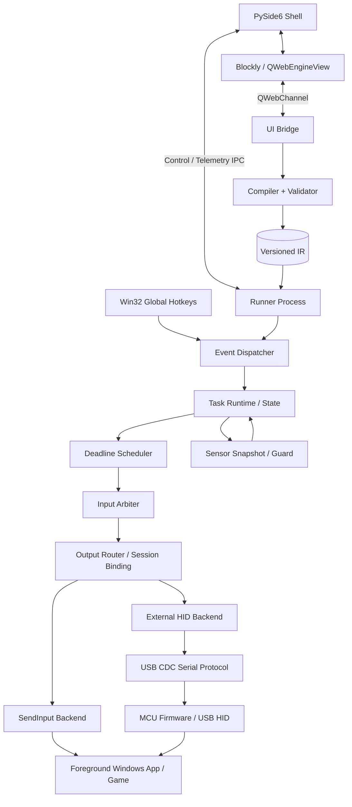
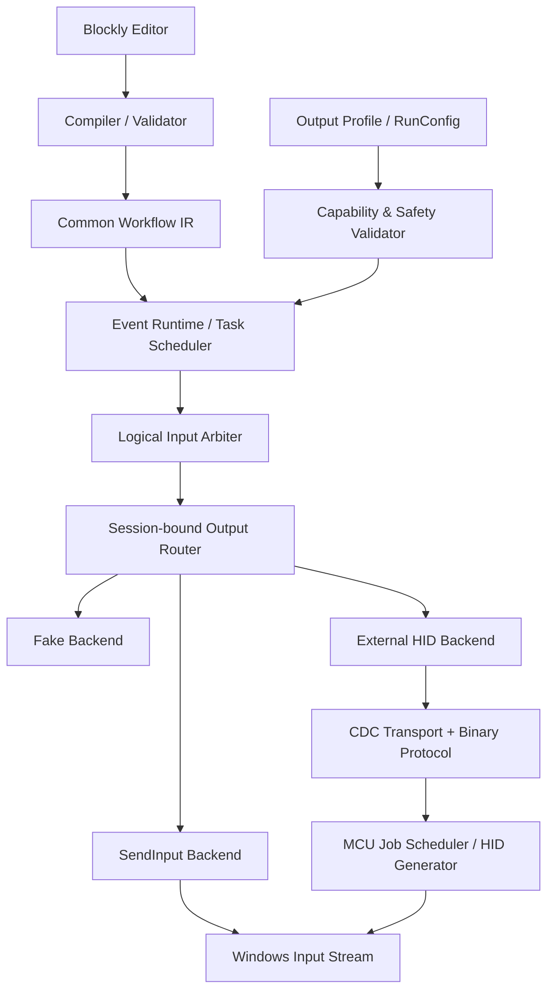

# Macro Studio — Codex용 통합 제품·기술 기획서 (멀티 출력 채널)

> 문서 버전: **1.1 (통합본, v1.0 확장)**  
> 작성일: **2026-11-15**  
> 플랫폼: **Windows 11 x64 우선**  
> 상태: **개발 착수용 통합 명세 (일부 수치는 검증 목표)**
> 핵심 변경: 실행 시 출력 채널 선택(**SendInput / External HID**) + HID Streaming/Onboard + 추후 결정적 구간 Offloading
> **규범 우선순위:** 제19~31장의 멀티 출력 사양이 이전 장의 단일 백엔드 예시와 충돌할 때, 제19~31장을 우선한다. 이전 장의 공통 런타임·안전 규약은 그대로 유효하다.

---

## 0. Codex에 대한 최상위 작업 지시

당신은 Windows 데스크톱 자동화 도구 **Macro Studio**의 구현 담당 개발자다. 이 문서를 제품 요구사항, 아키텍처, 동작 의미론, 테스트 기준의 **단일 기준(Single Source of Truth)** 으로 사용한다.

**목표:** Scratch/Entry처럼 블록을 조합해서 매크로를 작성하고, 작성한 프로그램을 별도 프로세스의 고성능 런타임이 실행하는 Windows 앱을 구현한다. 다음 두 모델을 **동일한 워크플로/런타임으로** 지원해야 한다.

1. **자율형(절차적 반복형):** 프로그램이 스스로 조건을 평가하고 동작을 반복 수행한다.
2. **반응형(핫키형):** 사용자가 단축키로 실행 시점을 결정하고 프로그램이 동작 시퀀스를 수행한다.
3. **혼합형:** 자율형과 반응형을 한 프로젝트에서 병행하며 상태와 워크플로를 공유한다.

**구현 원칙:**
- 문서에 명시된 **MVP를 우선 구현**한다. 후속 기능을 미리 과도하게 구축하지 않는다.
- 사용자 입력을 직접 실행할 수 있는 코드 문자열로 생성하거나 `exec`/`eval`하지 않는다. 검증 가능한 **버전 관리형 IR**을 해석한다.
- GUI 및 Blockly 렌더링은 **입력 타이밍의 실시간 경로에 개입하지 않는다**.
- 기본은 **시뮬레이션(드라이런) 모드**이며, 실제 입력은 사용자가 명시적으로 ARM/실행해야만 발생한다.
- 외부 사이트/CDN 없이 로컬 리소스로 실행 가능하게 만든다.
- Windows 전용 기능은 추상화하며 다른 OS에서는 **FakeInputBackend**로 테스트할 수 있게 한다.
- 단계마다 동작하는 결과물, 실행 방법, 테스트, 남은 제한사항을 보고한다.
- 구현 중 애매한 부분은 **안전하고 단순한 기본 동작**을 선택하고 결정 사항을 `docs/DECISIONS.md`에 남긴다.
- 마지막에 제시된 **Codex 구현 순서**를 따른다. 한번에 전 기능을 구현하려 하지 않는다.

---

## 1. 제품 정의

### 1.1 한 문장 정의

> 사용자가 블록 기반으로 이벤트·조건·반복·입력 시퀀스를 설계하고, Windows 고성능 입력 엔진으로 실행하는 **이벤트 기반 비주얼 프로그래밍 환경**.

### 1.2 설계 철학

- **Trigger → Guard → Workflow → Task → Output** 를 통일된 실행 모델로 삼는다.
- 자율형과 반응형의 차이는 *무엇이 워크플로를 시작시키는지*에 있으며 워크플로 정의 자체는 동일하다.
- 자율형 = `프로젝트 시작` 등으로 생성된 장수명 작업 + 조건/반복 블록.
- 반응형 = `핫키 발생` 등으로 생성된 단수명 작업.
- 혼합형 = 여러 핸들러의 Task가 공통 상태·워크플로·입력 스케줄러를 공유.
- 프로그램/프로젝트는 편집 시점의 **Blockly Workspace**와 실행 시점의 **검증된 IR**로 분리한다.
- **빠른 입력 생성**과 **앱이 입력을 인식하는 빈도**는 다른 지표다. 200Hz 합성 입력이 게임에서 200회 행동으로 인식된다는 보장은 없다.

### 1.3 주요 사용 시나리오

**UC-A. 자율형**

```text
[프로젝트 시작 시]
  [계속 반복]
    [만약 활성 창이 대상 프로그램이고 변수가 auto_enabled 이면]
      [A 키를 200Hz, 2ms 유지로 30회 연타]
    [10ms 대기]
```

**UC-B. 반응형**

```text
[F7 눌렀을 때]
  [B 키 50ms 누르기]
  [100ms 대기]
  [C 키 50ms 누르기]
```

**UC-C. 혼합형**

```text
[프로젝트 시작 시] -> 자동화 루프 실행
[F6 눌렀을 때] -> auto_enabled 토글
[F7 눌렀을 때] -> 자동 작업 잠시 중단, 긴급 동작 실행, 자동 작업 재개
[긴급정지 핫키] -> 모두 중단 및 합성 입력 해제
```

추후에는 화면 픽셀, 이미지 탐지, 창 상태, 사용자 정의 이벤트를 자율형 Guard의 입력으로 확장한다.

### 1.4 제품 비목표(Non-goals)

- 게임 보안/안티치트 우회, 보호된 프로세스에 대한 강제 입력, 관리자 권한 우회.
- 하드 리얼타임 또는 모든 게임의 입력 인식 보장.
- 게임 프로세스 메모리 읽기/쓰기, 드라이버/커널 입력 주입. **외부 USB HID 펌웨어는 v1.1의 정식 범위**이지만 커널 가상 HID 드라이버와 은닉/우회 기능은 범위 밖이다.
- 최초 버전의 OCR/컴퓨터 비전/복잡한 조건 센서.
- 최초 버전의 매크로 마켓플레이스, 클라우드 동기화, 서드파티 스크립트 플러그인.

---

## 2. 권장 기술 스택

| 계층 | 권장 기술 | 비고 |
|---|---|---|
| 데스크톱 UI | Python 3.12+ / PySide6 | Qt 위젯, 메뉴, 프로젝트 관리 |
| 블록 편집기 | Google Blockly (JavaScript) | 로컬 번들, JSON workspace serialization |
| 웹뷰 | `PySide6.QtWebEngineWidgets.QWebEngineView` | 앱 내 블록 편집기 |
| JS↔Python | `PySide6.QtWebChannel.QWebChannel` | **제어/편집만**, 실시간 입력 경로 제외 |
| 앱↔런타임 | `multiprocessing` (Windows `spawn`) 또는 명시적 IPC | 독립 프로세스; 명령/상태 메시지 |
| 컴파일러 | Python | Blockly 상태 → 프로젝트 AST → IR + 검증 |
| 실행기 | Python | 이벤트 디스패처, Task, 상태, 제어 흐름 |
| 스케줄러 | Python + `time.perf_counter_ns()` | 절대 데드라인 기반; 추후 C++ 교체 가능 |
| PC 입력 출력 | `ctypes` + `user32.SendInput()` | Windows 네이티브 합성 입력 |
| 외부 HID 제어 전송 | `pyserial` (HID Phase에서 추가) | CDC ACM/COM 포트, 프레임·CRC·ACK |
| MCU 펌웨어 | Arduino C++ / ATmega32u4 (Leonardo 참조 구현) | USB CDC + USB HID 복합 장치; 하드웨어 없이는 시뮬레이터 |
| 전역 핫키 | Win32 `RegisterHotKey` / 메시지 루프 | 초기 버전은 조합형 단축키에 집중 |
| 테스트 | `pytest`, FakeBackend, 선택적 JS 테스트 | 실제 입력 없이 로직 검증 |
| 패키징 | 추후 PyInstaller 검토 | MVP에선 개발 환경 실행 우선 |

**주의:** 라이브러리 최신 버전/호환성을 설치 시 확인하고 의존성 버전을 고정한다. Blockly는 가능하면 공식 JSON 직렬화 API를 사용한다. Qt WebEngine의 보안/리소스 배포 제약을 지킨다.

---

## 3. 상위 아키텍처



### 3.1 프로세스 및 스레드

**UI 프로세스**
- Qt 메인 스레드: Blockly 호스트, 메뉴, 속성, 시작/정지, 저장, 로그 표시.
- 편집 결과를 검증/컴파일한 후 Worker에 `LOAD_PROGRAM` 명령 전송.
- UI가 멈춰도 Worker가 무기한 입력을 내보내지 않도록 별도 watchdog/안전 중단 경로 필요.

**Runner 프로세스**
- 제어 메시지 수신기: `ARM`, `START`, `PAUSE`, `RESUME`, `STOP`, `SHUTDOWN`.
- Win32 메시지 루프가 필요한 핫키 수신기(전용 스레드 가능).
- 논리적 Task/워크플로를 구동하는 런타임.
- 스케줄링 및 중앙 Input Dispatcher. 고속 입력의 hot path에서 UI 호출·디스크 쓰기·JSON 파싱 금지.
- 텔레메트리 집계 및 저주파(예: 2~10Hz) 전송.

**중요:** 다중 OS 스레드가 각자 `SendInput()`을 호출하지 않도록 **중앙 Input Dispatcher**를 단일 권한 지점으로 둔다. 동시 Task는 우선 논리적 코루틴/스케줄된 실행 흐름으로 다룬다.

### 3.2 제어 경로 vs 고속 입력 경로

```text
제어 경로: Blockly → compile → IR → IPC → Task Runtime
고속 경로: 예약된 타임스탬프 → Scheduler → Input Arbiter → SendInput
센서 경로: 창/키 상태(필요시 화면) 샘플링 → 공유 상태 Snapshot → Guard
```

픽셀 검사, 이미지 처리 같은 상대적으로 느린 판단을 고속 키 이벤트 처리 루프 안에 넣지 않는다.

---

## 4. 통일된 프로그래밍 모델

### 4.1 핵심 개념

| 용어 | 의미 |
|---|---|
| Project | 블록 Workspace, 핸들러, 사용자 워크플로, 전역 변수, 설정 |
| Event Source | 프로그램 시작, 핫키, 주기 타이머, 상태 변화 등 |
| Event | 발생 시각/유형/페이로드를 가진 사실 |
| Handler | 특정 이벤트에 반응하는 엔트리포인트 + 선택적 Guard |
| Guard | 실행 조건. 참일 때만 Task 생성 |
| Workflow | 재사용 가능한 절차적 명령·조건·반복 시퀀스 |
| Task | Workflow의 **실행 인스턴스** (코루틴/PC/지역 상태 포함) |
| Scheduler | Task 재개 및 입력 이벤트의 타이밍 관리 |
| Input Arbiter | 공유 키/마우스 상태와 Task 간 충돌 해결 |
| State | 프로젝트 전역 변수, 태스크 로컬 변수, 활성 모드 |

### 4.2 핸들러 정의

모든 핸들러는 다음 모델로 통일한다.

```text
Handler {
  id,
  event_source,
  optional_guard,
  workflow_id,
  reentrancy_policy,
  priority,
  enabled
}
```

**MVP 이벤트:**
- `on_project_start`
- `on_hotkey_pressed` (예: Ctrl+Alt+F7)
- `on_interval` (시간 간격)

**후속 이벤트:** `on_hotkey_released`, `while_key_held`, `on_variable_changed`, `on_pixel_changed`, `on_window_focus_changed`, 사용자 정의 이벤트.

### 4.3 Task 수명주기

```text
CREATED → READY → RUNNING → WAITING → READY → ... → COMPLETED
                     ↘ CANCEL_REQUESTED → CLEANUP → CANCELLED
                     ↘ FAILED → CLEANUP
```

- `wait(ms)`는 스레드를 점유하는 무한 sleep이 아니라, 현재 Task의 다음 재개 시각을 예약하고 제어권 반환.
- `repeat`는 Task의 제어 흐름이다. 반복 횟수/조건을 안전하게 검증한다.
- **무한 루프에 대기가 전혀 없는 경우** 정지 명령/기타 Task가 굶주리지 않도록 명령 예산 또는 강제 양보(yield) 규칙을 둔다.
- Task는 취소 요청을 인지해야 하며, 시간 기반 블록은 취소 가능해야 한다.
- 워크플로 호출 시 스택 깊이/재귀 제한을 둔다.

### 4.4 핸들러 재진입 정책

| 정책 | 의미 | MVP |
|---|---|---|
| `ignore_if_running` | 동일 핸들러 Task가 진행 중이면 새로운 이벤트 무시 | 필수/기본 |
| `restart` | 기존 Task 취소·정리 후 새 Task 실행 | 필수 |
| `queue` | 요청을 유한 대기열에 넣고 순차 실행 | 후속 |
| `parallel` | 복수 Task 동시 실행 | 후속 |
| `override` | 대상 Task를 중단/일시정지하고 우선 실행 | 후속 |

**동시성 기본 정책:** MVP에서는 *같은 핸들러의 중복 실행을 금지*하고, 서로 다른 핸들러 간 동시성은 제한적으로 허용한다. 공유 입력 충돌이 아직 해결되지 않은 경우에는 **대기 또는 명시적 오류**로 처리한다. 이벤트 폭주 방지를 위한 큐 길이·동시 Task 수 상한을 둔다.

### 4.5 공유 상태와 원자성

- `Global Variables`: 프로젝트 단위 상태.
- `Task Locals`: 실행 인스턴스마다 별도 상태.
- 한 런타임 이벤트 루프에서 상태 변경을 순차 반영하거나, 필요시 명시적 동기화 사용.
- 변수 쓰기 → 이벤트/Guard 검사 순서를 결정적으로 정의한다.
- MVP는 숫자·불리언·문자열 정도의 타입부터 시작한다.

### 4.6 선택적 상태 머신

`Idle`, `Auto`, `Override` 같은 모드는 **일반 전역 상태**로 표현 가능하다. 별도 시각적 State Machine 편집기는 후속 기능으로 미룬다. 단순 매크로를 작성하는 데 상태 머신을 강제하지 않는다.

---

## 5. 블록 언어 설계

### 5.1 카테고리

| 분류 | MVP 블록 | 이후 확장 |
|---|---|---|
| 이벤트 | 프로젝트 시작, 단축키 누름, 주기마다 | 키 해제, 상태 변화, 픽셀 변화 |
| 입력 | KeyDown, KeyUp, Tap(누름 길이), 연타(Hz/길이/횟수), 마우스 클릭 | 드래그, 휠, 복합 키 시퀀스 |
| 시간 | 기다리기(ms), 주기 반복 | 시간 제한, 데드라인 |
| 제어 | if/else, N회 반복, 계속 반복, 종료 | break/continue, 예외 핸들링 |
| 데이터 | 변수 읽기/쓰기, 숫자·비교·논리 연산 | 배열, 딕셔너리 |
| 상태 조회 | 활성 대상 창 여부, 입력 상태, 현재 시간 | 픽셀·이미지·OCR |
| 워크플로 | 정의, 호출 | 인자·반환값, 라이브러리 |

MVP는 **워크플로 정의/호출**을 반드시 포함해 동일한 액션을 자율/반응형 양쪽에서 재사용할 수 있게 한다.

### 5.2 구조적 규칙

- 이벤트 블록은 최상위(Hat Block)에서만 사용한다.
- 실행 블록은 명령 연결(Statement Connection), 참조 값 블록은 타입 있는 Expression Connection 사용.
- 잘못 연결된 블록은 실행 전 컴파일 오류로 보고한다.
- 연결되지 않은 일반 블록은 무시하되 경고(또는 오류) 정책을 명시한다.
- 모든 블록에 안정적인 ID를 부여하고, 컴파일 오류 및 실행 로그가 원본 블록 ID를 참조할 수 있어야 한다.
- 한글 사용자 인터페이스를 기본으로 하고 내부 opcode/ID는 영문으로 통일.

### 5.3 고주파 입력 전용 블록

```text
[키 연타하기: 키=A, 주파수=200 Hz, 누름시간=2 ms, 횟수=100]
```

**정확한 의미:**
- `period_ns = 1_000_000_000 / hz` (가능하면 정수/유리수 누적 오차 보정).
- 매 주기 `KeyDown` → `hold_ns` 후 `KeyUp` 예약.
- `hold_ns > 0`, `hold_ns < period_ns`.
- `N회`는 N개의 *키 누름+해제 쌍*을 뜻한다.
- Task 취소/중단/포커스 상실 시 합성 KeyDown을 해제한다.
- 최초 구현은 `1~200Hz`를 기본 제공하고, 더 높은 Hz는 설정으로 **실험적** 활성화할 수 있다. 보장 수치가 아닌 벤치마크 대상이다.
- 매 프레임 Blockly나 Python 인터프리터의 범용 명령 N개를 돌리는 대신, `tap_sequence` **단일 IR 연산**으로 컴파일한다.

### 5.4 시간 모델

- 단위: 내부적으로 나노초 정수, UI에서는 ms / Hz를 명확히 표시.
- 반복 스케줄은 `now + sleep`의 반복이 아니라 **최초 기준 시각 + n × period**로 계산.
- 늦은 이벤트 처리 정책 명시: 기본 `skip_missed` (밀린 주기를 몰아서 입력하지 않음).
- 정지 요청, 포커스 이탈 등을 이벤트 간에 확인한다.
- 짧은 시간의 busy wait은 극히 제한적으로 사용하고 CPU 사용률을 측정한다.
- Windows의 일반 사용자 모드에서 1ms 이하 지터와 정확한 시점의 wake-up은 **보장하지 않는다**.

---

## 6. 프로젝트 저장 포맷과 실행 IR

### 6.1 두 형식을 혼동하지 말 것

1. **편집 프로젝트 파일**: Blockly Workspace JSON + 앱 메타데이터, 전역 변수/대상 창/핫키 정책 등. 예: `.macroproj` (JSON).
2. **컴파일된 IR**: 검증된 실행 명령. **Blockly 전용 필드/렌더링 좌표는 포함하지 않음.**

편집 파일을 로드한 뒤 컴파일할 수 있어야 하며, IR 단독 파일을 무조건 편집 가능하게 간주하지 않는다.

### 6.2 편집 프로젝트 예시(개념)

```json
{
  "schema_version": 1,
  "name": "Example project",
  "workspace": {"blocks": {"languageVersion": 0, "blocks": []}},
  "settings": {
    "dry_run_default": true,
    "focus_policy": "pause_on_blur",
    "preferred_output_profile_id": "local-default"
  }
}
```

`workspace`는 실제 Blockly serializer가 출력한 객체로 저장한다. 예시 내부의 버전값은 실제 라이브러리에 맞춰 갱신한다.

### 6.3 IR 예시(규범적 방향)

```json
{
  "ir_version": 1,
  "project_id": "example",
  "globals": {"auto_enabled": true},
  "workflows": {
    "tap_a_100_times": {
      "steps": [
        {
          "op": "tap_sequence",
          "block_id": "b-tap-1",
          "key": {"kind": "scan_code", "code": 30, "extended": false},
          "frequency_hz": 200,
          "hold_ns": 2000000,
          "count": 100,
          "missed_tick_policy": "skip_missed"
        }
      ]
    },
    "reactive_action": {
      "steps": [
        {"op": "key_tap", "block_id": "b-tap-b", "key": "B", "hold_ns": 50000000},
        {"op": "wait", "block_id": "b-wait", "duration_ns": 100000000},
        {"op": "key_tap", "block_id": "b-tap-c", "key": "C", "hold_ns": 50000000}
      ]
    }
  },
  "handlers": [
    {
      "id": "h-start",
      "event": {"type": "project_start"},
      "workflow_id": "tap_a_100_times",
      "policy": "ignore_if_running"
    },
    {
      "id": "h-hotkey",
      "event": {"type": "hotkey_pressed", "hotkey": "CTRL+ALT+F7"},
      "workflow_id": "reactive_action",
      "policy": "restart"
    }
  ]
}
```

**구현 시 보완할 것:** 위의 예제에서는 읽기 쉬운 이름/scan code가 혼재한다. 내부 검증 결과는 반드시 **일관된 정규화 KeySpec**으로 변환한다. `source block ID`, 오류 위치 매핑, 핸들러 우선순위, guard 표현식도 스키마에 포함한다.

### 6.4 IR 검증(실행 전 필수)

- 지원하지 않는 `ir_version` 또는 `op` 거부.
- 정의되지 않은 workflow/변수 참조 거부.
- 타입 검사(불리언 조건, 정수 반복 횟수 등).
- 음수 대기, 0Hz, 잘못된 key, `hold >= period` 금지.
- 반복 횟수/Task 수/큐 길이/워크플로 호출 깊이 상한.
- 무한 반복문에는 취소 가능한 대기 또는 작업 예산 적용.
- 프로젝트 로드만으로 자동 시작하거나 실제 입력하지 않음.
- 파일에서 로드한 문자열을 Python 코드로 평가하지 않음.

---

## 7. 고성능 입력 및 스케줄러

### 7.1 InputBackend 인터페이스

```python
class InputBackend(Protocol):
    def send_key_down(self, key: KeySpec) -> None: ...
    def send_key_up(self, key: KeySpec) -> None: ...
    def send_mouse_button(self, button: MouseButton, down: bool) -> None: ...
    def move_mouse(self, x: int, y: int) -> None: ...
    def release_all_owned_inputs(self) -> None: ...
```

구현체:
- `FakeInputBackend`: 이벤트와 타임스탬프 기록, OS 입력을 전혀 생성하지 않음.
- `WindowsSendInputBackend`: `ctypes`로 Win32 구조체와 `SendInput` 연결.
- `ExternalHIDBackend`: USB CDC 장치에 제어 명령 전송. 지원/연결 상태와 명시적 실행 모드 검사. v1.1 제19~31장 참조.

위 메서드는 **기존 내부 호출을 위한 최소 공통 기능**이다. 신규 코드는 제21장의 `BackendCapabilities`·`OutputSession`·`OutputDriver` 계약으로 통합한다. 추상 인터페이스의 `schedule()`은 지원하는 백엔드에만 capability-guarded optional operation으로 노출하며, 지원되지 않는 동작을 묵시적으로 SendInput으로 대체하지 않는다.

**권장 방식:** 스캔 코드 기반 키 입력은 `KEYEVENTF_SCANCODE` / `KEYEVENTF_KEYUP` 및 extended key 처리를 사용한다. Mouse/Keyboard/Hardware `INPUT` union 레이아웃과 포인터 크기(x64)를 검증한다. `SendInput` 반환값(삽입 이벤트 개수)을 검사하고 오류를 보고한다. 합성 입력은 백그라운드 윈도우 전용 메시지 전송과 다름을 명시한다.

### 7.2 Scheduler 책임

- 단조 고해상도 시계(`perf_counter_ns`) 사용.
- 다음 deadline을 가지는 예약 이벤트에 대해 우선순위 큐/최소 힙 유지.
- 예약된 KeyDown/KeyUp 이벤트 전달, Task 재개, 취소, 포커스 가드.
- 장시간 대기에는 sleep 또는 Windows 고해상도 waitable timer를 검토; deadline 직전의 짧은 구간에서만 선택적 spin.
- 정지 요청이 지연되지 않도록 bounded wait/다른 wake-up 경로 구현.
- 지나간 deadline을 무한히 따라잡지 않고 누락 주기 처리 정책 적용.
- 긴 연타 시퀀스 전 이벤트를 무한히 큐에 쌓지 말고 **bounded rolling horizon** 또는 다음 이벤트만 예약.

### 7.3 Input Arbitration

- 개별 Task별로 자신이 눌러 유지 중인 합성 키를 추적한다.
- 동일 키를 여러 Task가 동시에 사용한다면 소유권/reference counting 또는 독점권 정책으로 충돌 해결한다.
- KeyUp을 잘못 보내 다른 Task의 KeyDown 상태를 해제하지 않도록 한다.
- **MVP:** 같은 키/마우스 버튼에 대한 충돌은 보수적으로 거부하거나 직렬화해도 된다. 정책을 문서화하고 테스트한다.
- Task 종료·강제 중단·포커스 이탈·IPC 연결 끊김·프로세스 종료 전에 가능한 합성 키 해제를 시도한다.
- 사용자가 실제 물리적으로 누르고 있는 키를 임의로 해제하지 않도록 합성 입력 소유 상태와 물리 입력 상태를 구분한다. OS 자체는 키의 소유권을 구분하지 않으므로 이 동작은 **최선의 노력**이다.

### 7.4 Windows 제약

- `SendInput`은 UIPI 무결성 수준 제약을 받는다. 권한 상승/보안 우회를 시도하지 말 것.
- `SendInput` 성공 = 대상 앱의 실제 입력 인식 **아님**.
- DirectInput/Raw Input, 프레임별 키 상태 폴링, 게임별 입력 차이로 인해 일부 이벤트는 누락/무시될 수 있다.
- 실행 중 창 포커스가 변경되면 엉뚱한 앱에 입력할 수 있으므로 포커스 정책이 필요.
- `ctypes`가 빠른 OS API 호출을 제공하더라도 Python 타이밍 지터는 남는다. 더 높은 주파수가 필요할 때 스케줄러/디스패처만 C++ 확장 모듈로 교체할 수 있도록 인터페이스 유지.

---

## 8. 활성 창 정책 및 안전성

### 8.1 명시적 활성화 절차

1. 프로젝트를 연다. **기본 드라이런**.
2. 컴파일/검증 성공 후 사용자가 **ARM**한다.
3. 필요하면 대상 창을 명시적으로 선택한다(실행 중 활성 창 바인딩, 또는 창 선택 UI).
4. `START` 명령 또는 핫키가 발생하면 대상 창이 포그라운드인지 확인 후 실행.
5. 포커스가 사라지면 기본적으로 **PAUSE + 키 해제**. 다시 돌아왔을 때 자동 재개 여부는 정책으로 정한다. MVP 기본은 **사용자 명시 재개**.
6. `STOP`/긴급정지 시 모든 Task 취소, 스케줄 큐 비우기, 소유 입력 해제, 사용자에게 상태 표시.

### 8.2 필수 가드레일

- 전역 긴급정지 핫키(예: `Ctrl+Alt+Shift+F12`), 사용자 변경 가능하되 중복 충돌 검사.
- UI 상의 명시적 중단 버튼. 앱 종료 시 Worker 정지 및 키 정리.
- ARM 이전에는 `FakeInputBackend`만 사용.
- 최초 실제 입력 전에 경고/대상 확인 UI.
- 무한 루프 또는 고속 시퀀스에도 STOP 반응성을 유지.
- 기본 주파수 제한(예: 200Hz)과 실험 모드 상한을 구분하고 설정.
- 프로젝트 파일만 여는 것으로 실제 동작 실행 금지.
- 외부 URL, 코드 실행, 서브프로세스 실행, 파일 삭제 등의 블록을 기본 제공하지 않음.
- 계정 정보 수집, 백그라운드 감시, 은닉 실행, 원격 제어 기능은 범위에서 제외.

### 8.3 핫키 처리

- MVP는 `RegisterHotKey` 지원 범위의 조합형 전역 단축키부터 구현.
- 실행기에서 Win32 메시지 루프를 정상적으로 구동하고 종료 시 `UnregisterHotKey`.
- 단축키가 이미 사용 중인 경우 GUI에 충돌 상태 표시.
- 합성 입력으로 자신이 등록한 이벤트가 다시 발생하는 재귀 루프를 방지해야 한다. 핫키/입력 종류에 따라 태그(`dwExtraInfo`), 이벤트 출처 또는 정책 필터를 신중히 검증하고 테스트한다.
- UI가 포커스를 점유한 상태에서 만든 편집 단축키와 실행 핫키가 충돌하지 않도록 한다.

---

## 9. UI/UX 사양

### 9.1 레이아웃

```text
┌────────────────────────────────────────────────────────────────────┐
│ Macro Studio [열기/저장] [출력: Dry Run / SendInput / HID] [ARM] [STOP] │
├─────────────────┬──────────────────────────────────┬───────────────┤
│ 블록 팔레트     │ Blockly 캔버스                   │ 실행/속성      │
│  이벤트         │                                  │ 출력 채널      │
│  키보드         │ [프로젝트 시작하면]              │ 장치/대상 창   │
│  마우스         │   [계속 반복]                    │ 지터/주파수    │
│  시간           │     [...]                        │ 오류·로그      │
│  제어           │ [F7 누르면]                      │               │
│  변수           │   [...]                          │               │
│  워크플로       │                                  │               │
├─────────────────┴──────────────────────────────────┴───────────────┤
│ 상태: DRY RUN / ARMED / RUNNING / PAUSED / STOPPED                  │
└────────────────────────────────────────────────────────────────────┘
```

### 9.2 최소 UX 요구사항

- 블록 카테고리별 색 구분, 한글 명칭, 블록 툴팁.
- 프로젝트 새로 만들기, 열기, 저장, 다른 이름으로 저장.
- 편집 변경 시 미저장 표시.
- 컴파일 오류를 블록 ID/위치에 매핑해 해당 블록을 강조.
- 실행 상태: `DRY_RUN`, `ARMED`, `RUNNING`, `PAUSED`, `STOPPED`, `ERROR`.
- **실행 설정 패널**에서 `Dry Run / SendInput / External HID`를 선택하고, HID 선택 시 장치·실행 방식(Streaming / Onboard)을 표시한다. 연결되지 않은 기능은 비활성화하고 이유를 안내한다.
- 사용자에게 실제 입력 동작/종료 상태를 명확히 표시.
- 부하가 높은 시퀀스에서도 편집 UI가 독립적으로 반응.
- 로컬 WebEngine 내에서 외부 임의 사이트로 이동하지 않도록 탐색 제한.

---

## 10. IPC 계약(초안)

작업 프로세스 간 제어 메시지는 JSON 호환 객체로 정의하고, 메시지 스키마를 버전 관리한다. MVP에서는 Python 객체를 `multiprocessing.Pipe` 등으로 전달할 수 있지만, 수신 메시지의 타입/크기/상태 전이는 항상 검증한다.

**UI → Runner**

```text
LOAD_PROGRAM(ir)
SELECT_OUTPUT(profile_id, mode)   # STOPPED/DISARMED 상태에서만
CONNECT_OUTPUT()                 # HID 시 명시적 연결/Handshake
ARM(target_window, options)
DISARM()
START()
PAUSE()
RESUME()
STOP(reason)
SHUTDOWN()
```

**Runner → UI**

```text
READY(capabilities)
OUTPUT_STATUS(backend, device_id, capabilities, connection_state)
ACK(request_id)
STATE_CHANGED(state, reason)
COMPILE_OR_RUNTIME_ERROR(block_id, code, message)
TELEMETRY(snapshot)
LOG(level, message)
```

계약 규칙:
- 명령에 `request_id`, `schema_version`을 둔다.
- 잘못된 상태 전이(예: 미검증 IR을 START)는 거부.
- `STOP`은 중복 호출해도 안전해야 하며, 가능한 빠르게 수용.
- 고빈도 이벤트별 IPC 전송은 금지. 텔레메트리는 저주파 집계.
- Worker 연결 끊김 시 UI는 ERROR 표시; Worker는 UI heartbeat/watchdog에 의해 안전 정지.

---

## 11. 성능 목표 및 벤치마크

### 11.1 성능 정의

1. **Command Rate:** Scheduler가 보내려 한 KeyDown/KeyUp 이벤트 수/s.
2. **Injection Rate:** `SendInput` 반환값 기준 OS 스트림에 삽입 성공한 이벤트 수/s.
3. **Observed Rate:** 별도 관측 도구가 수신한 입력 이벤트 수/s.
4. **Recognized Rate:** 실제 대상 프로그램에서 행동으로 처리한 횟수/s (별도 앱별 측정).
5. **Scheduling Jitter:** 실제 이벤트 발생 시각 − 예약 시각(평균/P95/P99/최대).
6. **Stop Latency:** STOP 요청부터 **추가 합성 입력 생성 중단 + 정리 완료**까지 걸린 시간.
7. **CPU Load:** 100/200Hz 실행 중 프로세스별 평균/최대 CPU 점유.

### 11.2 목표(보장 아님)

- **기능 목표:** 테스트 환경에서 100Hz, 200Hz KeyDown/KeyUp 페어를 일정 시간 정상적으로 **발행**.
- **안전 목표:** STOP/포커스 이탈/예외 발생 시 남은 합성 키 상태를 정리.
- **응답 목표:** 대부분의 정상 환경에서 UI 입력 지연 없이 작업 제어. Stop latency 측정하고 회귀 테스트.
- **확장 목표:** 500Hz와 1000Hz는 측정 기반의 후속 실험. 달성/인식 보장을 제품 문구로 사용하지 말 것.
- 숫자형 지터·stop latency 합격 기준은 **하드웨어/OS 측정 후** 고정한다. 무근거하게 `P99 < 1ms`를 보장하지 않는다.

### 11.3 필수 테스트 행렬

| 테스트 | FakeBackend | 실제 Windows | 판정 |
|---|---:|---:|---|
| 블록 JSON 저장/로드 왕복 | ✓ | 선택 | 의미 동일 |
| 자동/핫키 핸들러 컴파일 | ✓ | 선택 | IR 검증 통과 |
| 조건/반복/변수/워크플로 호출 | ✓ | 선택 | 기대된 실행 순서 |
| 100/200Hz 합성 입력 | ✓ | ✓ | 발행 수·시간 오차 보고 |
| 중간 STOP, 포커스 이탈 | ✓ | ✓ | 추가 입력 중단, 키 정리 |
| 잘못된 IR/핫키 충돌 | ✓ | ✓ | 안전한 오류 반환 |
| UI 1초 이상 정체/Worker 장애 | ✓ | ✓ | 안전 정지 또는 복구 |
| 같은 키를 두 Task가 다룸 | ✓ | 선택 | 정의된 충돌 정책 준수 |
| 실제 게임에서 입력 인식 | 불가 | 수동·별도 | 입력 특성 기록, 보장하지 않음 |

**측정 결과는 CSV/JSON으로 내보낼 수 있게 구성**(MVP에서는 CLI 벤치마크 출력만으로 시작 가능).

---

## 12. 테스트 가능한 구현 분리

### 12.1 순수 로직 계층

- AST/IR 스키마 및 Validator.
- 이벤트 → 핸들러 매칭.
- Task 상태 전이.
- 제어 흐름 Interpreter.
- Time abstraction (`Clock` 인터페이스).
- Fake Scheduler/Fake Backend.

이 계층은 Windows가 아닌 CI 환경에서도 단위 테스트가 가능해야 한다.

### 12.2 Windows 통합 계층

- `SendInput` 구조체 정의/스캔 코드 매핑.
- 전역 핫키 등록/해제.
- `GetForegroundWindow()` 기반 대상 포커스 확인.
- 실행 프로세스 lifecycle + watchdog.
- 실제 키 이벤트 발행 측정.

**통합 테스트는 명시적 플래그로만 실제 입력을 보낸다.** 자동 `pytest` 기본 실행에서 OS에 실제 키 입력을 주입하지 않는다.

---

## 13. 권장 디렉터리 구조

```text
macro-studio/
├── README.md
├── pyproject.toml
├── .gitignore
├── docs/
│   ├── SPEC.md                   # 이 문서
│   ├── ARCHITECTURE.md
│   ├── DECISIONS.md
│   └── IR_SCHEMA.md
├── src/macro_studio/
│   ├── __main__.py
│   ├── app.py
│   ├── ui/
│   │   ├── main_window.py
│   │   ├── bridge.py
│   │   └── project_controller.py
│   ├── compiler/
│   │   ├── workspace_parser.py
│   │   ├── ast.py
│   │   ├── ir.py
│   │   ├── validator.py
│   │   └── compile.py
│   ├── runtime/
│   │   ├── worker.py
│   │   ├── event_dispatcher.py
│   │   ├── task.py
│   │   ├── interpreter.py
│   │   ├── scheduler.py
│   │   ├── input_arbiter.py
│   │   ├── clock.py
│   │   └── telemetry.py
│   ├── backends/
│   │   ├── base.py
│   │   ├── fake.py
│   │   ├── win32_sendinput.py
│   │   ├── output_router.py
│   │   └── external_hid.py
│   ├── external_hid/
│   │   ├── protocol.py
│   │   ├── codec.py
│   │   ├── transport.py
│   │   ├── discovery.py
│   │   └── simulator.py
│   ├── platform_win/
│   │   ├── hotkeys.py
│   │   └── foreground.py
│   ├── ipc/
│   │   ├── messages.py
│   │   └── transport.py
│   └── storage/
│       └── projects.py
├── frontend/
│   ├── package.json
│   ├── src/
│   │   ├── index.html
│   │   ├── main.js
│   │   ├── blocks.js
│   │   ├── toolbox.js
│   │   └── bridge.js
│   └── dist/                      # 빌드된 로컬 에셋
├── tests/
│   ├── test_ir_validation.py
│   ├── test_workflows.py
│   ├── test_events.py
│   ├── test_scheduler_fake.py
│   ├── test_cancellation.py
│   ├── test_input_arbiter.py
│   └── integration_win/
└── tools/
    ├── benchmark_input.py
    └── benchmark_hid.py
├── firmware/
│   └── leonardo_ref/
│       ├── README.md
│       ├── protocol.h
│       ├── protocol.cpp
│       ├── scheduler.h
│       ├── scheduler.cpp
│       └── leonardo_ref.ino
└── schemas/
    ├── project_v1.schema.json
    └── output_protocol_v1.md
```

구조는 권장안이며 실제 구현에 따라 파일명은 조정 가능하다. **모듈 경계/계약은 유지**한다.

---

## 14. 단계별 구현 계획과 완료 기준

### Phase 0 — 골격/계약/가짜 실행기

**작업**
1. `pyproject.toml`, 패키지 구조, README, 테스트 환경 구축.
2. IR 스키마 v1, Clock/InputBackend 추상화, FakeBackend 구현.
3. 프로젝트 시작/핫키 이벤트, Task 생명주기, `wait`·`repeat`·`if/else`·변수·워크플로 호출·`key_tap`·`tap_sequence` interpreter 구현.
4. 최소 CLI로 JSON IR을 검증·실행·정지하는 데모.

**완료 조건**
- 실제 입력 없이 FakeBackend에 기대한 이벤트가 기록된다.
- 자율형과 반응형의 두 워크플로가 **동일한 런타임**에서 처리된다.
- 잘못된 IR은 안전하게 거부된다.
- 단위 테스트 통과.

### Phase 1 — Windows Input Engine / 안전한 실행

**작업**
1. `ctypes` SendInput, KeySpec/키 해제, 오류 처리.
2. 정밀 deadline scheduler 및 cancel 가능한 시퀀스.
3. Win32 글로벌 핫키, 포커스 가드, ARM/STOP.
4. 벤치마크 CLI(100Hz/200Hz, 발행률, 지터, stop latency).

**완료 조건**
- Windows 실입력은 명시적으로 ARM한 경우에만 발생.
- Stop/포커스 변경 시 입력 해제와 작업 취소 동작.
- 100/200Hz 입력 발행 측정 리포트 출력(결과값 보장 아님).
- 관리자 권한 없이 동작 가능한 범위 명확히 안내.

### Phase 2 — Blockly/데스크톱 UI 통합

**작업**
1. PySide6 메인 창 + QWebEngineView + 로컬 Blockly 번들.
2. 기본 이벤트/입력/제어/변수/워크플로 블록.
3. Workspace serialization(JSON), 로드/저장.
4. Blockly → IR 컴파일 및 블록 ID별 오류 표시.
5. QWebChannel ↔ Python Bridge, Runner IPC, 실행 상태 표시.

**완료 조건**
- GUI에서 자율형·반응형 워크플로를 배치·저장·실행.
- 프로세스가 분리되어 UI가 실행 타이밍을 제어하지 않음.
- 드라이런과 실입력 모드가 시각적으로 구분됨.

### Phase 3 — 혼합 실행/충돌 처리/사용성 개선

**작업**
1. 하나의 프로젝트에 두 핸들러를 동시에 배치 및 재사용 워크플로 호출.
2. 기본 정책 `ignore_if_running`, `restart`와 명시적 충돌 처리.
3. 전역 변수/조건문의 의미론 고정, 재시작 및 키 정리 테스트.
4. 오류 매핑, 실행 통계 및 로그, 예제 프로젝트 3종.

**완료 조건**
- 자동 반복 중 F7에 반응하고 의도된 정책에 따라 작업 실행.
- 입력/상태 충돌의 동작이 문서화되어 재현 가능.
- 재시작/중지/포커스 이탈/Worker 오류의 테스트 통과.

### Phase 4 — External HID Streaming (USB 연결 및 기본 출력)

**작업**: 공통 Output Router / Capability 검사, 장치 연결/탐색, 바이너리 프로토콜, Leonardo 참조 펌웨어의 기본 키·마우스 출력, 연결 끊김과 watchdog, 실제 하드웨어 통합 테스트. 세부 계약은 제19~31장 참조.

**완료 조건**: 같은 워크플로를 SendInput 또는 External HID Streaming으로 실행; 하드웨어가 없으면 가짜 직렬 장치로 통합 테스트; 중단/재연결 정책 검증.

### Phase 5 — HID Onboard + Timed Batch

**작업**: MCU 내부 비차단 타이머, 사전 정의된 연타 시퀀스, `PREPARE/START/CANCEL`, 작업 완료/오류 상태, 통신 버퍼 제한, 오프로드 불가 오류 표현.

**완료 조건**: 고정 시퀀스가 MCU에서 반복 실행되며 PC 통신 단절 시 안전 정책대로 중단됨; 100/200Hz는 실측 결과와 오차를 보고하며 인식 보장은 하지 않음.

### Phase 6 — 후속 확장(초기 작업 범위 제외)

- `parallel`, `queue`, `override` + 자원별 arbitration 강화.
- 화면 센서(픽셀/영역/이미지/OCR), 별도 낮은 주기 센서 파이프라인.
- 시각적 FSM, 사용자 정의 이벤트, 사용자 정의 워크플로 인자/반환값.
- C++ 스케줄러/디스패처 선택적 교체.
- 정적 분석 기반 자동 결정적 구간 오프로딩(Adaptive Execution), 멀티채널 동시 혼합 출력.
- 실행 디버거(브레이크포인트/단계 실행), 프로젝트 마이그레이션, 패키징.

---

## 15. 주요 아키텍처 결정 기록(ADR 초안)

**ADR-001 — 이벤트 기반 통합:** 자율/반응형을 다른 인터프리터로 구현하지 않는다. 둘 다 Event → Handler → Workflow → Task 경로를 사용한다.

**ADR-002 — Blockly는 편집기:** Blockly가 입력 생성 함수나 고속 루프를 직접 실행하지 않는다. 편집 결과만 컴파일한다.

**ADR-003 — IR은 안정적 계약:** 런타임은 Blockly, Qt와 독립. 추후 C++로 이식할 수 있도록 IR opcode/타이밍 의미가 문서화되어야 한다.

**ADR-004 — 안전한 기본값:** 드라이런, 명시적 ARM, 전역 정지, 포커스 이탈 시 일시 중지/해제.

**ADR-005 — 스케줄링:** 상대 `sleep()` 누적 반복이 아니라 절대 deadline 기준. 무근거한 하드 리얼타임 보장은 하지 않는다.

**ADR-006 — 독립 Worker:** UI 프레임 렌더링과 스케줄링을 다른 프로세스로 격리한다.

**ADR-007 — 단계적 동시성:** MVP에선 보수적 충돌 정책; 후속으로 병렬/override 확장.

**ADR-008 — 출력과 실행 장소 분리:** 출력 채널(SendInput/HID)과 실행 장소(PC/MCU)는 서로 다른 축이다.

**ADR-009 — 실행 시 채널 바인딩:** 하나의 세션에 정확히 하나의 출력 채널을 바인딩. 활성 작업 도중의 채널 변경·자동 폴백 금지.

**ADR-010 — 장치 독립 IR:** 블록은 논리적 입력 명령을 만들고 백엔드가 OS 스캔코드/HID Usage로 매핑한다.

**ADR-011 — 단계적 HID 구현:** Streaming → Timed Batch/Onboard → 추후 Adaptive Offloading 순서로 구현한다.

---

## 16. Codex가 처음 수행해야 할 작업

이 기획서를 받은 후 **즉시 전체 기능을 작성하지 말고, 다음 순서로 작업한다.**

1. 현재 저장소를 조사하여 기존 코드/의존성/디렉터리 구조를 보고한다.
2. 없으면 `macro-studio/` 프로젝트 골격을 생성하고 개발·테스트 명령을 제공한다.
3. `docs/ARCHITECTURE.md`, `docs/IR_SCHEMA.md`, `docs/DECISIONS.md`를 작성한다.
4. **Phase 0만 먼저 구현**한다: IR v1, FakeBackend, Clock, Event/Task/Interpreter, CLI 예제, pytest.
5. 아래 **세 가지 시나리오**를 통과시키는 테스트를 작성한다.
   - A: 시작 이벤트로 조건/반복 동작 수행.
   - B: 모의 F7 이벤트로 동작 시퀀스 실행.
   - C: A와 B가 하나의 프로젝트에서 같은 재사용 워크플로를 호출.
6. 테스트 결과와 미구현 항목을 사용자에게 보고하고, 다음 단계인 Phase 1 구현의 구체 변경 범위를 제시한다.

### Phase 0 인수 기준(Definition of Done)

- `pytest`로 최소한 IR 검증, 핸들러 디스패치, 반복/조건, 가상 시간, 취소, 워크플로 재사용을 테스트한다.
- 정상/비정상 입력 IR을 모두 테스트한다.
- 실제 OS 키 입력이 **단 한 번도** 발생하지 않는 기본 테스트 환경이다.
- 샘플 프로젝트의 실행 결과를 이벤트 로그에서 확인할 수 있다.
- README에는 Windows 개발 환경 준비와 실행 명령, 프로젝트 구성, 제한사항을 기술한다.
- 설계되지 않은 고급 기능을 가짜로 '완성'했다고 보고하지 않는다.

---

## 17. 기술 참고 자료(공식 문서)

- Google Blockly 저장/불러오기(JSON): https://developers.google.com/blockly/guides/configure/serialization  
  최신 문서 경로: https://docs.blockly.com/guides/configure/serialization/
- Google Blockly 사용자 정의 블록: https://docs.blockly.com/guides/create-custom-blocks/define/json-and-js/
- Qt for Python `QWebEngineView`: https://doc.qt.io/qtforpython-6/PySide6/QtWebEngineWidgets/QWebEngineView.html
- Qt for Python `QWebChannel`: https://doc.qt.io/qtforpython-6/PySide6/QtWebChannel/QWebChannel.html
- Microsoft Win32 `SendInput`: https://learn.microsoft.com/en-us/windows/win32/api/winuser/nf-winuser-sendinput
- Microsoft Win32 `RegisterHotKey`: https://learn.microsoft.com/en-us/windows/win32/api/winuser/nf-winuser-registerhotkey
- Microsoft `QueryPerformanceCounter`: https://learn.microsoft.com/en-us/windows/win32/api/profileapi/nf-profileapi-queryperformancecounter
- Python `time` 모듈: https://docs.python.org/3/library/time.html
- Microsoft Raw Input 개요: https://learn.microsoft.com/en-us/windows/win32/inputdev/about-raw-input
- Arduino Leonardo(USB CDC + HID): https://docs.arduino.cc/hardware/leonardo/
- Arduino Keyboard 라이브러리: https://docs.arduino.cc/language-reference/en/functions/usb/Keyboard/
- Arduino Mouse 라이브러리(기본 상대 이동): https://docs.arduino.cc/language-reference/en/functions/usb/Mouse/

---

## 18. 요약: 반드시 지킬 제품의 정체성

> **매크로 = 사용자 또는 시스템 이벤트가 시작하는 재사용 가능한 Workflow.**  
> **자동화 프로그램 = 조건·반복·상태를 갖는 장수명 Task.**  
> **핫키 매크로 = 사용자 이벤트가 실행시키는 Task.**  
> **둘은 같은 IR·Task Runtime·Scheduler·InputBackend를 사용한다.**

이 원칙을 지키면 Scratch/Entry에 가까운 직관적 프론트엔드와, `ctypes + SendInput` 및 External HID라는 **교체 가능한 출력 채널**을 단일 앱에서 자연스럽게 결합할 수 있다. 아래 멀티 출력 계약은 위 공통 실행 모델을 구체화한다.


---

# Part B. v1.1 멀티 출력 채널 규범 사양

> **개발자 주의:** 이 절은 단순한 아이디어 메모가 아니라 실제 구현/테스트의 계약이다. 소프트웨어 통합만 필요한 초기 단계는 **Fake/Simulator**로 구현한다. `SendInput` 또는 HID 장치에 대한 실제 출력은 사용자 명시적 ARM 전에는 절대 발생시키지 않는다.

## 19. 기능 목표·범위·용어

### 19.1 사용자 관점 요구사항

- **FR-OUT-01:** 동일한 Blockly 프로젝트와 동일한 공통 IR로 `Dry Run`, `SendInput`, `External HID` 실행을 지원한다.
- **FR-OUT-02:** 사용자는 **실행 전에** 출력 프로필을 선택한다. 출력 프로필은 연결/장치/모드/가드 설정을 포함한다.
- **FR-OUT-03:** 장치가 지원하지 않는 명령을 포함하면 **실행 전** 오류와 원본 블록 ID를 표시한다. 일부 명령만 다른 채널로 자동 전송하지 않는다.
- **FR-OUT-04:** External HID v1은 **Streaming(PC 제어)**을 우선 구현한다. Onboard는 다음 단계에서 지원한다.
- **FR-OUT-05:** Onboard에서는 MCU가 지원하는 단순 결정적 시퀀스에 한해 자체 타이밍으로 실행한다.
- **FR-OUT-06:** 연결 끊김·명령 실패·타임아웃·대상 포커스 손실·사용자 STOP은 입력 생성 중단으로 수렴한다.
- **FR-OUT-07:** 사용자는 출력 채널, 연결 상태, 장치 기능, 마지막 오류, 실행/완료 상태를 확인할 수 있다.
- **FR-OUT-08:** 자동화(장수명 Task)와 핫키 매크로(단수명 Task)가 **동일한 Output Router**를 공유한다.

### 19.2 구분해야 할 세 축

| 축 | 값 | 의미 |
|---|---|---|
| Output Channel | `fake`, `sendinput`, `external_hid` | 실제 Windows에 입력을 만드는 경로 |
| Execution Location | `host`, `device` | 제어·타이밍 명령을 구동하는 위치 |
| HID Strategy | `streaming`, `onboard` | External HID 장치와 일하는 방식 |

- `fake`: 항상 `host`, 실제 OS/MCU 입력 없음.
- `sendinput`: 항상 `host`, Windows 사용자 모드 입력 주입.
- `external_hid/streaming`: 판단과 이벤트 발생 시각은 주로 PC가 관리, MCU는 CDC 명령을 HID 보고서로 전환.
- `external_hid/onboard`: 승인된 입력 시퀀스를 MCU에 미리 전달하고 MCU 타이머로 실행.
- `adaptive`는 **장기 목표**이며 v1.1 초기에 숨김/비활성 상태여야 한다. 지원되지 않는데 UI만 활성화하지 말 것.

### 19.3 비목표 및 보안 경계

- 커널 드라이버 개발, 안티치트·권한 제약 우회, 보호 프로세스 강제 제어, 백그라운드 특정 프로세스 강제 입력, HID 신원 위장/장치 은닉은 범위 밖이다.
- HID 출력은 **실제 USB 장치로 들어오는 경로**라는 점에서 SendInput과 다르나, 모든 게임·보안 제품에서 허용되거나 빠르게 인식된다는 보장은 없다.
- USB 연결 포트는 **로컬 장치 전송**으로만 사용한다. 원격 네트워크 연결/외부 명령 수신 기능은 MVP에 포함하지 않는다.
- 물리 HID 입력은 `RegisterHotKey`의 높은 수준 메시지만으로 장치 출처 구분이 보장되지 않는다. 해당 입력이 자체 트리거를 재귀적으로 생성하지 않도록 설계·테스트한다.

## 20. 멀티 출력 시스템 아키텍처



**원칙:** Task Runtime은 출력 백엔드에 직접 의존하지 않는다. 프로젝트의 모든 키/마우스 이벤트는 공통 `LogicalInputEvent`를 거쳐 **세션당 하나의 `OutputSession`**으로 전달한다. `OutputSession`은 `OutputRouter`가 생성한다.

### 20.1 프로세스별 책임

| 프로세스/스레드 | 책임 | 절대 하지 말 것 |
|---|---|---|
| UI 프로세스 | 출력 채널 선택, 디바이스 목록, 오류 메시지, 검증/ARM 버튼 | 매 KeyDown마다 JS 호출 |
| Runner 프로세스 | IR 해석, 이벤트/Task, 채널 연결 제어, 충돌 방지 | Worker 밖에서 임의 입력 전송 |
| Host deadline scheduler | 로컬 timed event 예약 및 취소 | Serial I/O 블로킹으로 타이밍 스레드 묶기 |
| CDC I/O worker | 프레임 파싱, ACK/NACK, 흐름 제어, heartbeat | 별도 승인 없이 HID 이벤트 재시도 |
| MCU firmware | CDC 해석, 안전 상태 머신, USB HID 보고서, 선택적 onboard 타이머 | 부팅 즉시 키 입력 출력 |

- CDC 통신은 분리된 I/O 경로에서 처리한다. MCU 연결 지연이 UI 렌더링을 막아서는 안 된다.
- 사전 로드된 Onboard 시퀀스는 **MCU 실행 상태**를 갖는다. 호스트 Task가 `START_JOB`을 성공적으로 전송했다고 해서 곧바로 `COMPLETED`로 바뀌면 안 된다.
- 기능별 작업 큐는 유한 크기이며 거부 시 오류를 명시적으로 반환해야 한다.

## 21. 공통 입력 모델과 백엔드 계약

### 21.1 Logical KeySpec

IR에 Windows 스캔 코드나 MCU 라이브러리 키 상수를 무조건 박아 넣지 않는다. 신규 블록에서는 가능하면 다음과 같은 **논리 키 ID**를 생성한다.

```json
{
  "kind": "physical_key",
  "key_id": "keyboard.a"
}
```

- 키 ID는 `keyboard.a`, `keyboard.enter`, `keyboard.left_shift`, `keyboard.arrow_left`처럼 범위가 명확한 이름을 사용한다.
- 컴파일러는 키 이름을 정규화한 후 백엔드별 `KeyMapper`가 이를 Windows Scan Code(+Extended) / USB HID Usage Page+Usage로 매핑한다.
- **v1.0 레거시** `{"kind":"scan_code","code":30,"extended":false}`는 `ir_version=1` 로드·마이그레이션 경로를 유지한다. 변환할 수 없는 키는 조용히 대체하지 않고 validation error를 낸다.
- `text_input`과 `physical_key`는 다른 명령이다. 기본 HID 키보드로 Unicode 텍스트 입력을 직접 보낼 수 있다고 가정하지 않는다. 한국어 IME·레이아웃 차이는 별도 기능으로 분리한다.
- 마우스 좌표는 `move_relative(dx,dy)`와 `move_absolute(x,y)`를 구분한다. Leonardo 참조 펌웨어에서 기본 Mouse 라이브러리 기반 **상대 이동만** 우선 지원한다.

### 21.2 제안하는 Python 자료형/인터페이스

```python
from dataclasses import dataclass
from enum import Enum
from typing import Protocol

class OutputKind(str, Enum):
    FAKE = "fake"
    SENDINPUT = "sendinput"
    EXTERNAL_HID = "external_hid"

class HidMode(str, Enum):
    STREAMING = "streaming"
    ONBOARD = "onboard"

@dataclass(frozen=True)
class BackendCapabilities:
    keyboard: bool
    mouse_buttons: bool
    mouse_relative: bool
    mouse_absolute: bool
    onboard_tap_train: bool
    timed_batch: bool
    max_concurrent_keys: int
    max_queue_events: int
    minimum_period_us: int | None
    protocol_major: int | None = None

@dataclass(frozen=True)
class LogicalInputEvent:
    type: str                 # key_down/key_up/mouse_button/mouse_move
    key_id: str | None = None
    value: object | None = None
    owner_task_id: str = ""

class OutputDriver(Protocol):
    def connect(self) -> BackendCapabilities: ...
    def emit(self, event: LogicalInputEvent) -> None: ...
    def release_all_owned_inputs(self) -> None: ...
    def stop(self, reason: str) -> None: ...
    def disconnect(self) -> None: ...

class OnboardSequenceDriver(Protocol):
    # Capability-check 후 사용할 선택적 확장; 모든 OutputDriver가 구현할 필요 없음.
    def prepare_tap_train(self, request: object) -> int: ...
    def start_job(self, job_id: int) -> None: ...
    def cancel_job(self, job_id: int) -> None: ...
```

- 실제 구현은 반환형, 타임아웃, 스레드/프로세스 안전성, 명령 이벤트·완료 이벤트 타입을 명확히 정의한다.
- **capability 미지원은 명시적 오류**(`UnsupportedCapability`)다. 장치가 미지원 명령을 요구받았다고 해서 임의로 SendInput을 혼용하지 않는다.
- `BackendCapabilities`는 연결된 장치의 펌웨어 버전/프로토콜/현재 모드에 따라 달라질 수 있으므로 ARM 직전에 재확인한다.
- `emit`은 **전송/주입 시도**를 의미한다. 대상 프로그램의 실제 입력 인식 여부나 MCU HID 보고서의 호스트 처리 완료를 의미하지 않는다.

### 21.3 OutputProfile과 RunConfig

**프로젝트의 Blockly/IR은 포트·장치·출력 채널에 직접 종속되지 않는다.** 장치 선택은 실행 시점의 설정으로 별도 보관한다.

```json
{
  "profile_schema_version": 1,
  "profile_id": "leonardo-local",
  "display_name": "Leonardo HID",
  "output_kind": "external_hid",
  "hid_mode": "streaming",
  "device_selector": {
    "usb_vid": null,
    "usb_pid": null,
    "serial_number": null,
    "port_hint": "COM5"
  },
  "focus_policy": "pause_on_blur",
  "heartbeat_interval_ms": 250,
  "watchdog_timeout_ms": 1500
}
```

- 위 값은 **예시**다. VID/PID/COM 번호를 특정 제품의 고정값으로 가정하지 말 것.
- 프로필은 사용자별 로컬 설정에 저장하고 프로젝트에는 `preferred_output_profile_id`만 둘 수 있다. 다른 PC로 프로젝트를 옮겨도 기존 포트명을 강제로 사용할 수 없다.
- RunConfig는 `dry_run`, `profile_id`, `requested_hid_mode`, `target_focus`, `arm_confirmation_token` 등의 **세션 설정**으로 생성한다. CLI/GUI 모두 동일한 검증 경로를 거친다.
- `dry_run=true`에서는 실제 프로필이 지정되어 있어도 **FakeDriver만** 활성화한다.

### 21.4 실행 전 검증 순서

1. 저장된 Blockly를 IR로 컴파일/정적 검증한다.
2. RunConfig를 검증하고 백엔드/장치 연결 가능 여부를 확인한다.
3. 연결된 장치에서 Capabilities를 조회한다.
4. IR 전체에서 필요한 출력 기능을 산출하고 Capabilities와 교차 검증한다.
5. 장치 기능으로 수행할 수 없는 구간을 블록 ID와 함께 보고한다. Streaming 모드라면 Host가 처리 가능한 제어 흐름과 장치가 지원하는 **출력 이벤트**를 구분한다.
6. 대상 포커스 정책/핫키 충돌/출력 안전 제한/STOP 경로를 점검한다.
7. 사용자가 실제 입력을 명시적으로 승인한 뒤 세션을 ARM한다.
8. 승인된 프로필을 실행 세션에 고정하고 작업 시작 전까지 변경하지 않는다.

## 22. 출력 세션 및 작업 상태 전이

### 22.1 Host OutputSession 상태

```text
DISCONNECTED --connect--> CONNECTED --validate--> READY
READY --ARM--> ARMED --start--> RUNNING
RUNNING --pause/focus lost--> PAUSED
PAUSED --user resume--> RUNNING
RUNNING/PAUSED --STOP--> STOPPING --release/ack--> STOPPED
ANY --fatal error/disconnect--> FAULTED --> STOPPING/STOPPED
STOPPED --disarm--> READY
READY/STOPPED --disconnect--> DISCONNECTED
```

- `RUNNING`에서 채널 변경 금지. 변경 시 **STOP → CANCEL → RELEASE → DISARM → DISCONNECT → SELECT/CONNECT → VALIDATE → ARM**을 수행해야 한다.
- 긴급 STOP은 `PAUSE`보다 우선한다. `PAUSE` 중에는 눌림 상태를 해제하되, 복귀 시 기존 입력이 자동으로 눌린 상태로 돌아간다고 가정하지 않는다.
- **암묵적 폴백 금지:** HID disconnect 발생 시 SendInput으로 대체하지 않는다. 오류 상태로 전환하고 실제 출력은 중단한다.
- UI와 Worker의 heartbeat가 사라지는 경우 Worker는 자체 중단 정책을 적용한다. MCU Onboard 중에는 MCU에서도 호스트 heartbeat를 검사한다.
- 연결을 끊기 전에 해제를 시도하지만 물리적으로 장치가 사라진 상황에서는 성공을 보장할 수 없다. 상태·이유를 보고한다.

### 22.2 MCU 상태 머신

```text
BOOT -> DISARMED
DISARMED --HELLO/valid handshake--> IDLE
IDLE --ARM_SESSION--> ARMED
ARMED --INPUT_EVENT--> ARMED (Streaming output)
ARMED --PREPARE_JOB--> PREPARED
PREPARED --START_JOB--> EXECUTING
EXECUTING --JOB_DONE--> ARMED
ARMED/PREPARED/EXECUTING --STOP/RELEASE_ALL--> DISARMED
ANY --watchdog/fault/invalid protocol--> FAILSAFE -> DISARMED
```

- **부팅 시 HID 입력은 모두 중립 상태**(키/버튼 미눌림)이어야 한다.
- `ARM_SESSION`은 새 Session ID로만 허용하며 watchdog 활성화를 수반한다.
- `FAILSAFE`는 예약 작업 제거, HID 키/마우스 버튼 중립 보고서 제출 시도, 포트 상태/오류 기록을 수행한다.
- 끊김 이후 자동 재접속해도 **자동 재ARM·자동 재START 금지**. 사용자의 확인과 handshake 재수행 필요.
- MCU가 자체적으로 계속 실행하는 완전 독립형 매크로 모드는 **초기 범위 밖**. Onboard 실행 중에도 호스트 heartbeat 소실 시 안전 정지한다.
- USB 재열거/COM 포트 변경 시 세션은 무효화된다.

## 23. External HID 통신 프로토콜 v1

### 23.1 물리 계층 및 전송

- Leonardo 참조 보드는 **USB Composite Device**: CDC ACM (명령 전송) + Keyboard/Mouse HID (출력)로 동작한다.
- Python 측 전송: `pyserial` 기반 COM 포트. 장치 열기/닫기 및 읽기 타임아웃은 블로킹 UI 스레드가 아닌 별도 작업에서 수행.
- MCU: 비차단 `loop()` 또는 동등한 인터럽트/스케줄러로 CDC 수신, heartbeat 감시, HID 보고서 출력 수행.
- 외부 시스템에서 온 JSON/텍스트를 펌웨어가 그대로 명령 실행하는 방식을 피한다. 바이너리 프레임+명시적 opcode와 payload 범위를 검증한다.
- 115200 같은 CDC의 nominal baud 설정은 **USB CDC 전송 성능을 직접 의미하지 않으므로**, 통신량·지연은 실측한다.

### 23.2 프레이밍 (규범적 초기안)

**COBS(Consistent Overhead Byte Stuffing) + `0x00` 프레임 구분자 + CRC-16/CCITT-FALSE**를 사용한다.

COBS 디코딩 전 바이트 스트림은 `COBS(DecodedFrame) || 0x00`이다. `DecodedFrame`은 다음 필드 순서와 크기를 따른다. 정수는 전부 little-endian.

| 필드 | 타입 | 바이트 | 비고 |
|---|---|---:|---|
| `major` | `u8` | 1 | v1에서 `1` |
| `minor` | `u8` | 1 | 확장 호환성 판정 |
| `msg_type` | `u8` | 1 | 제23.3절의 opcode |
| `flags` | `u8` | 1 | 초기 버전 `0`만 허용 |
| `seq` | `u16` | 2 | 요청/응답 상관관계, 연결마다 새 세션 |
| `session_id` | `u32` | 4 | 호스트가 handshake 시 부여한 불투명 토큰 |
| `payload_length` | `u16` | 2 | `0..64` |
| `payload` | byte array | `0..64` | 메시지별 엄격 검증 |
| `crc16` | `u16` | 2 | `major`부터 payload 마지막까지의 CRC |

- 디코딩된 프레임 최대 크기: `12 + 64 + 2 = 78 bytes`. MCU 수신 버퍼는 COBS 오버헤드·구분자를 포함한 bounded size로 구현한다.
- CRC 파라미터: `poly=0x1021`, `init=0xFFFF`, `refin=false`, `refout=false`, `xorout=0x0000`.
- 길이 불일치, CRC 불일치, 지원하지 않는 `major`, 예약된 플래그, 너무 긴 프레임은 **실행하지 않고 오류로 처리**한다.
- Parser는 불완전/손상된 패킷 이후 다음 delimiter에서 정상적으로 재동기화해야 한다.
- 프레임 길이·명령 개수·작업 큐·키 수에는 MCU 메모리에 맞는 상한을 둔다. Leonardo 32u4의 RAM 제약 때문에 큰 워크플로를 통째로 업로드하려 하지 말 것.

### 23.3 메시지 종류

| Opcode (가칭) | 방향 | 의미 | 응답 |
|---|---|---|---|
| `0x01 HELLO` | PC→MCU | 버전 협상, 새 세션 준비 | `HELLO_ACK` |
| `0x02 GET_CAPS` | PC→MCU | 기능·최대 버퍼·최소 주기 조회 | `CAPS` |
| `0x03 ARM_SESSION` | PC→MCU | 명시적 실행 활성화 | `ACK` |
| `0x04 DISARM_SESSION` | PC→MCU | 중립화 및 세션 종료 | `ACK` |
| `0x05 HEARTBEAT` | PC→MCU | 호스트 생존 확인 | `ACK` 또는 집계 상태 |
| `0x06 INPUT_EVENT` | PC→MCU | Streaming 키/버튼/상대 이동 | `ACK` |
| `0x07 RELEASE_ALL` | PC→MCU | MCU 소유 입력 해제 | `ACK` |
| `0x08 PREPARE_JOB` | PC→MCU | 온보드 시퀀스 저장/검증 | `ACK(job_id)` |
| `0x09 START_JOB` | PC→MCU | 지정 작업 시작 | `ACK` 후 `JOB_DONE` |
| `0x0A CANCEL_JOB` | PC→MCU | 지정 작업 취소/중립화 | `ACK` |
| `0x0B GET_STATUS` | PC→MCU | 현재 상태·작업·오류 | `STATUS` |
| `0x80 ACK` | MCU→PC | 명령 수신·검증·적용 성공 | 원본 `seq` 포함 |
| `0x81 NACK` | MCU→PC | 명령 거절 + error code | 원본 `seq` 포함 |
| `0x82 HELLO_ACK` | MCU→PC | 프로토콜/펌웨어/세션 정보 | 원본 `seq` 포함 |
| `0x83 CAPS` | MCU→PC | 장치 기능 | 원본 `seq` 포함 |
| `0x84 STATUS` | MCU→PC | MCU 현재 상태 | 원본 `seq` 포함 |
| `0x85 JOB_DONE` | MCU→PC | 작업 완료/취소/실패 | 원본 job ID 포함 |
| `0x86 FAULT` | MCU→PC | 비동기 장치 오류 | 오류 코드 포함 |

**규칙**

1. 세션 변경 후 MCU는 이전 작업과 키 상태를 정리한다.
2. `ACK`는 **요청을 수신·검증·적용했음**을 의미하고, `JOB_DONE`은 **MCU 스케줄러상 작업이 종료**되었음을 의미한다. 둘 다 대상 Windows 앱이 입력을 인식했다는 보장은 아니다.
3. `seq`는 한 세션에서 요청-응답 상관관계에 사용한다. 응답에는 원본 `seq`를 넣는다. `seq` wrap은 허용하되 장기 실행 시 outstanding 요청들과 충돌하지 않도록 bounded in-flight + cooldown을 적용한다.
4. 중복 명령에 의한 반복 입력을 방지한다. `INPUT_EVENT`, `START_JOB` 등 비멱등 명령을 **자동 재전송하지 않는다**. 타임아웃 시 상태 확인 또는 안전 중단 후 새 실행으로 복구한다.
5. `STOP/RELEASE_ALL` 경로는 중복 수신에도 안전해야 하며 모든 미결 작업보다 우선 처리한다.
6. 프로토콜은 로컬 USB를 신뢰된 물리 연결로 가정하며 인증/암호화를 제공하지 않는다. 이 가정이 깨지는 원격/네트워크 구성을 도입하지 않는다.

### 23.4 필수 페이로드 정의

- `HELLO`: `host_protocol_major:u8`, `host_protocol_minor:u8`, `requested_session_id:u32`; 응답은 `firmware_semver`, `board_model`, 지원 프로토콜 및 상태를 제공한다.
- `INPUT_EVENT KEY`: `action:u8 (1=down,2=up)`, `usage_page:u16`, `usage:u16`. 호스트는 논리 키 ID를 HID Usage로 변환해 보낸다.
- `INPUT_EVENT MOUSE_BUTTON`: `action:u8`, `button:u8`. `INPUT_EVENT RELATIVE_MOVE`: `dx:i16`, `dy:i16`(펌웨어가 허용 범위로 분할 또는 미지원 반환, 무제한 클램핑 금지).
- `PREPARE_JOB TAP_TRAIN`: `job_id:u16`, `usage_page:u16`, `usage:u16`, `period_us:u32`, `hold_us:u32`, `count:u32`. **count는 0을 허용하지 않는다.**
- `START_JOB`: `job_id:u16`; `CANCEL_JOB`: `job_id:u16`; `JOB_DONE`: `job_id:u16`, `status:u8`, `actual_count:u32`, `error_code:u16`.
- `CAPS`와 `STATUS`의 필드는 `schemas/output_protocol_v1.md`에서 바이너리 필드 순서까지 규정하고 PC/펌웨어 테스트 벡터를 동일하게 사용한다.
- Keyboard HID Usage Page는 일반적으로 `0x07`, 키 A의 Usage는 `0x04`이지만 모든 키가 1:1 매핑되는 것은 아니다. Unsupported는 명시적으로 보고한다.

### 23.5 프로토콜 호환성/테스트 벡터

- `major`가 다르면 연결 거부. `minor`가 높더라도 기기에서 지원하지 않는 명령/필드는 거부하고 `GET_CAPS`로 협상한다.
- Python codec과 펌웨어 parser가 동일한 fixture 바이트 배열을 공유한다: 빈 payload, 최댓값, CRC 오류, 잘린 프레임, 여러 프레임 합침, 잘못된 COBS, 0x00 포함 원시 payload.
- `HELLO` 전/중 DISARMED 상태에서 `INPUT_EVENT`를 보내도 USB HID 입력은 발생하지 않아야 한다.
- 포트 열기나 장치 리셋으로 재열거되는 상황에서 stale ACK를 잘못 받아들이지 않도록 `session_id`를 검사한다.

## 24. HID 실행 전략 및 오프로딩

### 24.1 Streaming (Phase 4 필수)

- Host Task Scheduler가 출력 이벤트 시각을 계산한다.
- Host의 CDC I/O worker가 `INPUT_EVENT` 패킷을 전송하고 ACK를 검증한다.
- MCU는 정상적인 ARMED 세션에서만 실제 HID 상태를 갱신한다.
- USB CDC 왕복·윈도우/MCU 스케줄링·HID 보고서 전송으로 지연/지터가 누적된다. 따라서 **200Hz 이상 이벤트 인식 보장**을 제품 요구사항으로 두지 않는다.
- Stream 큐가 가득 차거나 ACK가 지정된 타임아웃까지 오지 않으면 **백프레셔 오류/중단**을 표시한다. 프레임을 무제한 쌓거나 임의로 늦게 실행하지 않는다.

### 24.2 Timed Batch (Phase 5 선택적)

- 여러 입력 이벤트를 MCU에 미리 전달하고 MCU 시간 기준의 상대 데드라인으로 실행한다.
- PC↔MCU의 정확한 시계 동기화 없이도 `QUEUE → START` 순서로 **상대 시각** 기반 시퀀스 실행이 가능하다.
- `TimedBatch`는 MCU 수신 버퍼 상한과 실행 전 전체 승인 여부를 갖는다. 부분적으로 승인된 시퀀스가 실행되면 안 된다.
- 작은 AVR RAM에 긴 이벤트 타임라인을 저장하기보다 `TAP_TRAIN` 같은 압축 표현을 우선한다.
- Timed Batch는 Phase 5의 `TAP_TRAIN`이 동작한 뒤 측정 기반으로 도입하며 필수 조건은 아니다.

### 24.3 Onboard TAP_TRAIN (Phase 5 필수)

- `KeyTapSequence(key, period_us, hold_us, count)`를 MCU native `PREPARE_JOB` + `START_JOB`으로 실행한다.
- `period_us > hold_us > 0`이며 device caps의 최소 누름/뗌 간격을 만족해야 한다.
- 참조 Leonardo 장치의 **초기 안전 허용값(구현 전 검증 필요)**: `period_us >= 5000`, `hold_us >= 2000`, `(period_us - hold_us) >= 2000`; 추후 실측으로 조정할 수 있도록 CAPS에서 보고한다.
- 장치 내부는 `micros()` 등 단조 카운터와 wrap-around-safe 비교를 사용한다. `delay()`로 긴 대기를 만들어 STOP/Serial 처리 경로를 막지 않는다.
- 실행 중 이벤트 대기와 독립적으로 CDC parser·watchdog·취소 명령을 주기적으로 서비스해야 한다.
- 요청한 `count`만큼 scheduling했다고 해서 Windows에서 같은 수를 관측/인식했다는 뜻은 아니다.
- 장치가 `job_id`당 하나의 실행만 지원하면 `max_concurrent_jobs=1`을 CAPS에 보고한다. v1.1 기본값은 **device onboard 단일 작업**이다.

### 24.4 Adaptive Execution (후속, 구현 범위 밖)

정적 분석으로 워크플로를 다음과 같이 분할할 수 있다.

```text
[On F6]                 Host: 이벤트
[If pixel == red]       Host: Guard/센서
[Tap A 200Hz x100]      Device: 결정적 오프로딩 가능
[Wait job completion]   Host: JOIN/완료 대기
[Tap B once]            Host or Device: 선택된 정책에 따라 실행
```

**자동 오프로딩 가능 조건(추후 규격)**

- 구간은 외부 센서/Host 변수 읽기/불확정한 조건 분기/동적 키 선택이 없고, 스케줄링 의미가 정적으로 확정되어야 한다.
- MCU CAPS가 해당 명령을 지원해야 한다.
- 입력 소유권 충돌과 task cancellation boundary가 정의되어 있어야 한다.
- 오프로딩 실패 시 자동으로 SendInput으로 폴백하지 않는다. 재검증/사용자 실행 선택이 필요하다.
- Offload는 `block_id`·source map을 유지해 오류/텔레메트리를 GUI에 매핑한다.

## 25. 입력 소유권·충돌·타이밍 의미론

### 25.1 세션별 키 소유권

- `InputArbiter`는 `{backend_session_id, task_id, logical_key}` 단위로 눌림 소유 상태를 추적한다.
- SendInput에서는 합성된 키 상태만 제어한다. 실제 물리 키 상태를 강제로 덮어쓰지 않는다.
- External HID에서는 MCU가 **자신의 USB HID 인터페이스가 보고한** 키·마우스 버튼 상태를 유지한다.
- 한 task가 동일 키를 연속 KeyDown하는 경우 중복 보고서 처리 정책을 정의한다(예: idempotent hold). 서로 다른 task가 소유하면 **초기 정책은 충돌 거부**로 통일한다.
- 종료/STOP/워커 오류 시 소유 입력 해제를 시도한다. 물리 장치 연결이 이미 끊긴 경우 Windows측 장치 상태 정리까지 보장하지 않는다고 명시한다.

### 25.2 실행 순서와 작업 큐

- 한 세션의 `OutputRouter`만 해당 출력 채널에 명령을 쓰는 권한을 가진다.
- 동일 키에 대해 순서가 중요한 이벤트는 **동일한 Serial 단일 큐**에서 전송한다. 독립 스레드가 직접 MCU에 패킷을 쓰면 안 된다.
- `START_JOB` ACK 후에도 Running 상태를 유지하며, `JOB_DONE`을 받을 때 Task continuation을 재개한다.
- `STOP`은 신규 이벤트 스케줄링 차단 → 작업 취소 → 키 상태 해제 → DISARM 순서가 기본이다. **긴급 STOP은 큐에 쌓인 일반 입력보다 우선** 처리한다.
- 동시성이 구현되더라도 세션당 출력 채널을 하나만 사용한다. **SendInput+HID 동시 혼합 출력은 v1.1 제외**.

### 25.3 입력 루프 방지

- SendInput 자체 입력은 `dwExtraInfo` 태그 + LL hook의 injected bit 등을 활용해 추적할 수 있지만, 경로와 프로그램에 따라 태그만으로 완벽한 출처 판별을 보장하지 않는다.
- External HID 입력은 실제 장치의 HID 경로에서 들어오므로 SendInput injected 표시가 없다. Raw Input 장치 식별을 사용할 수는 있지만, `RegisterHotKey` 콜백만으로 해당 특정 장치 출처를 결정할 수는 없다.
- **MVP 안전 규칙:** 출력 매크로가 자신 또는 다른 핸들러의 활성 핫키 조합을 생성하는 경우 사전 경고/차단하며, 전역 긴급정지 핫키 조합은 출력 블록이 생성하지 못하게 제한한다.
- 입력 출처 판별 기반 자동 예외처리는 별도 통합 테스트가 통과하기 전까지 활성화하지 않는다.

## 26. 장치 연결/안전 정책

### 26.1 디바이스 검색/핸드셰이크

- COM 포트 전체를 검색하되 **임의 포트에 데이터부터 전송하지 않는다**. 사용자 선택 장치로 먼저 connect, 펌웨어 `HELLO`로 앱 프로토콜 식별/버전 협상을 한다.
- 단순 VID/PID로 장치 신원·펌웨어 버전을 확정하지 않는다. 같은 VID/PID로 다른 펌웨어가 동작할 수 있다.
- 장치 연결 시 COM 포트가 리셋/재열거될 수 있으므로 짧은 재탐색 UX와 사용자가 직접 포트를 고를 수 있는 fallback을 제공한다.
- 연결 성공만으로 ARM하지 않고, **사용자 별도 승인**을 요구한다.
- 장치가 CDC는 있으나 HID 기능이 없으면 CAPS에서 해당 기능을 거부한다.

### 26.2 Watchdog/Heartbeat

- 호스트는 장치가 ARMED 상태인 동안 기본 `250ms`마다 HEARTBEAT 전송(설정 가능한 값).
- MCU는 기본 `1500ms` 연속 무수신/무유효 heartbeat에서 `FAILSAFE`로 진입하고 **예약된 작업 취소 + 중립 HID 보고서**를 송신 시도한다.
- HEARTBEAT는 **해당 세션 ID, 유효한 프레임/CRC**가 맞아야 한다. 임의 잡음이나 stale heartbeat로 타이머를 연장할 수 없다.
- heartbeat 송신 자체가 실패하거나 serial RX/TX 버퍼가 가득 차도 호스트는 안전 정지 정책을 적용한다.
- 손상된 패킷 반복, 무한 누적, 비정상 명령, 펌웨어 예외는 `FAULT` 및 FAILSAFE 전환으로 수렴하도록 한다.
- 하드웨어 긴급 정지 버튼(예: MCU GPIO)은 추후 지원을 권장한다. 초기에는 **호스트 STOP과 MCU watchdog을 필수**, 실제 장치 검증 시 USB 분리/리셋 시나리오도 시험한다.

### 26.3 물리·운영 안전 제한

- 최초 실행은 `FakeBackend`와 테스트 전용 창에서 수행한다.
- MCU firmware 부팅 시 USB HID를 초기화하더라도 **입력 이벤트는 발생시키지 않는다**.
- 디바이스 연결 해제·작업 취소 후 키가 해제되지 않은 것처럼 보이면 장치 재연결 및 중립 상태를 확인하도록 UI에서 안내한다.
- Windows 대상 창 포커스 정책은 기존 제8장과 동일하다. HID라고 해서 특정 백그라운드 창을 지정할 수 있는 것은 아니다.
- **자동 시작 금지**, 로그온 시 은닉 실행 금지, 자동 포트 연결 후 즉시 ARM 금지.

## 27. UI/UX 확장 명세

### 27.1 실행 패널

```text
┌─────────────────────────────────────────────────────────────────┐
│ Project: Example                               [검증] [저장]    │
├───────────────────────────────┬─────────────────────────────────┤
│ Blockly / Workflow Canvas     │ 출력: ( ) Dry Run                │
│                               │       ( ) SendInput             │
│ [On F6]                       │       (●) External HID          │
│   [Tap A x100, 200Hz]         │ HID 장치: [Leonardo COM5 ▼]    │
│                               │ 실행: [Streaming ▼]             │
│                               │ 상태: Connected / Disarmed     │
│                               │ 기능: Kbd ✓, RelMouse ✓        │
│                               │ [연결] [검증] [ARM] [START]     │
│                               │ [긴급 STOP]                    │
│                               │ 최근 오류 / 상태 / 통계        │
└───────────────────────────────┴─────────────────────────────────┘
```

- `Dry Run`은 OS 입력이 전혀 발생하지 않는다는 점을 뚜렷하게 표시한다.
- HID 실행 모드는 **지원하는 기능만 활성화**한다. Phase 4에서는 `Streaming`만 선택 가능하며 `Onboard`에 `준비 중`을 표시한다.
- 연결 상태 `Disconnected / Handshaking / Connected / Armed / Executing / Faulted`를 구분한다.
- 사용자에게 장치 포트명·펌웨어 버전·프로토콜 버전·Caps·직전 handshake 시간(필요 시)을 보여준다.
- 실행 중 채널 드롭다운을 비활성화한다. 변경 요청 시 STOP을 먼저 실행하고 해제 결과를 확인한다.
- HID Onboard 실행에서는 **`ACK`와 `JOB_DONE`을 구분**해서 표시한다. 발행률과 Windows 인식률을 혼동하지 않는다.
- 에러 메시지에는 오류 코드·대상 프로필·원본 블록 ID를 포함할 수 있다. 사용자에게 프로토콜 바이너리 덤프를 기본 노출하지 않는다.

### 27.2 CLI 동등 기능

다음 명령은 **제안 인터페이스**이며 구현 시 세부 명칭을 README에 확정한다.

```bash
macro-studio validate examples/hybrid.macroproj --output-profile leonardo-local
macro-studio devices list
macro-studio devices probe --port COM5
macro-studio run examples/hybrid.macroproj --dry-run
macro-studio run examples/hybrid.macroproj --output sendinput --require-arm
macro-studio run examples/hybrid.macroproj --output external_hid --profile leonardo-local --require-arm
macro-studio benchmark --output fake --hz 200 --seconds 5
```

CLI에서도 실제 입력을 생성하는 명령은 독립적인 사용자 ARM 절차 또는 별도의 **명시적 로컬 확인**을 요구한다. 자동화된 CI에서 라이브 출력이 발생하지 않아야 한다.

## 28. 단계별 구현 계획 — v1.1 확장

| Phase | 목표 | 하드웨어 필요 | 완료 조건 |
|---|---|---|---|
| 0 | 공통 IR·FakeBackend·RunConfig 계약 | 아니오 | 기존 자율/반응/혼합 테스트 + 프로필 검증 |
| 1 | SendInput·안전한 실행 | Windows PC | 실제 입력 출력은 ARM한 경우에만 |
| 2 | Blockly/GUI 통합 | 아니오 | 출력 채널 UI + 미구현 모드 비활성 표시 |
| 3 | Task 충돌/상태 관리 | 아니오 | 공통 Router/Arbiter 회귀 테스트 |
| **4** | **External HID Streaming** | 단위 테스트는 필요 없음, 실기기 검증은 Leonardo 필요 | PC→MCU 키/마우스 입력, STOP/watchdog/CRC/재연결 시험 |
| **5** | **MCU Onboard TAP_TRAIN** | 실기기 검증 필요 | 사전 준비/시작/취소/완료, 온보드 스케줄 측정 |
| 6 | Adaptive Offloading·Timed Batch 고도화·혼합 채널 | 선택 | 별도 설계 승인 후 |

### Phase 4 구체 구현 순서 (Codex Task Checklist)

1. `OutputProfile`, `RunConfig`, `BackendCapabilities`, `OutputRouter`를 기존 백엔드와 통합. 오래된 SendInput/Fake 테스트를 먼저 통과.
2. `external_hid/codec.py`: COBS, CRC16, 고정 프레임 정의와 로컬 왕복 테스트.
3. `external_hid/transport.py`: 포트 I/O, seq/session, timeout, shutdown, bounded queues.
4. `external_hid/simulator.py`: 실제 COM 포트 없이 프로토콜 응답/중단/watchdog 재현하는 in-memory 가상 MCU.
5. Leonardo 참조 펌웨어: HELLO, CAPS, ARM, INPUT_EVENT, RELEASE_ALL, DISARM, HEARTBEAT, GET_STATUS.
6. HID 키보드·상대 마우스 기능의 mapping, 지원 범위 검사, 포커스 정책 반영.
7. GUI의 출력 선택기/장치 선택·연결 상태/실패 UX.
8. Mock/Windows/하드웨어 수동 통합 테스트, 로그·제약 정리.

### Phase 5 구체 구현 순서

1. Host에 `OnboardSequenceDriver` 추가하되 **capability를 확인**하고 unsupported에 실패한다.
2. `PREPARE_JOB`, `START_JOB`, `CANCEL_JOB`, `JOB_DONE` 프로토콜 추가.
3. MCU의 wrap-safe 타이머와 비차단 TAP_TRAIN 상태 머신 구현.
4. 단일 온보드 작업 실행·취소·중복 명령·queue bound·watchdog 시험.
5. Host Task가 MCU `JOB_DONE`까지 기다리는 join semantics 구현.
6. Host의 폴백 없는 실패 처리/원본 블록 오류 표시.
7. 100Hz/200Hz 벤치마크를 실제 환경에서 수행하고, 발행·관측·인식률은 별도 기록.

**구현 규율:** Phase 4가 끝나지 않았는데 Onboard나 Adaptive를 완성했다고 주장하지 말 것. MCU를 사용할 수 없는 환경에서는 simulator/codec/unit test 성공과 **실기기 미검증** 상태를 명확히 구분한다.

## 29. 테스트 행렬 및 인수 기준

### 29.1 자동화 가능한 테스트

| ID | 범위 | 기대 동작 |
|---|---|---|
| MB-001 | IR/프로필 독립성 | 같은 IR을 Fake, SendInput test-double, HID simulator에 전달 가능 |
| MB-002 | Capability validation | 미지원 absolute mouse / Unicode / onboard 명령 실행 전 거부 |
| MB-003 | 채널 선택 | RUNNING 중 SELECT_OUTPUT 거부, STOP 이후 변경 허용 |
| MB-004 | 자동 폴백 금지 | HID 연결 실패 시 SendInput 호출 횟수 0 |
| MB-005 | Dry Run | `dry_run=true`에서 HID/SendInput 호출 횟수 0 |
| MB-006 | COBS/CRC | 정상 frame 왕복, 손상 payload는 실행 0회 |
| MB-007 | 프레임 복구 | 노이즈/부분/연속 프레임 후 정상 프레임 파싱 |
| MB-008 | 버전 협상 | major 불일치 시 DISARMED로 거부 |
| MB-009 | 세션 고립 | 이전 session의 stale INPUT_EVENT/ACK 무시 |
| MB-010 | 중복 입력 방지 | INPUT_EVENT 타임아웃 후 자동 재전송 0회 |
| MB-011 | STOP 우선 | 큐 작업 중 STOP 시 추가 입력 예약 중단 |
| MB-012 | watchdog | heartbeat 끊기면 MCU simulator가 FAILSAFE로 중립화 |
| MB-013 | Onboard 경계 | `hold_us >= period_us`·count 0·최소 주기 위반 거부 |
| MB-014 | Onboard completion | START_ACK만으로 Task 완료 처리하지 않음; JOB_DONE에서 재개 |
| MB-015 | 키 충돌 | 두 Task가 같은 키를 동시에 누르는 경우 정책대로 충돌 처리 |
| MB-016 | 재귀 트리거 | 출력 키로 예약/긴급 핫키 조합을 생성하려는 프로그램은 검증 실패 또는 명시적 차단 |
| MB-017 | UI hang | Worker 안전 중단 정책이 GUI 응답성과 별개로 작동 |
| MB-018 | 레거시 프로젝트 | v1.0 `.macroproj`가 동일한 논리로 로드되고 프로필을 새로 선택 가능 |

### 29.2 실제 장치와 Windows에서 검증할 사항

- Leonardo가 실제로 CDC와 키보드/마우스 HID를 열거하는지, 장치 포트를 재연결했을 때 세션이 정상 초기화되는지.
- 테스트 전용 입력 수신기에서 A KeyDown/KeyUp 시퀀스를 관측하는지. **실제 외부 애플리케이션에서 정상 인식되는지**는 별도 수동 검증.
- 100Hz/200Hz 별로 Host `scheduled_at`/`sent_at`, MCU `accepted_at`/`hid_report_issued_at` (가능할 때), Windows tester `observed_at`의 개별 타임스탬프를 확보하되, **독립 시계의 원시 값끼리 직접 빼서 지연으로 발표하지 않는다**. 시계 동기화 또는 동일 시계 기반 도구로만 end-to-end latency를 산출한다.
- USB 케이블 분리, 포트 강제 종료, MCU 리셋, PC UI 강제 종료, Worker 강제 종료, 호스트 heartbeat 중단, 사용자가 STOP을 반복 입력하는 상황.
- 펌웨어가 잘못된 프레임/미지원 키를 받아도 임의 USB 입력을 내보내지 않는지.
- Game/Raw Input 호환성은 개별 대상에서 수동 검증만 하고 보장하지 않는다.

### 29.3 Definition of Done

**Phase 4 인수 조건**

- Windows + Python 앱: 동일한 IR이 SendInput과 External HID Streaming으로 실행 가능.
- Fake HID simulator 테스트와 실제 Leonardo 수동 통합 테스트 결과가 각각 기록됨.
- Firmware는 부팅 시 DISARMED, heartbeat timeout 시 FAILSAFE, STOP시 중립 상태.
- 연결 해제 후 자동 재ARM 없음, 자동 SendInput 폴백 없음.
- 오류는 사용자에게 명확하게 보이고 Host가 영구 RUNNING으로 고착되지 않음.

**Phase 5 인수 조건**

- 주기/유지시간/횟수 유효성 검사 및 캡 협상이 작동.
- MCU는 장시간 `delay()`로 Serial/STOP 처리를 막지 않음.
- `PREPARE` 승인과 `START` 실행과 `JOB_DONE` 완료가 서로 구분됨.
- 중간 CANCEL·watchdog·장치 연결 해제 및 재접속의 안전 경로 검증.
- 주파수/지터/입력 관측 결과를 보고하되 수치를 보장한다고 주장하지 않음.

## 30. 권장 저장소 확장 및 마이그레이션

```text
src/macro_studio/
  backends/
    base.py                   # OutputDriver / capability contract
    fake.py
    win32_sendinput.py
    external_hid.py
    output_router.py
  external_hid/
    codec.py                  # COBS + CRC + binary frame
    protocol.py               # opcode/payload/schema validation
    discovery.py              # COM / USB VID/PID hints
    transport.py              # pyserial, timeouts, inflight
    simulator.py              # in-memory virtual MCU
  runtime/
    output_session.py         # state transitions, run-bound output
    input_arbiter.py
  storage/
    output_profiles.py        # local device preferences
firmware/
  leonardo_ref/
    protocol.h/.cpp
    scheduler.h/.cpp
    leonardo_ref.ino
schemas/
  output_protocol_v1.md
examples/
  autonomous.macroproj
  hotkey.macroproj
  hybrid.macroproj
tests/
  test_output_routing.py
  test_capability_matrix.py
  test_hid_codec.py
  test_hid_protocol.py
  test_hid_simulator.py
  test_hid_disconnect.py
  test_onboard_sequence.py
  integration_win/
  integration_hardware/          # 수동 테스트 절차, CI 기본 제외
```

**마이그레이션 요구사항**

- v1.0 프로젝트/IR의 구조와 의미를 보존한다. 기존 명령의 opcode와 키 이름을 대규모로 바꾸려면 `ir_version=2`와 **명시적인 v1→v2 변환기**를 만든다. 과도한 변경은 피한다.
- 멀티 출력 설정을 프로젝트 파일에 박지 않고 `RunConfig + OutputProfile`로 연결한다.
- 기존 `FakeBackend`·`SendInputBackend` 공통 테스트가 깨지지 않도록 백엔드 계약의 adapter를 둔다.
- 새 의존성 `pyserial`은 HID 기능 개발/설치 시점에 추가하고, HID가 없는 환경에서도 Fake/SendInput 실행을 지원한다.
- firmware 라이브러리·빌드 타깃은 `README`에 정확한 툴체인/보드 프로필을 기록한다. 개발 머신에 장치가 없으면 미구현/미검증 항목을 솔직하게 보고한다.

## 31. Codex 실행 지침 (최종)

### 31.1 이미 v1.0 코드가 존재하는 저장소인 경우

1. 리포지토리를 조사하고 현재 구현 Phase, IR 버전, UI/Worker/Backend 구조를 먼저 파악한다.
2. **기존 코드를 삭제하거나 전체 재작성하지 않는다.** 이 문서의 변경점과 현재 코드 차이를 `docs/MULTI_BACKEND_GAP.md`로 기록한다.
3. `docs/DECISIONS.md`에 ADR-008~011 및 발견된 선택사항을 기록한다.
4. `OutputProfile`, `RunConfig`, `BackendCapabilities`, `OutputRouter`부터 추가하여 기존 Fake/SendInput 기능을 회귀 테스트한다.
5. 그다음 `external_hid/codec.py` 및 simulator를 구현하고 테스트한다.
6. 사용자에게 테스트 결과와 Phase 4 구현 대상을 보고한다. 기기 없이는 실제 HID 작동을 완료했다고 표시하지 않는다.

### 31.2 빈 저장소에서 시작하는 경우

1. 제0~3장을 따라 프로젝트 골격을 만들고 `docs/SPEC.md`를 본 문서로 저장한다.
2. 제4~7장과 제19~22장을 반영해 **Phase 0**의 공통 IR/OutputProfile/FakeBackend/Router 기반을 만든다.
3. Dry Run만으로 자율/반응/혼합 시나리오를 실행하는 CLI와 pytest를 완성한다.
4. 단계별 인수 조건 충족 후에만 Phase 1→Phase 2→Phase 3→Phase 4→Phase 5로 진행한다.
5. **전체 기능을 한 번에 구현하지 않는다.** 각 단계마다 실행 방법, 변경 파일, 테스트 결과, 미검증 사항, 다음 단계 계획을 보고한다.

### 31.3 최초 Codex 실행용 프롬프트

```text
이 저장소의 docs/SPEC.md는 Macro Studio v1.1 통합 명세다.

1) 저장소와 이미 구현된 Phase를 먼저 조사한다.
2) 기존 구조가 있으면 삭제/전면 재작성하지 않는다.
3) 통합 사양에 맞춰 아키텍처 갭 문서를 작성한다.
4) 이번 작업 범위는 다음 중 저장소 상태에 맞는 '첫 미완료 단계 하나'로 제한한다.
   - 신규 저장소: Phase 0 (IR, FakeBackend, OutputProfile/Router, CLI, 테스트)
   - v1.0 코어 완료: 멀티 출력 계약과 HID codec/simulator (Phase 4의 1~4단계)
5) pytest 및 해당 단계 검증을 실행한다.
6) 변경 파일, 실행 명령, 결과/실패, 다음 작업을 보고한다.

실제 HID 하드웨어가 연결되지 않았다면 MCU에 대한 실기기 검증 성공을 주장하지 않는다.
실제 SendInput/HID 출력은 명시적인 ARM 없이 실행하지 않는다.
```

### 31.4 구현 중 선택이 필요한 정책의 기본값

| 판단 항목 | 기본값 |
|---|---|
| 실행 기본 채널 | `fake` / Dry Run |
| 실제 장치 선택 | 사용자 선택 + HELLO 확인 |
| HID 초기 실행 모드 | Streaming |
| Onboard 자동 선택 | Phase 5 완료 전 비활성 |
| 자동 폴백 | 금지 |
| 채널 동시 사용 | 금지 |
| Onboard 동시 작업 수 | 1 |
| HID ARM heartbeat | 250ms |
| MCU watchdog timeout | 1500ms |
| HID 장치 연결 끊김 | STOP + 중립화 시도 + ERROR + 사용자 재ARM 필요 |
| 포커스 이탈 | PAUSE/해제, 사용자 명시 재개 |
| 키 충돌 | 초기에는 명시적 충돌 오류 |
| 불확정/미지원 키 | 실행 전 오류 |
| 코드 평가 `eval/exec` | 사용 금지 |
| 고속 실행 인식률 | 보장하지 않음; 측정·보고 |

---

**v1.1 최종 설계 명제**

> **사용자는 장치 독립적 Workflow를 블록으로 정의한다. Runtime은 하나이며 OutputSession은 실행 시 선택한다. HID Streaming에서는 PC가 판단하고 MCU가 HID 이벤트를 내보낸다. HID Onboard에서는 승인된 결정적 시퀀스를 MCU가 자체 실행한다. 모든 경로에서 사용자 승인·취소·입력 해제·장치 장애 처리의 의미가 동일해야 한다.**
