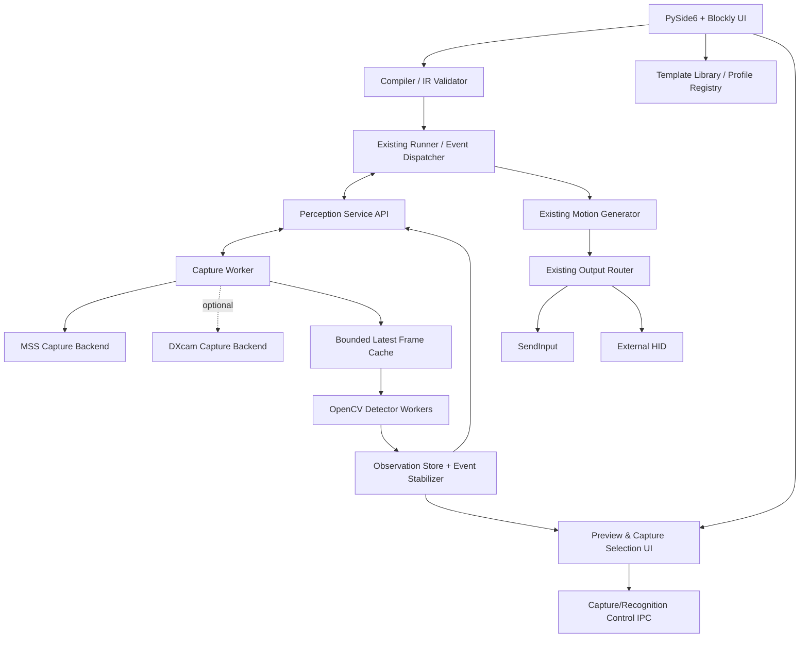

# Macro Studio v1.3 — Visual Recognition & Perception System

> **문서 유형:** Codex 구현용 규범적 확장 명세서  
> **문서 버전:** 1.3  
> **작성일:** 2026-11-17  
> **대상 플랫폼:** Windows 11 x64, Python 3.12+, PySide6 + Blockly  
> **적용 기준:** `Macro Studio v1.2` 통합 명세의 Part A/B/C 위에 적용되는 **Part D**  
> **범위:** 화면 캡처, OpenCV 인식, 시각적 조건/이벤트, 템플릿 라이브러리·인식 프로파일, 미리보기, 기존 워크플로·출력 엔진 연계  
> **최우선 원칙:** 이미지 인식은 **Perception(관찰)** 이고 키보드/마우스 송출은 **Action(실행)** 이다. 두 경로를 분리한다.

---

## D0. Codex에 대한 최상위 작업 지시

이 문서를 **기존 Macro Studio v1.2의 기능 확장 명세**로 취급한다. 최초 작업에서 저장소 구조와 기존 구현을 실제로 조사하고, v1.2를 보존한 채 최초 미완료 단계 하나만 구현한다. 명세에 없는 파일/모듈/인터페이스가 이미 존재한다고 가정하지 않는다.

**기존 유지 계약:**

1. Scratch/Entry 스타일 Blockly 편집기, 이벤트 핸들러, 자율형/반응형/혼합형 Workflow/Task 모델 유지.
2. 기존 IR 컴파일러와 검증기, 별도 Runner 프로세스, 정밀 스케줄러, Input Arbiter 유지.
3. SendInput/External HID 선택 및 Streaming/Onboard 경로 유지. 이미지 인식 때문에 출력 채널 선택을 바꾸지 않는다.
4. v1.2 `MouseMotionProfile`, `MotionGenerator`, `mouse_move_timed`, 프로파일 미리보기·상단 `마우스` 메뉴 유지.
5. 프로젝트/사용자 설정 이전 버전 파일의 로딩 및 마이그레이션 유지. 기존 프로파일 이름, 설정, 핫키, 타이밍 의미론을 무단 변경하지 않는다.
6. **기본 Dry Run**, 사용자 명시적 ARM 이전에 OS 입력 생성 금지. 화면 캡처와 미리보기 역시 사용자에 의한 명시적 시작 후에만 활성화.
7. GUI/화면 캡처/OpenCV 작업은 **고속 입력 핫패스에 진입하지 않는다**. 정밀 출력 스케줄러에서 캡처, OpenCV, PNG 인코딩, UI IPC 등을 수행하지 않는다.
8. 프로그램 실행에는 검증된 IR을 사용하고, 이미지/프로젝트 메타데이터에서 받은 문자열을 `eval()`/`exec()`하지 않는다.
9. 각 단계 결과로 코드·테스트·실행 방법·알려진 제약·문서 갱신을 제공한다. 결정 사항은 `docs/DECISIONS.md`에 기록한다.
10. 우선 `docs/VISUAL_RECOGNITION_GAP.md`를 작성해 기존 구현과 v1.3의 차이를 식별한다. 이후 **VR-0부터 첫 번째 미완료 단계 하나만** 구현하여 테스트하고 보고한다.

### 규범 우선순위

- 이미지 캡처/인식/관련 블록에 대해서는 **Part D(v1.3)** 가 우선한다.
- 공통 Task/안전/출력 채널 의미론은 v1.2의 Part A/B를 우선한다.
- 마우스 모션/프로파일/실행 정확성은 v1.2 Part C를 우선한다.
- Part D의 API·IR 필드 예시는 **논리 규약**이다. 실 저장소의 네이밍/버저닝과 충돌하면 일관된 매핑을 정의하고 명세-구현 대응표를 문서화한다. 필수 의미론 자체는 생략하지 않는다.

---

## D1. 제품 목표, 시나리오 및 범위

### D1.1 핵심 목표

Macro Studio가 화면 이미지로 현재 UI 상태를 파악하고, 그 결과를 기존 블록 워크플로의 **조건식·트리거·대기·데이터**로 사용할 수 있게 한다.

```text
[Screen / Window] → [Capture Backend] → [Frame Cache]
                         ↓
                  [OpenCV Recognition]
                         ↓
            [Recognition State / Events]
                         ↓
        [Existing Workflow / Coroutine Runtime]
                         ↓
             [Existing Mouse Motion Profile]
                         ↓
            [SendInput OR External HID]
```

### D1.2 대표 사용자 시나리오

- **자율형:** 특정 이미지를 찾을 때까지 비차단 대기 → 탐지 확인 → 클릭 → 다음 이미지 대기 → 반복.
- **반응형:** F6 → 등록한 이미지 검색 → 발견 시 중앙 좌표로 마우스 이동(`builtin.natural`) → 클릭.
- **혼합형:** 장수명 시각 감시 Task 실행 중, 사용자 핫키로 별도 탐색 Workflow를 우선 수행; Input Arbiter/Task 정책은 v1.2 재사용.
- **색상 기반:** 지정 ROI 안에 특정 HSV 범위 픽셀이 기준 면적 이상 존재할 때 Guard 통과.
- **모니터링:** 이미지가 나타나거나 사라질 때 각각 한 번 이벤트를 발생시킴. 같은 이미지가 수 프레임 동안 유지되어도 이벤트를 무한 발행하지 않음.

### D1.3 필수와 후속 범위

| 기능 | v1.3 MVP | 비고 |
|---|---|---|
| MSS 기반 화면 캡처 | **필수** | 기본 `from mss import MSS`; ROI·모니터 선택 |
| 단일 이미지 템플릿 매칭 | **필수** | OpenCV `matchTemplate`, 기본 1배 스케일 |
| HSV 범위/영역 색상 감지 | **필수** | 픽셀 존재 비율·면적 임계값 |
| 이미지 검색 결과 데이터 | **필수** | FOUND/NOT_FOUND/UNKNOWN, 좌표, 점수, 시각 |
| 이미지 출현/소멸 이벤트 | **필수** | 안정화, 히스테리시스/쿨다운 |
| 이미지 기다리기/조건/탐색 블록 | **필수** | Runtime 비차단 대기 |
| 템플릿 라이브러리·ROI 선택기 | **필수** | 화면 직접 캡처 또는 이미지 불러오기 |
| Recognition Profile 3종 + 사용자 정의 | **필수** | Strict/Balanced/Flexible, 설정 확장 가능 |
| 실시간 인식 미리보기 | **필수** | BBox·점수·FPS·지연·오류 |
| 마우스 모션 프로파일과 연계 | **필수** | 인식 중심 좌표 → v1.2 `mouse_move_timed` |
| DXcam 선택 백엔드 | **후속/선택** | 플러그형 인터페이스는 MVP에서 준비 |
| 다중 스케일 매칭 | **후속/선택** | 기본 1배 동작 보장 후 추가 |
| 단일 프레임 다중 템플릿 최적화/NMS | **후속/선택** | 필요 시 최적화 |
| ORB, OCR, 신경망 객체 탐지 | **v1.4 이후** | 별도 설계 필요 |
| 엔트리파이썬형 Python/LLM 작성 모드 | **이번 범위 밖** | 별도 v1.4 기획, v1.3 IR은 확장 가능하도록 |

**제외:** 프로세스 메모리 스캔, 게임 보안/안티치트 우회, 보호된 화면 캡처 우회, 은닉·무단 감시, 관리자 권한 우회, 임의 Python 코드 자동 실행, 스크린샷 클라우드 업로드, 원격 제어.

---

## D2. 용어 및 의미론

- **Capture Source:** 모니터/가상 데스크톱/지정 캡처 영역의 원본.
- **Frame:** 캡처에서 생성된 불변 이미지 스냅샷 + 좌표 메타데이터 + 단조 시계 타임스탬프.
- **ROI (Region of Interest):** 탐색할 사각 영역. 캡처 소스와 다른 좌표 공간일 수 있음.
- **Template:** 등록된 기준 이미지와 관련 메타데이터. ID 기반으로 참조하며 이름 변경에 영향받지 않음.
- **Detector:** `TemplateMatcher` 또는 `ColorDetector` 같은 독립 인식 모듈.
- **Recognition Profile:** 알고리즘 설정·임계값·탐색 간격·안정화 등을 재사용하는 프리셋. `MouseMotionProfile`과 다른 도메인.
- **Recognition Result:** 인식 상태, 위치, 점수, 출처 프레임·탐지 시점·오류 사유.
- **Observation:** 하나의 화면 관찰 결과. 이벤트와 실제 입력은 생성하지 않음.
- **Recognition Monitor:** 특정 Template/ROI/설정 조합을 주기적으로 평가하고 전이 이벤트를 발행하는 구독.
- **Frame Age:** 현재 단조 시각 − 프레임 캡처 완료 시각. 인식 처리 시간과 다름.
- **Found Confidence:** 매칭 메서드의 **유사도 점수**이지 정답의 확률이 아님.

### D2.1 상태는 세 가지

`FOUND`, `NOT_FOUND`, `UNKNOWN`을 반드시 구분한다.

- `FOUND`: 유효한 최신 프레임에서 기준을 만족하는 이미지/색상 영역이 확인됨.
- `NOT_FOUND`: 유효한 최신 프레임을 정상 분석했으나 기준을 만족하지 못함.
- `UNKNOWN`: 캡처 실패, 장치 분리, 지원하지 않는 소스, 프레임 만료, 인식 오류, 템플릿 무효 등으로 판단할 수 없음.

**보안 및 오동작 방지 규약:** `UNKNOWN`을 `NOT_FOUND`로 바꾸지 않으며, 기본적으로 `if image found` 조건은 `FOUND`에서만 참이다. `UNKNOWN` 상태에서 `NOT_FOUND` 전이(소멸) 이벤트를 허위 발행하지 않는다. 최신 검증 없이 과거 중심 좌표를 클릭하지 않는다.

---

## D3. 전체 시스템 아키텍처



### D3.1 프로세스 구성

- **UI 프로세스:** 메뉴, 영역 선택기, 템플릿 라이브러리, 프로파일 편집, 미리보기. 매크로의 입력 타이밍을 좌우하지 않음.
- **Runner 프로세스:** 기존 Task/IR/스케줄러/Input Arbiter, 비차단 조건·이벤트 처리. 이미지 픽셀 처리 없음.
- **Perception Worker:** 캡처, OpenCV 연산, 구독 상태, 최신 결과; GUI가 멈추거나 고속 입력 중이어도 독립 동작. 별도 프로세스를 기본 권장. 현재 저장소 제약으로 Worker 내부 별도 캡처 스레드/인식 풀을 채택한다면 고속 경로로부터의 물리적·논리적 분리를 테스트로 입증해야 함.

### D3.2 IPC 계약

- `CAPTURE_LIST_SOURCES`, `CAPTURE_START`, `CAPTURE_STOP`, `CAPTURE_SET_REGION`
- `TEMPLATE_REGISTER`, `TEMPLATE_REMOVE`, `PROFILE_RESOLVE`
- `RECOGNITION_FIND_ONCE`, `RECOGNITION_SUBSCRIBE`, `RECOGNITION_UNSUBSCRIBE`
- `RECOGNITION_RESULT`, `RECOGNITION_EVENT`, `PERCEPTION_HEALTH`, `PREVIEW_FRAME`
- 모든 요청/응답에 `request_id`, `session_id`, `schema_version` 포함. 장수명 구독에는 `subscription_id` 포함.
- `PREVIEW_FRAME`은 필요한 경우에만 전송하고, 해상도·FPS를 제한. 고속 입력 예약 큐에 이미지 페이로드를 섞지 않음.
- 캡처가 없는 Dry Run에서는 사용자 제공 정적 테스트 이미지/가짜 프레임 공급자로 동일 API를 검증 가능해야 함.
- 큐는 bounded. 최신 데이터가 중요한 미리보기/반복 관찰에서는 오래된 프레임부터 버림(`drop_oldest`); 입력 이벤트의 순서/완료 알림은 프레임 폐기 정책과 분리한다.
- IPC 역압/전송 실패 시 `UNKNOWN` 또는 명시적 오류로 알리고, 과거 관찰로 실행하지 않는다.

### D3.3 실행 독립성

30 FPS 인식은 약 33.3ms 간격의 관찰이고, 200Hz 입력 생성은 5ms 간격이다. 두 주파수는 서로 별개의 타이밍 영역이다. CV FPS가 낮아져도 기존 입력 이벤트 스케줄의 지연이 불필요하게 증가하지 않아야 한다.

---

## D4. Capture Backend

### D4.1 공통 자료형과 인터페이스

```python
@dataclass(frozen=True)
class CaptureRegion:
    left: int
    top: int
    width: int
    height: int

@dataclass(frozen=True)
class CapturedFrame:
    frame_id: int
    image_bgr: "np.ndarray"          # H x W x 3 uint8, 읽기 전용 소유권 정책
    origin_x: int                    # 가상 데스크톱 물리 픽셀 좌표
    origin_y: int
    captured_at_ns: int              # perf_counter_ns() 기반 단조 시각
    source_id: str
    width: int
    height: int

class ScreenCaptureBackend(Protocol):
    def list_sources(self) -> list["CaptureSourceInfo"]: ...
    def start(self, source_id: str, roi: CaptureRegion | None,
              target_fps: int) -> None: ...
    def read_latest(self) -> CapturedFrame | None: ...
    def stop(self) -> None: ...
    def close(self) -> None: ...
```

- `origin_x/y`는 **화면 전역 물리 픽셀 좌표계**. ROI 내부 좌표를 전역 좌표로 변환할 때 반드시 더한다.
- 다중 모니터가 왼쪽/위쪽으로 확장되어 음수 좌표가 생겨도 정상 처리한다.
- DPI 혼합 환경에서 화면 캡처·선택 오버레이·마우스 출력 간 좌표 일치를 테스트한다. 가능하면 프로세스 DPI awareness를 UI 초기화 전 명시적으로 설정하며 기존 프로젝트의 설정과 충돌하지 않게 한다.
- 이미지 버퍼는 생산자/소비자 경쟁을 방지한다. 재사용 링 버퍼를 무단 공유하지 말고 copy 또는 명확한 수명/소유권 계약을 둔다.
- `None`은 `NO_NEW_FRAME` 또는 캡처 불가 중 하나일 수 있다. 상위 계층에 명시적으로 구분된 상태/오류를 제공한다.

### D4.2 MSS 기본 구현

- 라이브러리 최신 사용법을 따라 `from mss import MSS` 사용(`mss.mss()` 이전 방식에 고정하지 않음).
- `MSS().monitors`와 모니터별 위치/크기에서 소스를 열거한다.
- ROI는 `{left, top, width, height}` 사각형으로 `grab()` 호출; 반환 BGRA 이미지 → OpenCV BGR로 변환한다.
- OpenCV에 전달할 때 `np.asarray(screenshot)`와 `cv2.COLOR_BGRA2BGR` 등을 사용한다.
- 초기 설정: 목표 캡처 30FPS, 설정 가능 5~60FPS. 60FPS는 성능 보장값이 아닌 시도 값이다.
- 시작/정지 후 자원 해제 및 프레임 버퍼 정리. 실패 반복 시 재연결 백오프·상태 표시.
- 전체 화면보다 ROI 캡처 우선. 여러 감시가 동일 소스·ROI를 공유하면 캡처 중복을 줄인다.

### D4.3 DXcam 확장 접점

- 같은 인터페이스를 만족하는 `DXcamCaptureBackend`는 선택 기능. 기본 MVP 구현을 DXcam 가용성에 의존시키지 말 것.
- `grab()`이 `None`을 반환하는 **새 프레임 없음** 상태를 적절히 처리하고 마지막 프레임을 무조건 새 프레임으로 가장하지 않는다.
- DXcam의 화면/장치 좌표계, 버퍼 재사용, `start`/`stop`/`release` 의미론을 별도로 검증한다.
- API·출력 색 공간·패키지 호환성은 실제 설치 버전으로 검증하고 고정한다.

### D4.4 캡처 오류·제약

- 모니터 재배치·해상도 변경·슬립/잠금 화면·로그오프·캡처 미지원 콘텐츠에 대비.
- 검은 화면과 실제 검은 UI를 임의 구분하지 못할 수 있음. 프레임 신선도/소스 상태는 체크하되 **완전한 검출 보장은 하지 않는다**.
- 보호된 콘텐츠/권한 제한을 우회하지 않는다. 사용자가 선택한 화면/ROI만 캡처한다.
- 기본적으로 이미지를 디스크에 자동 저장하거나 네트워크 전송하지 않는다.

---

## D5. Recognition Engine

### D5.1 Detector 인터페이스

```python
class ImageDetector(Protocol):
    def detect(self, frame: CapturedFrame,
               config: "DetectorConfig") -> "RecognitionResult": ...

class TemplateMatcher: ...   # 필수
class ColorDetector: ...     # 필수
```

인식 알고리즘은 GUI와 입력 백엔드에 의존하지 않는 순수 서비스로 작성한다. 배치/정적 이미지 테스트가 가능한 API를 필수로 둔다.

### D5.2 템플릿 매칭

- OpenCV `cv2.matchTemplate` 사용; MVP 기본 메서드는 `TM_CCOEFF_NORMED`.
- `cv2.minMaxLoc()`로 결과의 최대 위치 선택. `TM_SQDIFF*` 메서드는 최소값이 좋은 값임을 명시적으로 반영한다.
- 템플릿이 ROI보다 크거나 비어 있으면 `UNKNOWN` + `INVALID_TEMPLATE` 또는 구조화된 검증 오류.
- 변동이 거의 없는 단색 템플릿에서 정규화 상관계수가 퇴화할 수 있으므로 **분산/유효 픽셀 수 검증** 후 대체 `TM_SQDIFF_NORMED`나 색상 탐지를 사용자에게 안내한다. 비정상 `NaN`, `Inf`는 매칭 성공으로 판단 금지.
- 기본은 같은 픽셀 크기·배율. 확대/축소, 회전, 움직임 블러, 색조 변화에 대한 완전한 불변성은 보장하지 않는다.
- 알파/마스크 매칭을 후속 적용할 때 OpenCV에서 선택한 메서드의 **mask 지원 여부**를 사전 검증한다. 공식 튜토리얼 기준으로 `TM_SQDIFF`, `TM_CCORR_NORMED`의 mask 사용을 문서화한다.
- `score`는 메서드 결과를 투명하게 표시한다. 기본 `TM_CCOEFF_NORMED`에서는 [-1, 1] 범위의 값이지만 **통계적 확률은 아님**.
- 매칭 결과 좌표는 `bbox(left, top, width, height)`와 중심 `center_x/y`를 전역 **물리 픽셀**로 제공한다.
- MVP는 **가장 높은 일치값 한 곳** 반환. 복수 후보나 모든 일치 위치 나열은 후속.
- 템플릿별 최소 임계값을 프로파일 또는 블록 Override로 설정 가능.

### D5.3 HSV 색상 감지

- 캡처된 BGR 프레임을 HSV로 변환하고 ROI 픽셀에 `cv2.inRange` 적용.
- HSV 8비트 색 공간 기준 Hue는 **0~179**, Saturation/Value는 **0~255**. UI는 사용자 친화적 표시를 제공하되 내부 단위를 명시한다.
- Hue 범위가 179/0을 넘는 빨간색 등은 두 범위 OR 조합 지원.
- 작은 단일 노이즈 픽셀만으로 성공 처리하지 않도록 `min_pixel_count`, `min_fraction`(ROI 대비 면적비) 제공.
- 결과에 탐지 픽셀 수·비율·선택 ROI·계산 시각 포함. 색상 영역 중심은 검출 픽셀 무게중심으로 정의할 수 있으나 클릭 목표로 자동 사용하려면 명시적 선택 필요.

### D5.4 결과 자료형

```python
class RecognitionStatus(str, Enum):
    FOUND = "FOUND"
    NOT_FOUND = "NOT_FOUND"
    UNKNOWN = "UNKNOWN"

@dataclass(frozen=True)
class RecognitionResult:
    status: RecognitionStatus
    detector_id: str
    template_id: str | None
    frame_id: int | None
    source_id: str
    captured_at_ns: int | None
    processed_at_ns: int
    bbox: tuple[int, int, int, int] | None  # 전역 물리 px
    center_x: float | None
    center_y: float | None
    score: float | None
    error_code: str | None
    error_message: str | None
```

- `FOUND`가 아니면 기본적으로 `bbox`/중심 좌표는 `None`.
- 템플릿 `score`는 method-aware similarity. 색상 탐지 점수는 면적 비율 등 별도 명세하며 두 점수의 통계적 의미가 같다고 가정하지 않는다.
- `captured_at_ns`와 `processed_at_ns`는 같은 PC 단조 시계 도메인. 다른 프로세스에서 사용할 때도 같은 호스트 타이머 기준을 사용하며 직렬화 단위를 명시한다.
- IPC/저장에서는 단조 시간과 벽시계를 혼동하지 않는다. 디버깅용 UTC 기록 시각은 별도 필드로 둔다.
- 기본 결과 유효기간 `max_age_ms = 250`(프로젝트/블록에서 변경 가능). 지난 결과는 강제로 `UNKNOWN(STALE_RESULT)`으로 간주한다.
- 탐지 성공 직후 마우스 이동처럼 수백 ms 걸리는 동작을 수행할 때는 **정책**(`require_fresh_before_action`, `max_age_ms`)을 명시적으로 결정. 기본은 액션 예약 직전에 결과를 검증하고 필요하면 재탐지한다.

---

## D6. Recognition Monitor: 출현·소멸 의미론

### D6.1 안정화 상태 머신

이미지 출현/소멸 트리거는 매 프레임 발화가 아니라 **에지 트리거**다.

```text
UNINITIALIZED
   | valid frames
   v
NOT_PRESENT -- [N회 안정적 FOUND] --> PRESENT -- [M회 안정적 NOT_FOUND] --> NOT_PRESENT
       ^                                      |
       +--------------------------------------+
UNKNOWN은 판단을 일시 중단하며, 소멸/출현으로 오인하지 않음
```

- MVP 기본값: `appearance_frames=2`, `disappearance_frames=2`, `cooldown_ms=500`.
- 기본 매칭 임계값 예시: `enter_threshold=0.90`, `exit_threshold=0.82` (`TM_CCOEFF_NORMED`에만 적용; 경험적 초기값이며 템플릿별 튜닝 필요).
- `FOUND` 연속 프레임을 2회 확인하면 `IMAGE_APPEARED` 1회. 상태 유지 중 추가 발화 없음.
- `NOT_FOUND` 연속 프레임을 2회 확인하면 `IMAGE_DISAPPEARED` 1회. 상태 유지 중 추가 발화 없음.
- `UNKNOWN`은 연속 카운터를 리셋/보류하고 **직접 에지 이벤트를 만들지 않는다**. 재개 시 유효한 연속 프레임을 다시 확보해야 함.
- 새 구독의 초기 상태 처리: 기본은 최초 안정적 PRESENT를 **초기 상태 확립**으로만 취급하고 `IMAGE_APPEARED`를 발생시키지 않는다. `fire_on_initial_present=true` 선택 시 1회 발생.
- 동일 이미지에 대한 구독이 여럿인 경우 `(template_id, ROI, profile_id, source_id)` 키로 캡처/매칭을 캐시할 수 있지만, 각 구독의 Cooldown/진입 정책은 독립적으로 유지.
- 이벤트 페이로드에 `subscription_id`, `event_seq`, `image_id`, `result`, `occurred_at_ns` 포함. Runner는 동일 `event_seq` 중복 수신 시 재실행하지 않는다.

### D6.2 런타임 연결

- `on_image_appeared` / `on_image_disappeared`는 기존 Handler → Task 생성 규칙(우선순위, 재진입 정책, Ignore/Queue/Restart 등)을 그대로 따른다.
- `wait_for_image`는 매 프레임 polling `while True`를 강제하지 않고 Runner Task를 **WAITING**으로 전환한다. `deadline_ns` 만료 시 `TIMEOUT` 반환 또는 명시적 분기.
- `wait_for_image_disappear`는 현재 감지 상태 확인 후 소멸까지 대기. 캡처 실패는 `UNKNOWN`으로 유지하며 임의로 성공 처리하지 않음.
- 실행 중 프로젝트/프로파일·ROI·템플릿 변경 시 기존 구독은 명시적 버전 검사 후 재생성하거나 오류로 중지; **묵시적으로 바뀐 의미론으로 실행하지 않는다**.

---

## D7. 템플릿 라이브러리와 프로파일 영속성

### D7.1 템플릿 메타데이터 예시

```json
{
  "template_schema_version": 1,
  "id": "template.a1b2c3",
  "display_name": "Confirm Button",
  "image_path": "assets/templates/a1b2c3.png",
  "sha256": "<sha256-hex>",
  "width_px": 92,
  "height_px": 30,
  "source": "screen_selection",
  "created_at_utc": "2026-11-17T00:00:00Z",
  "capture_metadata": {
    "source_id": "monitor.primary",
    "dpi_scale": 1.0,
    "capture_origin": {"x": 300, "y": 200}
  },
  "recognition_profile_id": "builtin.balanced"
}
```

- 프로젝트마다 `assets/templates/` 내 이미지 파일과 별도의 메타데이터를 보유. 저장/이동/복사 시 자산이 누락되지 않아야 함.
- 외부 절대 파일 경로를 프로젝트 파일에 그대로 강제하지 않음. 앱 데이터의 사용자 공유 라이브러리를 선택 지원하더라도 프로젝트 이식성을 위한 **스냅샷/복사** 정책을 정의.
- 파일명은 이름 대신 안전한 ID 사용. `..` 경로 순회/심볼릭 링크를 통한 프로젝트 경계 탈출 방지.
- 최대 템플릿 크기, 파일 용량/개수 제한은 구현 상수로 명시(예: 최대 2048×2048, 10MB/파일). 이미지 디코딩 실패 시 UI 오류.
- 중복 파일 해시 검사 지원. 템플릿 삭제 전 참조 중인 블록·감시를 확인. 원본 참조를 묵시적으로 깨지 않음.
- 템플릿 이미지와 인식 결과 스크린샷은 민감한 화면 정보를 포함할 수 있으므로 자동 클라우드 동기화/로그 첨부 금지.

### D7.2 기본 Recognition Profile

| ID | 이름 | 기본 방향 | 설정 예시 |
|---|---|---|---|
| `builtin.strict` | Strict | 오탐 감소 우선 | enter 0.95, exit 0.88, stable 3/3 |
| `builtin.balanced` | Balanced | 일반 UI 권장 | enter 0.90, exit 0.82, stable 2/2 |
| `builtin.flexible` | Flexible | 누락 완화 우선 | enter 0.82, exit 0.75, stable 2/3 |

> 프리셋 수치는 `TM_CCOEFF_NORMED` 기반 **시험 초기값**이다. `Flexible`의 다중 스케일 지원은 후속이며 v1.3 MVP에서는 낮은 임계값/안정화 조절로만 차별화한다. UI가 다중 스케일을 지원한다고 잘못 표시하지 않는다.

```json
{
  "recognition_profile_schema_version": 1,
  "id": "user.12345678-1234-1234-1234-123456789abc",
  "name": "My UI Profile",
  "detector": "template",
  "method": "TM_CCOEFF_NORMED",
  "enter_threshold": 0.90,
  "exit_threshold": 0.82,
  "appearance_frames": 2,
  "disappearance_frames": 2,
  "cooldown_ms": 500,
  "max_age_ms": 250,
  "scan_interval_ms": 33,
  "roi": {"kind": "source", "left": 100, "top": 100, "width": 500, "height": 400}
}
```

- 내장 프리셋은 읽기 전용, `복제`를 통해 사용자 정의 프로파일 생성.
- 프로파일 ID는 변하지 않고 표시 이름은 변경 가능. 삭제 시 참조 검사.
- 사용자 정의 프로파일, 프로젝트 기본값, 템플릿별 Override, 블록별 Override 계층을 정의한다.

### D7.3 설정 적용 우선순위

```text
Application Default Recognition Profile
     ↓
Project Default Recognition Profile
     ↓
Template Recognition Profile Override (optional)
     ↓
Block / Subscription Override (optional)
```

- `MouseMotionProfile`과 `RecognitionProfile`은 별도 Registry/Schema를 사용한다.
- 사용자의 명시적 Override가 없으면 상위 프로파일을 상속한다.
- 실행 세션에서 설정 스냅샷을 고정해, 편집 화면의 일시적인 슬라이더 이동이 실행 중 모호하게 영향을 주지 않게 한다.

---

## D8. Blockly 블록 및 IR 확장

### D8.1 카테고리: `이미지 인식`

| 블록 | 종류 | 의미 |
|---|---|---|
| `이미지 [템플릿] 이 나타났을 때` | 이벤트 Hat | 안정적 미검출→검출 전이 |
| `이미지 [템플릿] 이 사라졌을 때` | 이벤트 Hat | 안정적 검출→미검출 전이 |
| `이미지 [템플릿] 이 보이는가?` | Boolean 조건 | 최신 캐시가 FOUND이면 참. UNKNOWN은 거짓 + 진단 |
| `이미지 [템플릿] 를 찾고 결과를 저장` | 비차단 탐색 명령 | 현재 또는 다음 유효 프레임에서 검색 후 결과 핸들 보관 |
| `이미지 [템플릿] 가 나타날 때까지 기다리기` | 비차단 대기 명령 | FOUND/timeout/error 명시 |
| `이미지 [템플릿] 가 사라질 때까지 기다리기` | 비차단 대기 명령 | NOT_FOUND/timeout/error 명시 |
| `인식 결과의 [X/Y/Score/Status]` | 값 블록 | 지정 결과 변수 접근 |
| `지정 영역에 [HSV 색상] 이 존재하는가?` | Boolean 조건 | 최소 면적 기준 |
| `지정 영역의 색상을 탐지하고 결과 저장` | 비차단 탐색 명령 | 픽셀 수·비율·상태 제공 |

- 템플릿 선택은 라이브러리의 `id`로 저장. 사용자에게는 표시명과 썸네일을 보여준다.
- 각 인식 블록은 ROI 및 프로파일 상속/Override를 설정할 수 있다.
- 인식 데이터는 타입 있는 `RecognitionResult`를 사용. 숫자 `0`/null로 실패를 암묵 표현하지 않는다.
- `image is visible` 조건에서 캐시가 없거나 오래되었다면 Runner를 블로킹하지 않는다. MVP의 조건은 **최신 저장 스냅샷만 검사**하고 캐시 없이는 거짓+UNKNOWN 경고를 반환; 정확한 즉시 탐색이 필요하면 `find`를 앞에 배치하게 한다. 향후 expression-level await 지원은 별도 설계.
- 모든 새 블록은 `block_id`를 IR까지 전달해 컴파일/실행 오류 위치를 매핑한다.

### D8.2 신규 IR 예시 1: 단발 인식

```json
{
  "op": "vision_find",
  "block_id": "block-find-01",
  "template_id": "template.a1b2c3",
  "result_var": "target",
  "profile_ref": "inherit",
  "roi": {"kind": "source", "left": 0, "top": 0, "width": 800, "height": 600},
  "max_age_ms": 250,
  "timeout_ms": 1000,
  "on_error": "return_unknown"
}
```

**동작:** Task를 대기 상태로 전환 → Perception Service가 유효 프레임에서 검색 → 결과를 변수 `target`에 저장 → Task 재개. 프레임이 유효하지 않으면 `UNKNOWN`; 타임아웃을 `NOT_FOUND`로 왜곡하지 않는다.

### D8.3 신규 IR 예시 2: 이미지 이벤트

```json
{
  "id": "handler.confirm.appeared",
  "event_source": {
    "type": "on_image_appeared",
    "template_id": "template.a1b2c3",
    "profile_ref": "builtin.balanced",
    "fire_on_initial_present": false
  },
  "workflow_id": "workflow.click_confirm",
  "reentrancy_policy": "ignore",
  "priority": 10,
  "enabled": true
}
```

### D8.4 신규 IR 예시 3: 비차단 대기

```json
{
  "op": "vision_wait",
  "block_id": "block-wait-01",
  "template_id": "template.a1b2c3",
  "condition": "appear",
  "timeout_ms": 5000,
  "result_var": "target",
  "profile_ref": "inherit"
}
```

- `condition: "appear" | "disappear"`.
- `vision_wait`는 사용자 정의 `timeout_ms`를 가지며 무한 대기는 명시적 선택 + STOP 응답성을 테스트.
- 지원되지 않는 이미지/프로파일/ROI/알고리즘은 런타임에서 막연히 무시하지 않고 사전 Validator 오류 처리.
- 프로젝트 스키마 및 IR 버전은 실제 구현 체계에 맞춰 증가/마이그레이션. 기존 v1.2 IR/Workspace 로드 가능.

---

## D9. 사용자 인터페이스 및 메뉴

### D9.1 상단 메뉴

`파일 | 편집 | 실행 | 마우스 | 이미지 인식 | 설정 | 도움말`

`이미지 인식` 메뉴 내용:

1. **화면에서 템플릿 캡처...** — 캡처 소스 선택 → 영역 선택 오버레이 → 결과 검토 → 이름/저장.
2. **템플릿 라이브러리...** — 목록/썸네일/연결된 블록/삭제/이름 변경/이미지 교체.
3. **인식 프로파일 관리...** — 내장 3종, 복제, 사용자 프로파일 편집/삭제, 적용 범위.
4. **실시간 인식 미리보기...** — 소스/ROI/템플릿/프로파일 선택, BBox·점수·진단 표시.
5. **캡처 엔진 설정...** — MSS/DXcam(후속), 모니터, 캡처 목표 FPS, 성능/진단.

### D9.2 템플릿 캡처 UX

- 캡처 시작 시 사용자에게 캡처 대상과 범위를 보여주고, 취소(Esc)와 저장 동작을 명확히 구분.
- 선택 오버레이가 템플릿 이미지에 찍히지 않도록 **선택 전 프레임 고정** 또는 오버레이 숨김 후 캡처.
- 드래그 영역 최소 크기/최대 크기 및 모니터 경계 검사. 다중 모니터 및 음수 좌표 지원.
- DPI 100%, 125%, 150% 등에서 선택 사각형과 저장 이미지 실제 좌표 일치.
- 템플릿 파일을 직접 가져오는 기능(형식 PNG 우선) 포함.
- 캡처 결과 썸네일/픽셀 크기/출처/잠재적 단색 템플릿 경고 표시.

### D9.3 프로파일 관리 창

- 왼쪽: 내장/사용자 프로파일 목록, 생성(복제), 이름 변경, 삭제.
- 가운데: 탐지 알고리즘, 매칭 임계값, 진입/이탈 임계값, 스캔 주기, ROI, 안정화 프레임, 결과 유효 기간.
- 오른쪽: 동일 Profile로 평가한 샘플 결과/현재 인식 미리보기.
- 변경 값이 실제 인식 결과에 미치는 영향을 즉시 표시하되 **실행 세션의 설정 스냅샷은 사용자의 재적용 전까지 불변**.
- 프로파일 저장 전 값 범위·관계 검증(`exit_threshold <= enter_threshold` 등).

### D9.4 실시간 Recognition Preview

- 왼쪽 또는 상단: 캡처 화면/ROI, 선택 템플릿 썸네일.
- 캡처 화면 위: 매칭 후보 위치 Bounding Box + 중심점 + 점수.
- 하단 진단: `FOUND/NOT_FOUND/UNKNOWN`, 캡처 FPS, 인식 FPS, 캡처 지연, 처리 지연, Frame Age, 이벤트 횟수, 마지막 오류.
- Preview가 60FPS를 보장하지 않음. 렌더링 목표 최대 15~30FPS로 제한 가능. 실제 인식 작업은 독립.
- 미리보기 표시를 위해 PNG/JPEG 인코딩이나 UI 업데이트가 고속 Runner를 블로킹하면 실패.
- 장치 선택과 미리보기 시작은 명시적 사용자 동작. 기본적으로 앱 시작 시 캡처 비활성.
- 개인정보/민감 UI 노출을 줄이기 위해 ROI 밖은 기본 미표시/마스킹을 검토.

---

## D10. 기존 Mouse Motion + 듀얼 출력 채널과의 연계

### D10.1 대표 엔드투엔드 워크플로

```text
[F6 Hotkey]
    ↓
[vision_find(template="Confirm", timeout=1000ms) → target]
    ↓
[if target.status == FOUND and target.is_fresh]
    ↓
[mouse_move_timed(target.center, profile="builtin.natural")]
    ↓
[click(left)]
    ↓
[Done]
```

- `target.center_x/y`는 **전역 물리 px**이며 기존 `MotionGenerator`의 타깃 좌표와 같은 좌표계로 변환해야 한다.
- `mouse_move_timed` 실행 직전에는 좌표 유효성, 모니터 연결, 결과 신선도, 선택 대상 창/포커스 확인.
- 이동 시간이 길어 타깃이 이동하거나 사라질 수 있으므로 `click` 전 재탐색 옵션(`revalidate_before_click`)을 제공. MVP 기본은 민감 오동작을 줄이도록 **켜짐**을 권장하되 인식 비용이 추가됨을 UI에 설명한다.
- 실행 가능한 기기 능력 검사: SendInput은 절대 좌표 처리, 외부 HID는 상대 좌표 이동만 지원할 수 있다. v1.2 Part C의 Output Capability/양자화/포인터 가속/캘리브레이션 제약을 그대로 적용한다.
- External HID 연결 여부와 무관하게 **인식 판단은 PC Perception Worker에서 수행**. Onboard MCU에서 OpenCV를 실행하지 않는다.
- SendInput/External HID 사이에 **묵시적 폴백 금지**. 선택 채널 불능이면 사용자에게 오류/일시중지/중단 정책 보고.
- 화면 인식 결과만으로 사용자가 ARM하지 않은 매크로를 활성화하지 않는다.

### D10.2 실패 처리

| 상황 | 필수 동작 |
|---|---|
| 이미지 미발견 | 정상 `NOT_FOUND`, 블록의 분기/타임아웃 정책 수행 |
| 캡처 실패 또는 오래된 결과 | `UNKNOWN`, 클릭/이동 금지(기본) |
| 템플릿 파일 없음/손상 | Validator/런타임 오류, 관련 블록 강조 |
| 화면/모니터 좌표 변경 | 기존 좌표 폐기·재탐색 필요 |
| 결과를 얻은 뒤 대상 창 포커스 소실 | v1.2 포커스 가드 실행, 합성 입력 정리 |
| 작업 STOP/긴급정지 | 대기 중 감시 구독 해제, Task 취소 및 합성 입력 해제 |
| Perception Worker 비정상 종료 | 모든 관련 결과 UNKNOWN, 의존 Task 실패/중단, 전체 출력 계속 여부 안전 정책 적용 |
| DXcam 지원되지 않는 시스템 | MSS 사용 여부를 사용자에게 명시, 묵시적 백엔드 변경 로그 남김 |

---

## D11. 비차단 동시성·성능

### D11.1 스케줄링 모델

- Capture Worker가 일정 주기로 프레임 생산. 동일 캡처 소스에 대한 복수 구독은 가능하면 프레임 공유.
- 인식 작업은 템플릿/ROI/프로파일별로 계획하고, 프레임 하나에 대해 여러 감지 수행 가능.
- Runner에서 `vision_find` 호출 시 직렬화 가능한 요청 핸들 반환 후 Task를 대기 상태로 이동.
- 인식 결과가 들어오면 Event Dispatcher가 Task를 재개하거나 핸들러 실행을 예약. 화면 인식 콜백에서 직접 `SendInput()` 호출하지 않음.
- 입력 스케줄러의 정밀 시계와 인식 감시 주기는 독립. CV의 FPS를 높인다고 OS 입력 인식률이 자동 상승하는 것은 아님.
- 창 UI가 인식 Worker 결과를 소비하는 속도보다 느리면 미리보기 프레임은 누락 가능. 결과 이벤트는 중복 방지/시퀀스 추적.

### D11.2 초기 성능 목표(측정 조건에 좌우되는 검증 목표)

| 지표 | 초기 목표/정책 | 측정 방법 |
|---|---|---|
| ROI 감시 목표 주기 | 30 FPS 기본, 5~60 설정 | 실제 capture FPS/recognition FPS 분리 |
| 단일 200×200 ROI 탐지 처리 | 10ms 이하 지향(보장 아님) | OpenCV 연산 시작/종료 타임스탬프 |
| 결과 유효 기간 | 기본 250ms | 단조 시간 기반 frame age 판정 |
| Preview 렌더 | 최대 15~30 FPS 기본 | 실제 UI FPS 측정 |
| Runner 정지 응답 | v1.2 정지 SLO 유지 | CV Worker 정지/감시 취소 포함 |
| 고속 입력 지터 영향 | 시각 감시 ON/OFF 비교·보고 | 입력 타이밍 P50/P95/P99 측정 |
| 누적 메모리 | 장시간 실행에서 무제한 증가 금지 | bounded buffer / soak test |

MSS/CPU/OpenCV 성능은 해상도·ROI 크기·템플릿 크기·동시 감시 개수·디스플레이 설정·머신에 따라 달라진다. 위 수치를 '보장'이라고 홍보하지 않는다. 프레임 재사용/드롭, 인식 처리량, CPU 사용률을 로그에 남겨 병목을 파악한다.

### D11.3 벤치마크 도구

`python -m tools.bench_vision --source synthetic --roi 400x300 --templates 1 --duration 30`와 동등한 **헤드리스 벤치마크**를 제공한다. 명령 이름이 기존 저장소와 충돌하면 통일된 CLI로 맵핑하고 문서화한다.

보고값: 실제 캡처 FPS, 인식 FPS, 이미지별 Score 분포, P50/P95/P99 캡처·매칭 지연, 결과 나이, 드롭 수, CPU/메모리, 기존 출력 스케줄러 지터 비교.

---

## D12. 저장 구조 및 모듈 경계

기존 저장소의 폴더를 우선 조사하고 유사한 이름 중복 모듈을 만들지 않는다. 권장 추가 구조:

```text
src/macrostudio/
  perception/
    models.py             # Frame, Result, Profile, Template, ROI
    capture_base.py       # ScreenCaptureBackend
    capture_mss.py        # MSS 기반 구현
    capture_dxcam.py      # 후속 옵션
    frame_store.py        # 최신 프레임 bounded cache
    template_match.py     # OpenCV TemplateMatcher
    color_detect.py       # HSV ColorDetector
    monitor.py            # stability/hysteresis/edge events
    service.py            # request/subscribe/lifecycle
    ipc_contracts.py      # versioned Perception IPC
    registry.py           # Template / RecognitionProfile registry
  ui/
    template_library.py
    template_selector.py
    recognition_profiles.py
    recognition_preview.py
    capture_region_selector.py
  runtime/
    ...                   # 기존 Task/IR/Compiler에 vision op만 확장
  motion/
    ...                   # v1.2 모션 생성기 그대로 재사용
  output/
    ...                   # 기존 SendInput/HID 그대로 재사용
assets/
  ...                     # 프로젝트별 template assets
examples/
  vision_find_and_click.*
  vision_appeared_event.*
tests/
  perception/
    fixtures/
    test_mss_adapter.py
    test_template_match.py
    test_color_detect.py
    test_monitor_events.py
    test_result_freshness.py
    test_coordinates.py
    test_ir_vision.py
    test_vision_workflow.py
```

**주의:** 저장소가 아직 v1.2 전 단계라면 인식 기능이 의존하는 최소 인터페이스를 Stub/Fake로 설계해 후행 Phase가 구현 가능하도록 하되, 기존 사용자 파일이나 이미 존재하는 코드 구조를 대규모로 변경하지 않는다.

---

## D13. 단계별 구현 계획 (한 번에 한 단계)

### VR-0 — Gap 분석/경계 계약/테스트 기반

1. 기존 앱/Runner/Blockly/IR/Motion/Output 구조 조사.
2. `docs/VISUAL_RECOGNITION_GAP.md` 작성: 구현됨/없음/변경점/우선순위/파일 단위 계획.
3. Perception 공통 모델, 오류 코드, Capture/Detector/Service API, IPC 버전 계획 확정.
4. FakeCaptureBackend와 테스트용 프레임 피처 도입. 실제 OS 캡처·입력 없이 검증.
5. 기존 v1.2 회귀 테스트 통과, 계획/결정 문서 작성.

**완료:** 기존 코드 손상 없음, 공통 데이터 계약+Fake 테스트, gap 문서 확인.

### VR-1 — MSS 캡처/좌표 및 프레임 생명주기

1. MSS 의존성 고정, 소스/ROI 열거 및 캡처 구현.
2. Frame 원점/좌표 일치, BGR 색 변환, DPI/다중 모니터 경계 검증.
3. 캡처 시작/중지, source loss/timeout, bounded latest frame buffer 구현.
4. 입력 없이 10초 캡처 통계 출력하는 진단 CLI 개발.

**완료:** 실기기 Windows에서 화면/ROI 캡처, Fake에서 음수 좌표, 프레임 누수·중지 테스트 통과.

### VR-2 — 인식 엔진 및 템플릿 영속성

1. `TemplateMatcher` + `ColorDetector` 구현.
2. 정적 이미지/합성 이미지 fixture로 정확한 bbox/score/색 검출 테스트.
3. Template Registry, 이름/ID/파일 검증·해시·이식성 구현.
4. Recognition Profile Registry(Strict/Balanced/Flexible)와 설정 검증 구현.
5. 상태 `FOUND/NOT_FOUND/UNKNOWN`, 결과 만료 테스트.

**완료:** 헤드리스 이미지 탐색 및 템플릿 저장/재로드 일치, 오탐 조건/실패 의미론 검증.

### VR-3 — 비차단 Perception Service / 이벤트 의미론

1. Perception Worker 분리 및 IPC 명세 구현.
2. `find_once`, `subscribe`, `unsubscribe`, health, bounded queue 구현.
3. 안정적 출현/소멸 전이 상태 머신, 초기 상태, 쿨다운, 오류/불명 상태 구현.
4. 기존 Runner Task 대기/재개/STOP 처리와 연결. 인식 콜백에서 직접 입력 금지.

**완료:** 가짜 프레임 시퀀스 재생으로 이미지 이벤트가 정확히 1회씩, stale/오류시 잘못된 액션 없음, STOP 즉시 작동.

### VR-4 — Blockly/IR 및 기존 Mouse Motion 연계

1. `이미지 인식` 카테고리와 필수 9종 블록 추가.
2. `vision_find`, `vision_wait`, 인식 조건/값, 이미지 출현/소멸 핸들러 IR 컴파일·검증.
3. 예제 `F6 → 이미지 찾기 → natural 프로파일로 중심 이동 → 클릭` 구현.
4. FakeOutputBackend로 채널 독립성 테스트, 실제 SendInput/HID는 ARM·capability 검증 후만 실행.
5. 기존 프로젝트 파일 로드/저장/마이그레이션 및 오류 하이라이트 테스트.

**완료:** 블록 저장/로드 및 IR 실행 성공, 인식 중심 좌표가 v1.2 Motion Generator에 정확히 전달.

### VR-5 — 상단 UI 및 실시간 미리보기

1. 상단 `이미지 인식` 메뉴, 템플릿 캡처/가져오기, 라이브러리 관리.
2. 프로파일 관리 창, 내장 프리셋/복제/사용자 편집.
3. 실시간 Recognition Preview(BBox/score/상태/FPS/latency/Frame Age).
4. 캡처 ROI 선택 도구와 프레임 오버레이 문제·DPI 검증.
5. 캡처 프라이버시·명시적 시작/정지 UX 완성.

**완료:** GUI에서 이미지 저장→설정→탐지→미리보기→블록 선택까지 사용자 주도 흐름 완성.

### VR-6 — 통합 검증/성능/문서

1. SendInput/External HID(실기기 미보유 시 Fake/Simulator) 통합 회귀.
2. 입력 스케줄러 지터 ON/OFF 비교 및 병목 기록.
3. 캡처 소스 소실, 템플릿 삭제, 프로파일 변경, Ctrl+Alt+Shift+F12 긴급 중지 테스트.
4. 사용자 가이드, API/IR 계약, Known Limitations, 샘플 프로젝트, 벤치마크 결과 작성.
5. 가능한 범위에서 Windows 실기기 수동 테스트. 다른 OS CI는 Fake만 수행.

**완료:** D15의 인수 테스트 충족 및 산출물 구비.

### 선택 확장 (MVP 완료 뒤)

- DXcam 백엔드; 다중 템플릿 검색 최적화; 여러 매칭 결과와 NMS; 다중 스케일/마스크; ROI 추적; ORB/OCR은 이후 별도 계획.
- Python DSL/LLM 코딩 모드(v1.4)는 별도 명세에서 다룬다.

---

## D14. 자동화 테스트·수동 검증 매트릭스

### D14.1 반드시 자동화할 테스트

| ID | 검증 내용 | 성공 조건 |
|---|---|---|
| VR-T01 | BGRA → BGR 변환 | 기대 픽셀 채널 순서 일치 |
| VR-T02 | ROI origin 변환 | 지역/전역 bbox, center 정확 |
| VR-T03 | 음수 좌표 모니터 | bbox/중심 음수 좌표 보존 |
| VR-T04 | 100/125/150% DPI 매핑(변환 로직) | 좌표 변환 테스트 일치 |
| VR-T05 | 단일 템플릿 정확히 삽입 | bbox 위치/크기 정확 |
| VR-T06 | 템플릿 없음 | NOT_FOUND |
| VR-T07 | 템플릿이 ROI보다 큼 | UNKNOWN + 구조화 오류 |
| VR-T08 | 단색/퇴화 템플릿 | NaN 성공 금지, 검증 오류/폴백 |
| VR-T09 | 색상 존재/없음 | 픽셀 수, 면적 비율 정확 |
| VR-T10 | HSV Hue 랩어라운드 | 두 색상 범위 OR 정상 |
| VR-T11 | 2회 FOUND 안정화 | 한 번만 APPEARED 발행 |
| VR-T12 | 2회 NOT_FOUND 안정화 | 한 번만 DISAPPEARED 발행 |
| VR-T13 | UNKNOWN 연속 입력 | 가짜 소멸/출현 없음 |
| VR-T14 | 초기 PRESENT 처리 | 기본 에지 미발행, 옵션에만 발행 |
| VR-T15 | 지터·반복 검출 | 쿨다운/히스테리시스 중복 방지 |
| VR-T16 | 만료된 cached result | UNKNOWN(STALE_RESULT), 클릭 차단 |
| VR-T17 | Worker 크래시/IPC 끊김 | 의존 Task 안전 실패/중단 |
| VR-T18 | STOP while vision_wait | 빠르게 구독 해제, Task 정리 |
| VR-T19 | `vision_find` 비차단 | 입력 Scheduler 스레드 정지 없음 |
| VR-T20 | 프로젝트 저장/재로드 | Template ID/프로파일/IR 유지 |
| VR-T21 | 템플릿 이름 변경 | ID 참조 유지 |
| VR-T22 | 참조 중인 템플릿 삭제 | 삭제 방지 또는 명시적 안전 마이그레이션 |
| VR-T23 | 잘못된 경로/손상 이미지 | 경계 밖 읽기 없음, 사용자 오류 |
| VR-T24 | FakeOutput로 찾기→이동→클릭 | 이동 좌표, 입력 순서, 프로파일 정확 |
| VR-T25 | HID 미연결 또는 지원 기능 부족 | 묵시적 SendInput 폴백 없음 |
| VR-T26 | ARM 없는 인식 이벤트 | OS 입력 0회 |
| VR-T27 | 새 프레임 없음/느린 소비자 | 오래된 프레임 폐기, 큐 bounded |
| VR-T28 | Preview 활성화 | 인식/출력 호출 스레드에서 UI 블로킹 없음 |
| VR-T29 | 기존 v1.2 샘플 프로젝트 | 정상 로드/실행/저장 |
| VR-T30 | 서로 다른 상태 코드/시각 | 정상/오류/만료 상태 혼동 없음 |

### D14.2 Windows에서 수동으로 검증할 테스트

- 다중 모니터 주/보조 좌표, 화면 배율 100/125/150%, 절전 복귀, 해상도 변경.
- 캡처 지역 선택 오버레이가 템플릿에 찍히지 않는지.
- 일반 Windows UI(메모장/테스트용 GUI)에서 이미지 탐지 → 이동 → 클릭. 실제 입력은 사용자 ARM 이후만.
- 전체 화면 또는 보호된 화면에서 캡처 실패 시 `UNKNOWN` 표기·자동 입력 중단을 확인(보안 정책 우회 금지).
- External HID 모드는 정상 연결 시 로직 재사용, 미연결 시 명확한 오류.
- 긴급정지, 포커스 소실, UI 닫힘, Perception Worker 종료 시 입출력 안전 상태 확인.

---

## D15. Definition of Done (최종 완료 조건)

아래 항목을 모두 만족해야 v1.3 완료로 표시한다.

- [ ] MSS와 ROI/모니터 선택·좌표 변환 및 오류 관리가 동작한다.
- [ ] `TemplateMatcher`와 `ColorDetector`가 정적 테스트 및 실화면에서 동작한다.
- [ ] `FOUND/NOT_FOUND/UNKNOWN` 구별과 결과 시각/신선도 검사, 만료 처리 완료.
- [ ] 출현/소멸 트리거 안정화, 이벤트 중복 방지 및 비차단 기다리기 완료.
- [ ] 상단 `이미지 인식` 메뉴와 이미지 라이브러리·영역 선택·프로파일 관리 완료.
- [ ] `Strict/Balanced/Flexible` 기본 프리셋, 사용자 복제/편집/저장/삭제 완료.
- [ ] 실시간 미리보기: BBox, 점수, 상태, FPS, 처리 시간, Frame Age 표시.
- [ ] Blockly 블록/IR/Validator/Runner를 통해 이미지 인식 동작 실행 가능.
- [ ] 기존 v1.2 `MouseMotionProfile` 및 SendInput/External HID Output Router 재사용.
- [ ] `F6 → 이미지 찾기 → Natural 모션으로 이동 → 클릭` 시나리오가 Fake에서 자동 검증되고 Windows에서 수동 검증 가능.
- [ ] Dry Run/ARM/STOP/포커스 가드와 기존 핫키 동작, 회귀 테스트 유지.
- [ ] 이미지 캡처/인식이 입력 타이밍 핫패스에 진입하지 않음이 테스트/프로파일링으로 확인됨.
- [ ] `docs/VISUAL_RECOGNITION_GAP.md`, `docs/VISUAL_RECOGNITION.md`, `docs/DECISIONS.md`, 벤치마크/테스트 결과가 갱신됨.
- [ ] 사용자 동의 없는 캡처·스크린샷 저장·네트워크 전송이 없음.

---

## D16. Codex가 보고할 형식

각 단계 종료 시 다음 순서로 짧고 구체적으로 보고한다.

```text
[Macro Studio v1.3 / VR-N]
1. 조사한 기존 구성과 변경한 파일
2. 구현한 기능과 실제로 동작하는 범위
3. 실행한 명령 및 테스트 결과(PASS/FAIL/SKIP)
4. Windows 실기기 검증 여부 / 미검증 사항
5. 안전·성능·호환성 관련 제한
6. docs/DECISIONS.md에 추가한 결정
7. 다음 첫 미완료 단계(단, 요청 없이 진행하지 않음)
```

### 첫 실행용 Codex 프롬프트

```text
Macro Studio 개발을 이어서 진행해 줘.

1. docs/SPEC.md에 있는 Macro Studio v1.3 통합 명세서를 먼저 읽어.
2. 기존 코드를 실제로 조사하고 v1.2 기능과 현재 구현 상태를 파악해.
3. Part D(v1.3 Visual Recognition)의 요구사항을 기준으로
   docs/VISUAL_RECOGNITION_GAP.md를 만들어.
4. VR-0 ~ VR-6 중 첫 번째 미완료 단계 딱 하나만 구현해.
5. 기존 코드를 삭제하거나 전체를 새로 쓰지 마.
6. 실제 입력은 사용자가 명시적으로 ARM하기 전에는 절대 생성하지 마.
7. 화면 캡처는 사용자가 켰을 때만 수행하고,
   이미지/인식 결과를 자동으로 외부 전송하지 마.
8. pytest와 기존 회귀 테스트를 실행하고 결과를 보고해.
9. 의사결정 사항은 docs/DECISIONS.md에 남겨.
10. Python/LLM 편집기 기능은 이번 v1.3 범위에서 구현하지 마.
```

---

## D17. 참고 자료 및 기술 사실 확인

아래 문서는 구현 전에 **실 설치 버전의 API와 대조**한다.

- MSS Usage (최신 API, `MSS`, monitor/ROI): https://python-mss.readthedocs.io/latest/usage.html
- MSS Documentation: https://python-mss.readthedocs.io/stable/
- OpenCV Template Matching: https://docs.opencv.org/4.x/de/da9/tutorial_template_matching.html
- DXcam (후속 선택 백엔드): https://github.com/ra1nty/DXcam

**문서 해석 주의:** 라이브러리의 이론적 FPS나 예제 수치는 Macro Studio의 실제 성능 보장이 아니다. v1.3 성능은 실기기 벤치마크로 검증한다.

---

## D18. 설계 결정 요약

1. **하나의 Blockly 프로그램**, 하나의 Task Runtime, 하나의 Output Router 구조를 유지한다.
2. 화면 인식은 **별도 Perception Service**로 분리한다.
3. 캡처는 **MSS 기본**, **DXcam 선택 확장**이다.
4. MVP 탐지는 **OpenCV 단일 템플릿 매칭 + HSV 색상 감지**다.
5. `RecognitionResult`는 `FOUND/NOT_FOUND/UNKNOWN`을 구분하며 신선도와 전역 좌표를 포함한다.
6. 감시는 에지 트리거·연속 프레임 확인·쿨다운을 사용한다.
7. 프로파일은 `RecognitionProfile`로 관리하며 `MouseMotionProfile`과 분리한다.
8. `이미지 인식` 메뉴에서 템플릿 캡처/라이브러리/프로파일/미리보기를 관리한다.
9. **Find Image → Center → v1.2 Mouse Move → Click**이 v1.3의 대표 인수 테스트다.
10. Python/LLM 작성 모드, OCR, ORB, 객체 탐지, 커널/보안 우회는 범위 밖이다.

**최종 원칙:** *Perception은 화면에서 관찰한 사실만 기록한다. Decision은 기존 Workflow Runtime에서 수행한다. Action은 기존 Output Router와 Input Arbiter를 통해서만 실행한다.*
